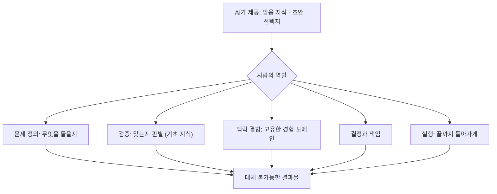

## 한 줄 요약

**지식을 "아는 것"의 값은 떨어졌고, 지식을 가지고 "판단하고 책임지고 끝까지 해내는 것"의 값이 올랐다.**

AI가 답을 싸게 만들었기 때문에, 이제 희소한 것은 답 자체가 아니라 답을 둘러싼 것들이다.

## 무엇이 싸졌고 무엇이 비싸졌나

| 싸진 것 (AI가 대체) | 비싸진 것 (여전히 사람) |
|---|---|
| 정의·문법·API 사용법 암기 | 무엇을 물어야 하는지 아는 것 (문제 정의) |
| 보일러플레이트 코드 작성 | AI 답이 틀렸을 때 알아채는 것 (검증력) |
| 일반적인 정보 검색·요약 | 내 상황에만 있는 맥락 (도메인·현장 지식) |
| 표준적인 문서·보고서 초안 | 결과에 대한 책임과 결정 |
| "평균적인" 결과물 | 끝까지 붙들고 실제로 돌아가게 만드는 실행력 |
| | 사람을 설득하고 신뢰를 얻는 것 |

## 경쟁력 있는 사람의 특징

### 1. 문제를 정의하는 사람
AI는 질문에 답하지만, **어떤 질문이 중요한지**는 정해주지 않는다. "고객이 왜 불편해하지?", "이 시스템에서 진짜 병목은 어디지?"를 찾아내는 사람이 AI를 가장 잘 쓴다. 같은 AI를 써도 질문의 질이 결과의 질을 결정한다.

### 2. 깊은 기초가 있어 검증할 수 있는 사람
역설적으로 **AI 시대에 기초 지식의 가치는 오히려 올라갔다.** 기초가 없으면 AI가 그럴듯하게 틀린 답을 줄 때 그대로 받아들인다. 기초가 있으면 "이건 트랜잭션 격리 수준 때문에 안 될 텐데?" 하고 잡아낸다. 외우는 용도가 아니라 **판별하는 용도**의 지식이다.

### 3. 남이 접근할 수 없는 맥락을 가진 사람
AI는 인터넷에 공개된 지식으로 학습했다. **현장에서 직접 겪은 것, 특정 도메인의 암묵지, 조직 내부 사정, 실제 장비·고객·데이터를 만져본 경험**은 AI가 모른다. 범용 지식 + 고유 맥락의 교집합이 가장 대체되기 어렵다.

### 4. 끝까지 해내는 사람 (실행력)
아이디어와 초안은 이제 누구나 1분 만에 만든다. 차이는 **배포까지, 운영까지, 장애 대응까지** 가져가는 데서 난다. "만들 줄 안다"와 "실제로 돌아가게 해서 책임진다"는 다르다.

### 5. 책임지고 결정하는 사람
AI는 선택지를 나열해주지만 **책임은 지지 않는다.** 불확실한 상황에서 트레이드오프를 따져 결정하고, 그 결과를 감당하는 사람은 여전히 필요하다. 조직은 결국 "이 사람에게 맡기면 된다"는 신뢰에 돈을 낸다.

### 6. 사람과 일하는 사람
설득, 협상, 요구사항 조율, 팀을 움직이는 것. 기술이 평준화될수록 **사람 사이의 일**이 차별화 요소가 된다.

### 7. 빠르게 배우고 AI를 도구로 쓰는 사람
지식 자체가 아니라 **학습 속도**가 경쟁력이다. AI를 써서 낯선 분야를 며칠 만에 실무 수준으로 따라잡는 사람, 반복 업무는 AI에 맡기고 자기 시간을 판단·설계에 쓰는 사람이 레버리지를 얻는다.

## 구조로 보면

## 개발자 관점에서 실천으로 옮기면

1. **기초를 버리지 말 것** — OS·네트워크·DB·자료구조처럼 AI 답을 검증하는 데 쓰이는 지식은 계속 쌓는다
2. **경험을 기록할 것** — 직접 겪은 장애·디버깅·설계 결정은 AI가 갖지 못한 자산이다. 글로 남기면 그 자체가 증명이 된다
3. **도메인 하나를 깊게** — "자바 잘하는 사람"보다 "네트워크 관리 시스템을 자바로 깊게 아는 사람"이 희소하다
4. **AI를 적극적으로 쓰되, 결과를 내 이름으로 책임질 수 있을 만큼만** 믿는다
5. **"왜?"를 묻는 습관** — AI가 준 답에 왜 그런지 설명할 수 없으면 아직 내 지식이 아니다

## 결론

AI 시대의 경쟁력은 **"많이 아는 사람"에서 "잘 판단하고, 고유한 맥락을 가지고, 끝까지 책임지는 사람"**으로 옮겨갔다. 지식은 보편화됐지만, 그 지식을 어디에 어떻게 쓸지 결정하는 능력과 직접 겪은 경험은 보편화되지 않는다.
