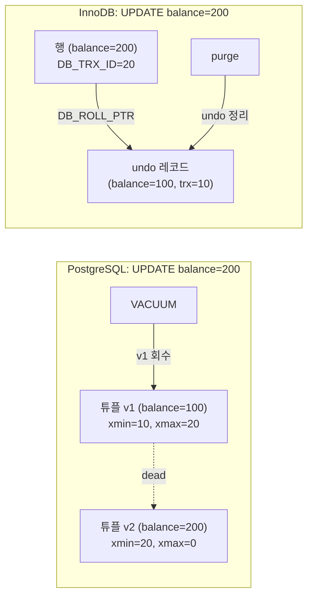
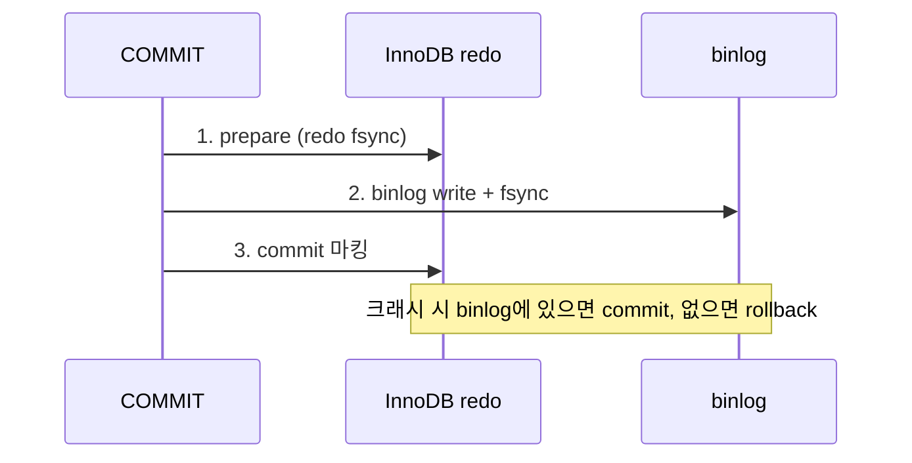

## 질문

PostgreSQL과 MySQL(MariaDB)은 서로 다른 엔진을 쓰는데, 구조적으로 비교하면 어떻게 다른가?

## 핵심: 이전 버전을 어디에 두느냐

두 DB 모두 MVCC 기반이지만, **행의 이전 버전을 어디에 저장하고 언제 치우는지**가 다르다. 이 선택이 저장 구조, 인덱스, 로그, 격리 수준 동작까지 갈라놓는다.

| | PostgreSQL | InnoDB |
|---|---|---|
| UPDATE 방식 | **새 튜플을 heap에 추가** (append) | **행을 제자리에서 갱신** (in-place) |
| 이전 버전 위치 | 같은 테이블 heap 안 (dead tuple) | **undo log** (별도 영역) |
| 버전 식별 | 튜플 헤더의 `xmin` / `xmax` (트랜잭션 ID) | 행의 숨은 컬럼 `DB_TRX_ID` + `DB_ROLL_PTR`(undo 포인터) |
| 과거 버전 읽기 | heap에서 보이는 튜플을 골라 읽음 | 최신 행에서 undo 체인을 거슬러 재구성 |
| 정리 주체 | **VACUUM** (autovacuum) | **purge 스레드** |

## 1. 저장 구조: heap vs 클러스터드 인덱스

| | PostgreSQL | InnoDB |
|---|---|---|
| 테이블 | **heap** (순서 없는 페이지 묶음, 8KB) | **클러스터드 인덱스** = PK B+Tree의 leaf가 곧 행 (16KB) |
| 보조 인덱스가 가리키는 것 | 물리 위치 `ctid` (페이지 번호, 슬롯) | **PK 값** |
| 보조 인덱스 조회 | 인덱스 → heap 1회 | 보조 인덱스 → PK 인덱스 재탐색 (2번 탐색) |
| UPDATE 시 인덱스 | 새 튜플 위치가 바뀌므로 **모든 인덱스에 새 엔트리** (HOT 예외) | 인덱스 컬럼이 바뀐 인덱스만 갱신 |

**HOT(Heap-Only Tuple)**: 인덱스 컬럼이 바뀌지 않고 같은 페이지에 빈 공간이 있으면, PostgreSQL은 인덱스를 건드리지 않고 같은 페이지 안에서 튜플 체인만 잇는다.

## 2. 로그와 크래시 복구

| | PostgreSQL | MySQL + InnoDB |
|---|---|---|
| 로그 종류 | **WAL 하나** | InnoDB **redo** + **undo** + 서버 계층 **binlog** |
| 일관성 맞추기 | WAL만 보면 됨 | redo와 binlog를 **내부 2PC**로 맞춤 |
| torn page 방지 | `full_page_writes` | **doublewrite buffer** |
| 복제 | WAL 스트리밍(물리), logical decoding(논리) | **binlog** 기반 |
| 버퍼 | `shared_buffers` + OS 페이지 캐시 | `innodb_buffer_pool` 중심, 보통 `O_DIRECT`로 OS 캐시 우회 |

MySQL은 **스토리지 엔진이 플러그인**이라 구조가 갈린다. binlog는 엔진과 무관한 서버 계층 로그이고 redo는 InnoDB 내부 로그라서, 둘을 맞추는 절차가 따로 필요하다. PostgreSQL은 엔진이 하나라 WAL 하나로 복구와 복제를 모두 처리한다.

## 3. 격리 수준과 락

| | PostgreSQL | InnoDB |
|---|---|---|
| 기본 격리 수준 | **READ COMMITTED** | **REPEATABLE READ** |
| RR의 실체 | Snapshot Isolation | 일반 SELECT는 스냅샷, **UPDATE/DELETE/`FOR UPDATE`는 최신 값(current read)** |
| RR에서 동시 UPDATE 충돌 | **에러** (`could not serialize access`) | 락 대기 후 **최신 값 기준으로 갱신** |
| Phantom 방지 | 스냅샷 | **gap lock / next-key lock** |
| SERIALIZABLE | **SSI** (의존성 추적 후 충돌 시 abort) | 락 기반 |
| 행 락 저장 위치 | 튜플 헤더(`xmax`) | 메모리의 lock system |
| DDL | **트랜잭셔널 DDL** (롤백 가능) | 암묵적 커밋 |

## 4. 연결·프로세스 모델

| | PostgreSQL | MySQL |
|---|---|---|
| 연결당 | **OS 프로세스** (fork) | **스레드** |
| 연결 비용 | 크다 | 작다 |

## 정리

- **PostgreSQL**은 새 버전을 테이블에 쌓고 나중에 치운다. **InnoDB**는 제자리에서 고치고 이전 버전을 undo에 빼둔다.
- 이 차이가 heap vs 클러스터드 인덱스, WAL 하나 vs redo+binlog 2PC, VACUUM vs purge로 이어진다.
- 같은 `REPEATABLE READ`라도 PostgreSQL은 충돌을 에러로, InnoDB는 current read와 락으로 처리한다.
