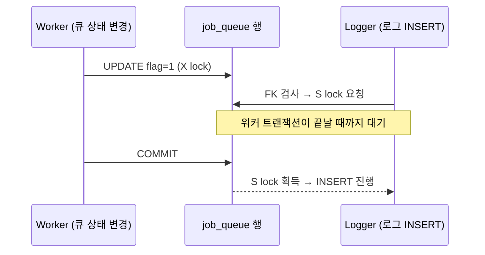

## 의문

외부에서 받은 스키마를 보다가 이상한 점을 발견했다. 감사 로그 테이블이 작업 큐 테이블의 id를 들고 있는데, FK 제약이 없다.

```sql
CREATE TABLE job_queue (
  id BIGINT AUTO_INCREMENT PRIMARY KEY,
  flag TINYINT NOT NULL DEFAULT 0,   -- 0 대기 / 1 처리중 / 2 완료 / 9 실패
  ...
  KEY idx_queue_flag (flag, id)
);

CREATE TABLE audit_log (
  id BIGINT AUTO_INCREMENT PRIMARY KEY,
  event_type VARCHAR(24) NOT NULL,
  queue_id BIGINT NULL COMMENT 'job_queue.id 상관키',
  external_user_id BIGINT NULL,     -- 외부 시스템의 사용자 식별자
  ...
  KEY idx_log_queue (queue_id)      -- 인덱스는 직접 만들어 둠
);
```

DB 전체를 덤프해도 `FOREIGN KEY` / `REFERENCES`가 단 한 줄도 없다. 실수인가, 의도인가?

## 답

대부분 **의도된 설계**로 읽힌다. 이유를 테이블 성격별로 나누면 다음과 같다.

### 1. 참조 대상이 애초에 이 DB에 없다

`external_user_id`, 메시지 id, 세션 id 같은 컬럼은 **외부 시스템의 식별자**다. FK는 같은 DB 안의 테이블만 가리킬 수 있으므로 걸 대상 자체가 없다. 실제로 FK 후보는 `audit_log.queue_id → job_queue.id` 하나뿐이다.

### 2. 감사 로그는 부모보다 오래 살아야 한다

| FK 옵션 | 큐 행을 정리(purge)할 때 일어나는 일 | 감사 로그 관점 |
|---|---|---|
| `RESTRICT` (기본) | 로그가 남아 있으면 큐 행 삭제 불가 | 큐를 못 비움 |
| `CASCADE` | 큐 행 삭제 시 로그도 같이 삭제 | **감사 기록 증발** — 최악 |
| `SET NULL` | 로그의 `queue_id`가 NULL로 바뀜 | 추적성(lifecycle 상관관계) 상실 |
| **FK 없음** | 큐만 지워지고 로그는 그대로 | append-only 원칙 유지 |

감사 로그는 "그때 무슨 일이 있었나"를 남기는 게 목적이라, 부모 행이 사라져도 **id 값은 그대로 남아야** 한다. 그래서 컬럼 주석도 "참조"가 아니라 "상관키(correlation key)"라고 적혀 있다.

또 `queue_id`가 NULL 허용인 것도 단서다. 큐와 무관한 이벤트(연결, 워밍업 등)도 같은 로그에 쌓는다.

### 3. 큐 테이블은 쓰기 핫스팟이다

InnoDB에서 FK가 있으면 자식 INSERT/UPDATE마다 **부모 행을 조회하고 공유 잠금(S lock)** 을 건다.



큐는 `flag`가 0→1→2/9로 계속 바뀌는 테이블이고, 로그는 바로 그 상태 전이마다 쌓인다. FK를 걸면 **로그 쓰기가 큐 워커와 잠금 경쟁**을 하게 되고, 트랜잭션 순서가 엇갈리면 데드락까지 생긴다. 로그 쓰기 때문에 본 작업이 느려지는 건 본말전도다.

### 4. 롤백된 작업도 로그는 남겨야 한다

큐 INSERT가 실패·롤백된 경우에도 "실패했다"는 로그는 별도 트랜잭션으로 남기고 싶다. FK가 있으면 존재하지 않는 부모 id를 가진 로그는 INSERT 자체가 거부된다.

### 5. 운영 관행

DB 전체에 FK가 하나도 없다는 건 테이블 단위 판단이라기보다 **팀 컨벤션**일 가능성이 크다. FK 없이 운영하는 팀이 흔히 드는 근거:

- 무결성은 애플리케이션(서비스 레이어)에서 보장
- 대량 데이터 정리·마이그레이션·파티셔닝 시 FK가 걸림돌
- 덤프/복원 순서 의존성 제거
- 샤딩·DB 분리 시 어차피 FK는 못 씀

FK가 자동으로 만들어 주던 인덱스(`idx_log_queue`)는 **직접 만들어 둔 것**을 보면, "조인/조회 성능은 챙기되 제약은 빼겠다"는 의도가 드러난다.

## 그럼 FK는 언제 거는가

| 상황 | FK 권장 여부 |
|---|---|
| 주문 ↔ 주문상품처럼 부모 없는 자식이 **논리적으로 불가능** | ✅ 건다 |
| 마스터/코드 테이블 참조, 쓰기 빈도 낮음 | ✅ 건다 |
| 감사 로그·이벤트 로그 (부모보다 오래 살아야 함) | ❌ 상관키로만 |
| 고빈도 상태 변경 큐·잡 테이블 | ❌ 잠금 경쟁 |
| 외부 시스템 식별자 | ❌ 걸 대상 없음 |
| 샤딩·서비스별 DB 분리 | ❌ 물리적으로 불가 |

## 정리

- FK가 없는 건 실수라기보다 **"참조는 하되 생명주기는 묶지 않는다"** 는 선택이다.
- 감사 로그의 핵심은 불변성·보존성이고, FK의 `RESTRICT/CASCADE/SET NULL` 어느 것도 이와 맞지 않는다.
- 대신 무결성 책임은 애플리케이션으로 넘어간다. 고아 id가 생길 수 있다는 걸 전제로 조회 시 `LEFT JOIN`을 쓰는 등 방어적으로 다뤄야 한다.
