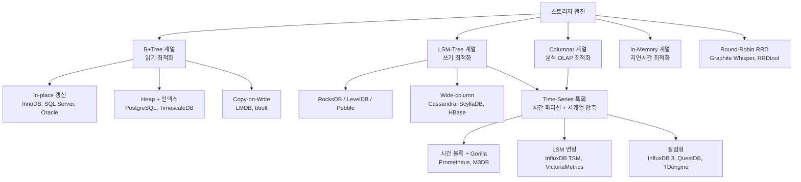
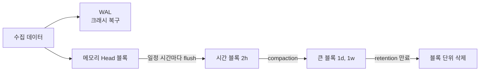

## 질문

1. 최신 DBMS에 쓰이는 DB 엔진(스토리지 엔진) 종류와, 각 엔진을 사용하는 DB 목록은?
2. 시계열 DB(Time Series DB)는 어떤 엔진을 사용하는가?

## 1. 먼저 분류 기준

"엔진"은 보통 **데이터를 디스크/메모리에 어떤 자료구조로 저장하는가**(스토리지 엔진)를 말한다. 기본 축은 4가지이고, 시계열 DB는 이 중 **LSM·Columnar 위에 시간 축 최적화를 얹은 특화 계열**이다.

| 계열 | 핵심 자료구조 | 강점 | 약점 | 주 용도 |
|---|---|---|---|---|
| B+Tree | 정렬된 페이지 트리, 제자리 갱신 | 점 조회·범위 조회 빠름, 예측 가능한 읽기 | 랜덤 쓰기 비용, 페이지 분할 | OLTP 범용 |
| LSM-Tree | MemTable → SSTable 순차 flush + compaction | 쓰기 처리량 매우 높음, 압축률 좋음 | 읽기 증폭, compaction 부하 | 대량 쓰기, 로그, 분산 KV |
| Columnar | 컬럼 단위 저장 + 압축 + 벡터화 실행 | 집계·스캔 압도적, 고압축 | 단건 갱신·삭제 약함 | OLAP, DW, 로그 분석 |
| In-Memory | 해시/스킵리스트/트리를 RAM에 | 마이크로초 지연 | 용량=RAM, 영속성은 별도(AOF/스냅샷) | 캐시, 세션, 실시간 |
| **Time-Series 특화** | LSM 또는 Columnar + 시간 파티션 + delta/XOR 압축 | append 쓰기·구간 집계 최적, 파티션 단위 retention | 임의 갱신·조인 약함, 고카디널리티 태그에 취약 | 메트릭, IoT, 금융 틱 |
| Round-Robin (RRD) | 고정 크기 순환 파일 | 디스크 사용량 고정 | 해상도 손실, 확장성 낮음 | 레거시 네트워크 모니터링 |

## 2. B+Tree 계열

| 엔진 | 사용하는 DB | 비고 |
|---|---|---|
| **InnoDB** | MySQL, MariaDB, Percona Server | 클러스터드 인덱스(PK 순 저장), Undo Log 기반 MVCC |
| **PostgreSQL Heap + B-Tree** | PostgreSQL, 그리고 파생 DB 다수 (Aurora PostgreSQL, AlloyDB, Neon, Supabase, Greenplum 등) | 테이블은 힙(순서 없음), 인덱스만 B-Tree. 갱신 시 새 튜플 생성 → VACUUM 필요 |
| PostgreSQL Heap + hypertable | **TimescaleDB** (시계열) | 시간 청크로 자동 분할, 오래된 청크는 컬럼 압축(Hypercore)으로 변환하는 하이브리드 |
| **WiredTiger** | MongoDB (3.2+ 기본) | B-Tree 기본(LSM 모드도 있음), 문서 단위 MVCC, 압축. 5.0+ Time Series Collection도 이 위에서 동작 |
| SQL Server 엔진 | Microsoft SQL Server, Azure SQL | 클러스터드 인덱스, 별도로 Columnstore·In-Memory OLTP(Hekaton) 탑재 |
| Oracle 엔진 | Oracle Database | Heap 테이블 + B-Tree 인덱스, Undo 세그먼트 기반 MVCC |
| SQLite B-Tree | SQLite, libSQL/Turso | 단일 파일 임베디드 |
| Redwood (B+Tree) | FoundationDB | 기존 SQLite 기반 엔진을 대체 |
| **Copy-on-Write B+Tree** | LMDB, bbolt (etcd), CouchDB | 쓰기 시 경로 복사 → 락 없는 읽기, 크래시 안전 |

## 3. LSM-Tree 계열

| 엔진 | 사용하는 DB | 비고 |
|---|---|---|
| **RocksDB** | MyRocks(MySQL/MariaDB 엔진), TiKV(TiDB 저장층), YugabyteDB(DocDB, RocksDB 포크), Kafka Streams 상태 저장소, Flink 상태 백엔드 | Meta가 LevelDB 기반으로 개발. 사실상 LSM 표준 |
| **LevelDB** | 구형 Chrome IndexedDB, 일부 블록체인 노드 | Google, RocksDB의 원조 |
| **Pebble** | CockroachDB (20.2+ 기본) | Go로 작성된 RocksDB 호환 엔진 |
| **Badger** | Dgraph | Go, 키/값 분리(WiscKey 방식) |
| 자체 LSM | Apache Cassandra, ScyllaDB, HBase, Google Bigtable | Wide-column 모델 |
| **TSM / TSI** (LSM 변형) | **InfluxDB 1.x~2.x** (시계열) | 시계열 전용 LSM. 3.x는 컬럼형으로 전환 |
| 자체 엔진 (MergeTree 영감) | **VictoriaMetrics** (시계열) | LSM + 컬럼 저장, 높은 압축률·메모리 효율 |
| HBase / Cassandra 위 구현 | **OpenTSDB**, **KairosDB** (시계열) | 1세대 분산 TSDB, 범용 LSM DB를 저장층으로 사용 |

## 4. Columnar(컬럼형) 계열

| 엔진 | 사용하는 DB | 비고 |
|---|---|---|
| **MergeTree** | ClickHouse | LSM과 유사한 파트 병합 + 컬럼 저장. 시계열·로그 저장소로도 많이 씀 |
| DuckDB 엔진 | DuckDB, MotherDuck | 임베디드 OLAP ("분석용 SQLite") |
| 자체 컬럼 엔진 | Snowflake, Google BigQuery(Capacitor), Amazon Redshift, Vertica | 클라우드 DW |
| 자체 컬럼 엔진 | Apache Doris, StarRocks, Apache Druid, Apache Pinot | 실시간 OLAP |
| ColumnStore | MariaDB ColumnStore, SQL Server Columnstore Index | 행 저장 DB에 붙는 컬럼 엔진 |
| Arrow + Parquet + DataFusion | **InfluxDB 3.x** (시계열) | 오브젝트 스토리지 기반 컬럼형 |
| 자체 컬럼 + 시간 파티션 + mmap | **QuestDB** (시계열) | 컬럼형 append-only, 초고속 수집(ingest), SQL 지원 |
| 자체 엔진 / TsFile / Mito | **TDengine**, **Apache IoTDB**, **GreptimeDB** (시계열) | 컬럼형 + LSM. IoT·메트릭·로그 특화 |
| 인메모리 + 컬럼형 | **kdb+** (시계열) | 금융 틱 데이터 |
| 파일 포맷 | Parquet, ORC (+ 테이블 포맷 Iceberg, Delta Lake, Hudi) | Spark·Trino 같은 엔진이 읽는 레이크하우스 저장 형식 |

## 5. In-Memory 계열

| 엔진/DB | 비고 |
|---|---|
| Redis, Valkey, Dragonfly, KeyDB | KV 캐시. 영속성은 RDB 스냅샷·AOF |
| Memcached | 순수 캐시, 영속성 없음 |
| SAP HANA | 인메모리 컬럼형 RDBMS |
| SQL Server In-Memory OLTP (Hekaton) | 락프리 인메모리 테이블 |
| Tarantool (memtx), VoltDB | 인메모리 OLTP |
| MySQL MEMORY 엔진 | 임시 테이블용 |
| Amazon Timestream (시계열) | 최근 데이터는 Memory store, 과거 데이터는 Magnetic store(컬럼형)로 2계층 |

## 6. Time-Series 특화 계열

### 6-1. 왜 B+Tree가 아닌가

시계열 DB는 B+Tree를 거의 쓰지 않는다. 대부분 **LSM 변형**이나 **컬럼형 엔진**을 쓰고, 그 위에 **시간 기준 파티셔닝**과 **시계열 전용 압축**을 얹는다.

| 시계열 데이터의 특성 | 엔진에 주는 의미 |
|---|---|
| 쓰기가 압도적으로 많고, 거의 항상 시간순으로 추가(append)됨 | 순차 쓰기에 강한 LSM·append-only 구조가 유리함 |
| 과거 데이터는 거의 수정되지 않음 | 제자리 갱신(B+Tree의 강점)이 필요 없음 |
| 조회는 "구간 + 집계(avg, max, rate)" 위주 | 컬럼 단위 스캔이 유리함 |
| 인접한 값이 비슷함(타임스탬프 간격 일정, 값이 서서히 변함) | delta·XOR 압축으로 10배 이상 줄일 수 있음 |
| 오래된 데이터는 일괄 삭제(retention) | 시간 파티션 단위로 통째로 지우면 됨 (행 단위 DELETE 불필요) |

### 6-2. 시간 블록 구조 (Prometheus 계열)

### 6-3. TSDB별 엔진 전체 목록

| DB | 엔진 | 계열 | 특징 |
|---|---|---|---|
| **Prometheus** | 자체 TSDB (Head 블록 + WAL + 2시간 단위 블록) | LSM 유사 + 시간 블록 | Gorilla 압축(타임스탬프는 delta-of-delta, 값은 XOR)으로 샘플당 약 1.3바이트 |
| Thanos / Cortex / Mimir | Prometheus TSDB 블록을 오브젝트 스토리지에 저장 | 위와 같음 | Prometheus의 장기 보관·수평 확장용 |
| **VictoriaMetrics** | 자체 엔진 (ClickHouse MergeTree에서 영감) | LSM + 컬럼형 | 압축률·메모리 효율이 높음 |
| **InfluxDB 1.x/2.x** | TSM (Time-Structured Merge tree) + TSI 인덱스 | LSM 변형 | 시계열 전용으로 만든 LSM |
| **InfluxDB 3.x** | Apache Arrow + Parquet + DataFusion | 컬럼형 (오브젝트 스토리지) | TSM을 버리고 컬럼형으로 전환 |
| **TimescaleDB** | PostgreSQL heap + hypertable(시간 청크) + 컬럼 압축(Hypercore) | B-Tree 행 저장 → 오래된 청크는 컬럼형으로 변환 | 최근 데이터는 행, 과거 데이터는 컬럼으로 저장하는 하이브리드. SQL을 그대로 씀 |
| **QuestDB** | 자체 컬럼 저장, 시간 파티션, mmap 파일 | 컬럼형 append-only | 초고속 수집(ingest), SQL 지원 |
| **ClickHouse** | MergeTree | 컬럼형 + LSM 유사 | 범용 OLAP이지만 시계열·로그 저장소로 많이 씀 |
| **TDengine** | 자체 엔진 (장비당 테이블 1개, super table) | 컬럼형 + LSM | IoT 특화 |
| **Apache IoTDB** | TsFile | 컬럼형 + LSM | IoT·산업 장비용 |
| **GreptimeDB** | Mito 엔진 (LSM + Parquet) | LSM + 컬럼형 | 메트릭·로그·트레이스 통합 |
| **M3DB** (Uber) | 자체 엔진 + Gorilla 압축 | 시간 블록 | 대규모 메트릭용 |
| **OpenTSDB** | HBase 위에 구현 | LSM (wide-column) | 1세대 분산 TSDB |
| **KairosDB** | Cassandra 위에 구현 | LSM (wide-column) | 위와 같음 |
| **Graphite** | Whisper (고정 크기 라운드로빈 파일) | RRD 계열 | 파일 크기가 고정되고, 오래된 값은 덮어씀 |
| **RRDtool** | Round Robin Database | RRD 계열 | 고전적인 네트워크 모니터링(MRTG, Cacti) |
| **kdb+** | 인메모리 + 컬럼형 | 컬럼형 | 금융 틱 데이터 |
| Amazon Timestream | Memory store + Magnetic store | 메모리(최근) / 컬럼형(과거) 2계층 | 매니지드 서비스 |

### 6-4. TSDB 계열별 정리

| 계열 | 대표 DB | 한 줄 설명 |
|---|---|---|
| 시간 블록 + Gorilla 압축 | Prometheus, Thanos, Mimir, M3DB | 메트릭 모니터링의 사실상 표준 |
| LSM 변형 | InfluxDB 1/2 (TSM), VictoriaMetrics | 쓰기 처리량이 핵심 |
| 컬럼형 | InfluxDB 3, QuestDB, ClickHouse, TDengine, IoTDB, GreptimeDB | 최근 트렌드. Parquet·오브젝트 스토리지와 결합 |
| RDBMS 확장 | TimescaleDB | PostgreSQL 생태계와 SQL을 그대로 활용 |
| 범용 LSM DB 위에 구현 | OpenTSDB (HBase), KairosDB (Cassandra) | 1세대 방식, 지금은 사용이 줄어드는 추세 |
| 라운드로빈(RRD) | Graphite Whisper, RRDtool | 고정 용량, 레거시 |

### 6-5. 공통 기법

- **시간 파티셔닝**: 청크·블록·파티션을 시간 단위로 나눠서 쿼리할 때 해당 구간만 읽고(pruning), retention은 파티션째 삭제함
- **시계열 압축**: delta-of-delta(타임스탬프), XOR(실수 값), RLE·dictionary(태그)
- **다운샘플링**: 오래된 원본 데이터를 1분·1시간 단위 집계로 줄여서 보관
- **역색인**: 라벨·태그(`host=a, region=b`)로 시리즈를 찾는 인덱스. Prometheus의 postings, InfluxDB의 TSI가 여기에 해당

## 7. "엔진을 갈아끼울 수 있는" DB

일부 DB는 스토리지 엔진이 **플러그인 구조**라 테이블별로 엔진을 고를 수 있다.

| DB | 선택 가능한 엔진 |
|---|---|
| MySQL | **InnoDB(기본)**, MyISAM(구형, 트랜잭션 X), MEMORY, CSV, ARCHIVE, MyRocks(Percona/MariaDB) |
| MariaDB | InnoDB(기본), Aria(MyISAM 후계), MyRocks, ColumnStore, Spider(샤딩), S3 |
| PostgreSQL | Table Access Method(12+) → heap(기본), OrioleDB(undo 기반, 개발 중), Citus/Hydra columnar. 확장(extension)으로 TimescaleDB 시계열 엔진 추가 |
| MongoDB | WiredTiger(기본), In-Memory(엔터프라이즈) — 과거 MMAPv1은 제거됨 |

반대로 Oracle, SQL Server, CockroachDB, ClickHouse, 그리고 대부분의 전용 TSDB(Prometheus, InfluxDB, QuestDB 등)는 엔진이 DB와 일체형이다.

## 8. 분산 DB의 "SQL 층 + KV 엔진" 구조

최근 분산 SQL(NewSQL)은 SQL 처리층과 KV 저장 엔진을 분리하는 패턴이 일반적이다.

| 분산 DB | SQL 층 | 저장 엔진 |
|---|---|---|
| TiDB | TiDB 서버 (MySQL 호환) | TiKV → RocksDB (분석용 TiFlash는 컬럼형) |
| CockroachDB | 자체 (PostgreSQL 호환) | Pebble |
| YugabyteDB | PostgreSQL 포크 | DocDB (RocksDB 포크) |
| Google Spanner | 자체 | Colossus 위의 자체 엔진 |
| Amazon Aurora | MySQL/PostgreSQL 엔진 그대로 | 공유 분산 스토리지 (redo log만 전송) |

시계열 쪽도 비슷하게 **쿼리층과 저장층을 분리**하는 흐름이 있다. Thanos·Mimir는 Prometheus 블록을, InfluxDB 3·GreptimeDB는 Parquet 파일을 오브젝트 스토리지에 두고 쿼리 노드만 수평 확장한다.

## 9. 한 줄 요약

- **범용 OLTP** → B+Tree (InnoDB, PostgreSQL, Oracle, SQL Server)
- **쓰기 폭주·분산 KV** → LSM (RocksDB 계열, Cassandra)
- **분석·집계** → Columnar (ClickHouse, DuckDB, Snowflake)
- **초저지연 캐시** → In-Memory (Redis 계열)
- **메트릭·IoT 시계열** → LSM 변형 또는 Columnar + 시간 파티션 + Gorilla류 압축 (Prometheus, InfluxDB, VictoriaMetrics, TimescaleDB, QuestDB)
- 최근 트렌드는 **HTAP**: 한 DB 안에 행 엔진 + 컬럼 엔진을 같이 두는 방식 (TiDB+TiFlash, SQL Server Columnstore, SingleStore, AlloyDB 컬럼 엔진)
- 시계열도 **Arrow/Parquet 기반 컬럼형 + 오브젝트 스토리지** 조합으로 수렴하는 중 (InfluxDB 3, GreptimeDB)
