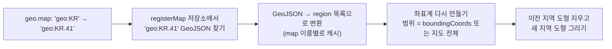

**Q**: ECharts에서 `geo: { map: mapName }`의 이름이 바뀌면 어떤 일이 벌어지나? 그리고 map의 id와 name은 뭐가 다른가?

**A**:

## 1. `geo.map` 이름이 바뀌면 일어나는 일

`option` computed가 다시 계산되면 vue-echarts가 `setOption`을 부르고, ECharts 안에서는 이런 순서로 처리돼요.

1. **등록된 지도 찾기**: `registerMap`으로 넣어 둔 저장소에서 새 이름을 찾아요. 등록 안 된 이름이면 지도가 안 그려지고 콘솔에 경고가 나와요. 그래서 지도를 바꾸는 함수에서 `registerMap`을 먼저 하고 지금 지역 값을 나중에 바꿔요.
2. **region으로 변환**: GeoJSON의 feature 하나하나를 ECharts의 region으로 바꿔요. 이 결과는 map 이름별로 캐시돼서, 같은 지도로 다시 돌아오면 다시 변환하지 않아요.
3. **좌표계 다시 계산**: 화면에 보일 범위를 정해요. `boundingCoords`가 있으면 그 범위를, 없으면 새 지도 전체를 화면에 맞춰요.
4. **다시 그리기**: 이전 지도의 지역 도형을 지우고 새로 그려요. 두 지도 사이에 모양이 바뀌는 애니메이션은 없고, 바로 바뀌어요.

**바뀌지 않고 남는 것**
- **`zoom`과 `center`**: 확대하거나 끌면 ECharts가 이 값을 geo option 안에 저장해 두고, 지도가 바뀌어도 그대로 둬요. 경상도에서 확대한 채로 서울을 눌렀을 때 화면 밖에 그려졌던 게 이것 때문이었고, 그래서 지도를 바꿀 때 `zoom: 1, center: null`로 되돌리는 처리를 같이 불러요.
- **`regions` 스타일**: 이름으로 지역을 찾아 적용해요. 새 지도에 없는 이름은 그냥 무시돼요.

## 2. id와 name의 차이

ECharts에는 이름이 비슷한 게 세 가지 있어서 헷갈리기 쉬워요.

| 무엇 | 어디서 정하나 | 무엇을 가리키나 | 예 |
|---|---|---|---|
| **map 이름** | `registerMap(name, geoJson)` | 등록된 **지도 데이터 하나** | `'geo:KR.41'` |
| **geo 컴포넌트 `id`** | `geo: { id: 'main' }` | geo 컴포넌트 **자체** (`geoIndex`와 같은 역할) | 안 씀 |
| **region 이름** | `nameProperty`로 고른 feature 속성 | 지도 안의 **지역 하나** | `'KR.41.830'` (idPath — 조각 `segmentId`는 부모 코드를 뗀 나머지, 전체 코드 `41830`은 `code`. idPath는 파일에 없고 받을 때 경로 + 조각으로 채운다) |

- **지도 데이터에는 이름만 있고 id가 따로 없어요.** `registerMap`의 첫 번째 인자인 문자열이 곧 식별자예요. `geo.map`에는 이 문자열을 넣어요.
- **geo `id`는 지도 데이터와 관계없어요.** option 안에 geo 컴포넌트가 여러 개 있을 때 어느 컴포넌트인지 구분하는 값이에요. 예를 들어 `setOption`으로 특정 geo만 고칠 때 써요. geo가 하나뿐이라 지금은 안 써요.
- **region 이름**은 ECharts가 지역을 구분하는 키예요. 클릭 이벤트의 `args.name`, `regions[].name`, label `formatter`의 `p.name`이 모두 이 값이에요. 기본값은 feature의 `properties.name`인데, `nameProperty: 'idPath'`로 바꿔 두어서 지금은 idPath가 들어가요.
- GeoJSON 표준의 `feature.id` 필드는 ECharts가 읽지 않아요. 지역을 구분할 값은 `properties` 안에 넣고 `nameProperty`로 지정해야 해요.

정리하면 `geo.map`을 바꾸는 건 **보여 줄 지도 데이터를 바꾸는 것**이고, 그 지도 안의 지역들은 **region 이름(idPath)**으로 구분돼요.
