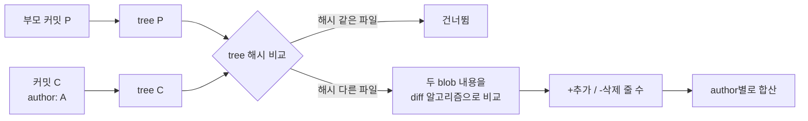

**Q**: Git은 파일 단위로 snapshot을 찍는다고 했는데, contributors 화면에 각자 몇 줄을 기여했는지는 어떻게 계산하는가?

**A**: **저장하지 않고, 볼 때마다 계산한다.** Git은 snapshot만 저장하지만 "커밋 = 부모 snapshot과 비교한 차이"로 언제든 다시 만들어낼 수 있다. 줄 수 통계는 이 계산 결과를 author별로 합친 값이다.

## 계산 과정



1. 커밋마다 **부모 커밋의 tree**와 **자기 tree**를 비교한다.
2. 해시가 같은 디렉터리·파일은 내용이 같다는 뜻이라 바로 건너뛴다 → 바뀐 파일만 빠르게 골라낼 수 있다.
3. 바뀐 파일은 두 blob(이전 내용 / 새 내용)을 diff 알고리즘(기본 Myers)으로 비교해 **추가 줄 / 삭제 줄**을 센다.
4. 이 숫자를 커밋의 author 기준으로 전부 더한다.

즉 snapshot 방식이라서 불가능한 게 아니라, **"이전 snapshot vs 지금 snapshot"을 비교하면 diff가 나오므로** 통계는 그냥 파생값이다. (이전 글의 `git diff`가 2줄만 보여주는 원리와 같다.)

## 직접 계산해보기

```bash
# 특정 author의 추가/삭제 줄 합계
git log --author="이름" --no-merges --numstat --pretty=tformat: \
  | awk '{add+=$1; del+=$2} END {print "+"add, "-"del}'

# 커밋 수 기준 순위
git shortlog -sn --no-merges

# 커밋 하나의 파일별 +/- (C의 부모와 비교)
git show --numstat <commit>
```

## GitHub Contributors 그래프의 규칙

| 항목 | 동작 |
|---|---|
| 대상 브랜치 | default 브랜치(main 등)만 |
| merge 커밋 | **제외** — 부모가 2개라 누구 기준 diff인지 모호하고, 이중 집계됨 |
| 사람 식별 | 커밋의 author 이메일 → GitHub 계정에 연결된 이메일만 집계 |
| 계산 시점 | 미리 저장된 값이 아니라 백그라운드에서 계산 후 캐시 (그래서 처음엔 "계산 중"이 뜸) |
| 대형 저장소 | 커밋이 매우 많으면 통계가 표시되지 않거나 일부만 나옴 |

## 주의: "수정"이라는 개념은 없다

diff는 **줄 단위**라서 한 줄을 고치면 `-1 +1`로 센다. 그래서:

- 들여쓰기·포매터 한 번 돌리면 수천 줄 "기여"가 생긴다
- 파일 이동/리네임, lock 파일, 생성 코드가 숫자를 크게 부풀린다
- 같은 줄을 여러 번 고치면 매번 다시 카운트된다

## 두 가지 "기여 줄 수"

| 지표 | 명령 | 의미 |
|---|---|---|
| **변경량 (churn)** | `git log --numstat` | 지금까지 추가·삭제한 줄의 **누적 합**. GitHub Contributors가 이것 |
| **현재 생존 줄 수** | `git blame` | 지금 코드에서 **각 줄을 마지막으로 바꾼 사람**. 지워진 코드는 안 셈 |

```bash
# 현재 코드 기준 author별 줄 수 (blame)
git ls-files | xargs -n1 git blame --line-porcelain 2>/dev/null \
  | grep '^author ' | sort | uniq -c | sort -rn
```

`git blame`도 저장된 값이 아니라, 커밋 이력을 거꾸로 따라가며 "이 줄이 처음 지금 모양이 된 커밋"을 diff로 찾아내는 계산이다.

## 정리

- Git 저장소에는 **줄 수 통계가 어디에도 저장돼 있지 않다**
- 커밋마다 부모 snapshot과 diff → author별 합산 = contributors 숫자
- merge 커밋 제외, default 브랜치 기준, 줄 단위라 "수정"은 삭제+추가로 집계
- "누가 많이 바꿨나"(churn)와 "누구 코드가 지금 남아있나"(blame)는 다른 지표
