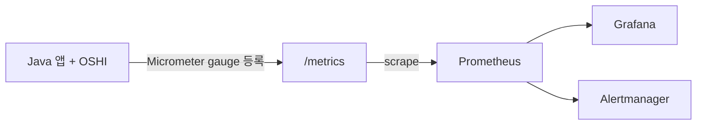

OSHI와 Prometheus는 서로 대체하는 관계가 아닙니다. 하는 일의 층위가 다릅니다.

- **OSHI**: Java 라이브러리입니다. JVM 프로세스 안에서 OS와 하드웨어 정보(CPU, 메모리, 디스크, NIC, 센서 등)를 조회하는 API만 제공합니다.
- **Prometheus**: 모니터링 시스템입니다. 데이터를 직접 가져오고(pull), 시계열 DB에 저장하고, PromQL로 조회하며, 알림까지 보냅니다.

## 비교

| 항목 | OSHI | Prometheus |
|---|---|---|
| 정체 | Java 라이브러리 (JNA 기반) | 독립 실행 서버 (Go) |
| 역할 | 현재 상태 조회 (snapshot) | 수집, 저장, 조회, 알림 |
| 데이터 저장 | 없음. 호출한 시점의 값만 반환 | 내장 TSDB에 이력 보관 |
| 수집 대상 | 자기 자신이 실행 중인 호스트만 | exporter가 있는 모든 대상 (여러 호스트, 네트워크 장비, 앱) |
| 수집 방식 | 코드에서 직접 호출 (`SystemInfo().getHardware()...`) | HTTP `/metrics`를 주기적으로 scrape |
| 조회 | Java 코드로 직접 처리 | PromQL (rate, sum by 등) |
| 알림 | 없음 | Alertmanager 연동 |
| 시각화 | 없음 | Grafana 연동 |
| 언어 종속 | Java/JVM 전용 | 상관없음 |

## 같은 층위끼리 묶으면

| 층위 | Java 생태계 | Prometheus 생태계 | Zabbix |
|---|---|---|---|
| 호스트 정보를 수집하는 쪽 | **OSHI** | **node_exporter** | zabbix-agent |
| 수집 결과를 노출하는 쪽 | Micrometer, Prometheus Java client | `/metrics` endpoint | agent 프로토콜 |
| 저장, 조회, 알림을 맡는 쪽 | — | **Prometheus** | zabbix-server |

정확히 대응하는 짝은 **OSHI ↔ node_exporter**이고, **Prometheus ↔ Zabbix**입니다.

## 함께 쓰는 방식

## 언제 무엇을 쓰나

- **OSHI가 맞는 경우**: 직접 만드는 Java 에이전트나 앱 화면에 호스트 상태를 바로 띄워야 할 때. 예를 들어 Spring 백엔드가 자기 서버의 CPU와 디스크를 API로 내려줘야 할 때입니다.
- **Prometheus가 맞는 경우**: 여러 호스트나 장비의 이력을 쌓고, 추세를 보고, 알림을 걸어야 할 때.
- **NMS 구성에서는**: 호스트 지표는 node_exporter가 OSHI보다 수집 항목이 넓고 이미 검증된 도구입니다. 그래서 자체 Java 에이전트를 만들 계획이 없다면 OSHI는 필요하지 않습니다.
