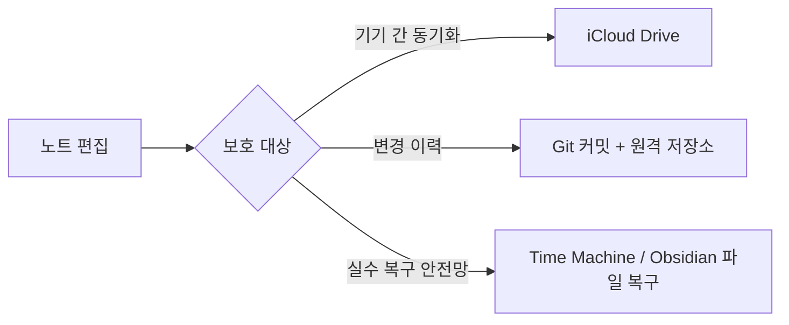

## iCloud Drive에는 버전 관리 기능이 없나?

**결론: iCloud Drive 자체에는 Dropbox·Google Drive 같은 "파일별 버전 기록" 기능이 없다.** 대신 아래처럼 부분적으로 대체할 수 있는 수단이 몇 가지 있다.

| 수단 | 무엇을 복구하나 | 한계 |
|---|---|---|
| **iCloud.com → 데이터 복구 / 최근 삭제됨** | **삭제된** 파일 (30일 이내) | 내용 변경 이전 버전은 복구 불가 |
| **macOS Versions** (파일 → 복귀 → 모든 버전 탐색) | 앱이 자동 저장한 이전 버전 | Pages·TextEdit·미리보기 등 이를 지원하는 앱으로 연 파일만. Obsidian·VS Code로 편집한 `.md`는 해당 없음 |
| **Time Machine** | 로컬 디스크의 시간별 스냅샷 | 파일이 Mac에 실제로 내려받아져 있어야 백업됨 ("Mac 저장 공간 최적화"로 클라우드에만 있는 파일은 빠짐) |
| **Obsidian 파일 복구 코어 플러그인** | 노트별 스냅샷 (기본 5분 간격, 7일 보관) | 로컬 보관, 기기 간 공유 안 됨 |
| **Obsidian Sync** (유료) | 노트별 버전 기록 | 유료, iCloud 대신 쓰는 동기화 |
| **Git** | 커밋 단위의 전체 이력 | 직접 커밋해야 함 |

### 마크다운 노트·블로그 저장소라면

- **Git이 가장 확실한 버전 관리**다. iCloud는 "동기화", Git은 "이력"으로 역할을 나누는 게 낫다.
- 단, **`.git` 폴더를 iCloud Drive 안에 두는 것은 피하는 게 좋다.** iCloud가 `.git` 내부의 작은 파일들을 개별 동기화하면서 충돌 사본(`index 2` 같은 파일)이 생기거나 오브젝트가 손상되는 사례가 흔하다.
- 일반적인 구성: 작업 폴더는 iCloud 밖에 두고 Git + 원격 저장소(GitHub 등)로 이력·백업을 맡기거나, iCloud에 꼭 둬야 하면 Time Machine을 같이 켜 둔다.

