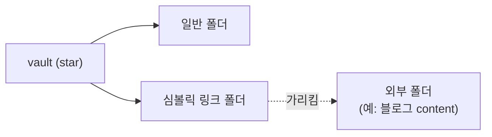

**결론**: VS Code의 multi-root workspace 같은 기능은 **없다**. Obsidian은 창 하나에 vault(폴더) 하나만 연다. 여러 폴더를 함께 보려면 아래 우회 방법 중 하나를 쓴다.

| 방법 | 어떻게 | 장점 | 단점 |
|---|---|---|---|
| 창 여러 개 | vault 전환기에서 다른 vault를 새 창으로 연다 | 설정·플러그인이 vault별로 분리, 안전 | vault끼리 링크·검색·백링크가 안 이어짐 (`obsidian://` URI로만 연결) |
| 심볼릭 링크 | 다른 폴더를 vault 안에 심볼릭 링크로 넣는다 (`ln -s 원본 vault/폴더명`) | 한 창에서 검색·링크·그래프가 다 됨 | 공식 "지원"이 아니라 "동작은 함" 수준. 다른 vault 안을 가리키거나, 링크가 돌고 돌거나, 같은 파일이 두 경로로 보이면 문제. iCloud·Git 동기화 시 링크가 실제 파일처럼 다뤄지기도 함 |
| 상위 폴더를 vault로 | 두 폴더를 모두 담는 부모 폴더를 vault로 연다 | 설정 하나로 다 보임 | 관련 없는 파일까지 색인. 안쪽 폴더가 이미 vault면 `.obsidian` 설정이 겹쳐 혼란 (vault 안의 vault는 비추천) |
| 플러그인 | 외부 폴더를 붙여 주는 커뮤니티 플러그인 | 설정 UI로 관리 | 내부적으로 위와 같은 방식이거나 기능이 제한적, 유지보수 여부 확인 필요 |

## 심볼릭 링크 쓸 때 주의

- 링크 폴더 안 파일을 Obsidian에서 고치면 **원본이 바로 바뀐다**(사본이 아님).
- 링크 형식이 서로 다르면 양쪽에서 다 맞게 보이지 않는다. 예: 블로그(Quartz)가 `[[cs/network/...]]` 같은 사이트 기준 경로를 쓰면, Obsidian에서는 vault 기준 경로가 달라 해석이 어긋날 수 있다.
- 파일 이름 규칙이 다르면(예: Quartz는 폴더 대표 문서가 `index.md`) 한쪽 규칙에 맞춰야 한다.
- 외부 폴더 안에 `.obsidian`이 있으면 안 된다(vault 안의 vault).

## vault 두 개를 이어서 쓰려면

창 여러 개 방식에서 다른 vault의 노트로 가는 링크는 `obsidian://open?vault=이름&file=경로` URI로 걸 수 있다. 다만 백링크·그래프에는 잡히지 않는다.
