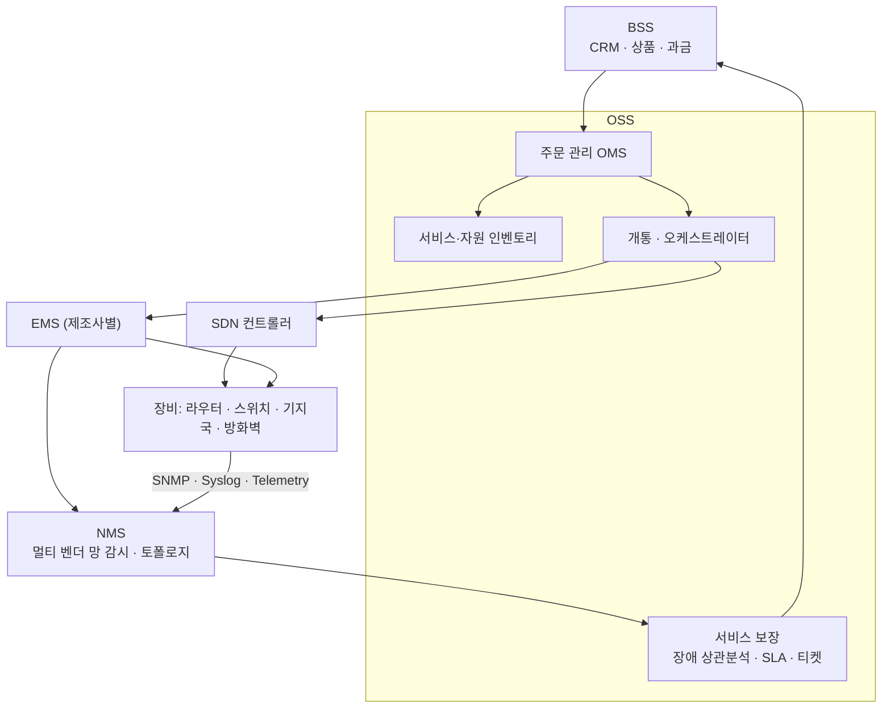
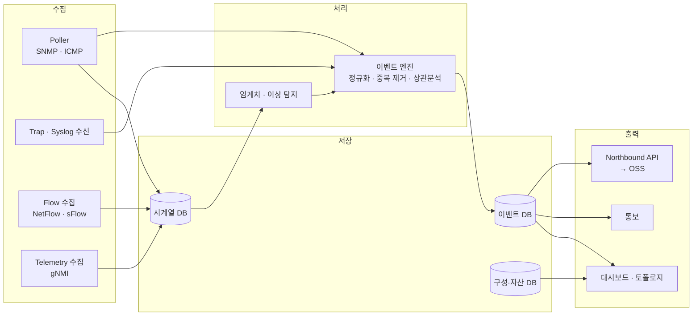
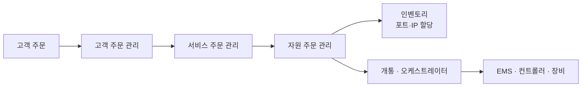
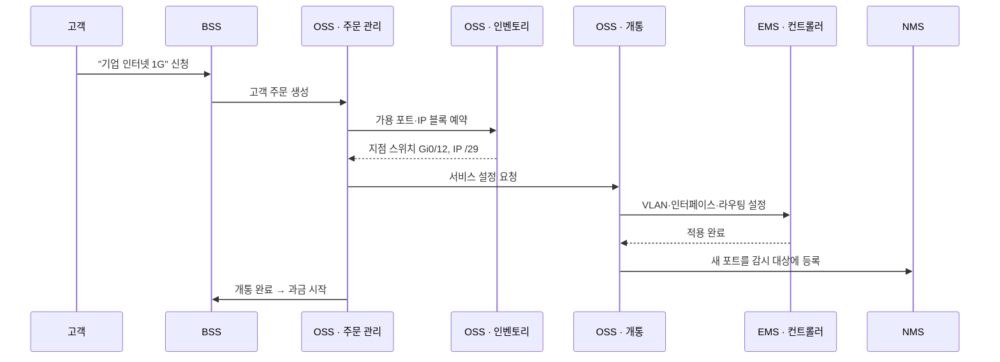
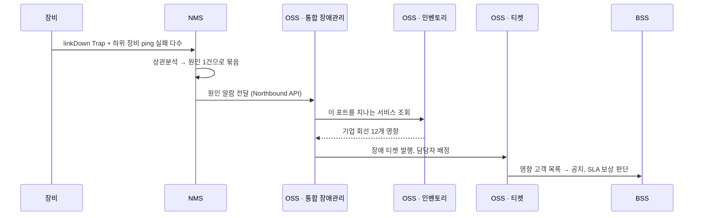

## 질문

망 관리 쪽에서는 NMS, OSS가 함께 나온다. 둘 다 "망을 관리한다"는데 무엇이 다르고, 서로 어떻게 연결되는가?

## 답: 보는 대상이 다르다

- **NMS**는 **장비와 망**을 본다. "어느 장비·어느 포트가 문제인가"
- **OSS**는 **고객에게 파는 서비스**를 본다. "어느 고객·어느 서비스가 영향을 받고, 어떻게 개통·복구하나"

NMS가 망 상태를 요약해 OSS에 올리고, OSS는 그 정보를 서비스·고객 단위로 해석해 BSS(과금·고객 관리)로 넘긴다. 반대 방향으로는 OSS가 개통·변경 명령을 NMS·EMS로 내려보낸다.

## 전체 계층

| 계층 | 관리 대상 | 시스템 | 예시 기능 |
| --- | --- | --- | --- |
| 사업 | 고객·상품·매출 | **BSS** | CRM, 상품 카탈로그, 요금 청구 |
| 서비스 | 고객에게 파는 서비스 | **OSS** | 주문 관리, 서비스 개통, SLA, 장애 티켓 |
| 망 | 여러 제조사가 섞인 망 전체 | **NMS** | 토폴로지, 종단 간 장애·성능 감시 |
| 장비군 | 한 제조사 장비 묶음 | **EMS** | 장비 설정, 알람 수집, 펌웨어 |
| 장비 | 개별 장비 | 장비 관리 에이전트 | 포트·카드 상태, 알람 생성 |

> 이 계층 구분은 ITU-T의 통신망 관리 모델(TMN)에서 왔다. 프로토콜은 사라졌지만 계층 이름은 업계 공통 언어로 남았다.

## NMS 내부 구조

| 구성 요소 | 하는 일 | 예시 |
| --- | --- | --- |
| Poller | 장비에 주기적으로 값을 물어봄 | 5분마다 포트 `ifInOctets`를 조회해 사용률 계산 |
| Trap·Syslog 수신 | 장비가 먼저 보내는 이벤트 수신 | `linkDown` Trap, `%LINK-3-UPDOWN` 로그 |
| 이벤트 엔진 | 알람을 정리하고 원인을 좁힘 | 코어 스위치 장애로 하위 장비 알람 50건 → "원인 1건 + 영향 50건" |
| 구성·자산 DB | 장비 목록, 설정 백업, 연결 관계 | 모델·펌웨어·위치, 매일 밤 설정 백업 |
| Northbound API | 상위 OSS에 데이터 전달 | 알람 발생 시 OSS 티켓 자동 생성 |

NMS 기능은 보통 **FCAPS**로 분류한다: 장애(Fault), 구성(Configuration), 사용량(Accounting), 성능(Performance), 보안(Security).

## OSS 내부 구조

OSS는 **개통(Fulfillment)** 과 **보장(Assurance)** 두 흐름으로 나뉜다.

| 흐름 | 구성 요소 | 하는 일 |
| --- | --- | --- |
| 개통 | 주문 관리 (OMS) | 고객 주문을 서비스 주문·자원 주문으로 쪼개고 진행 추적 |
| 개통 | 서비스 카탈로그 | 상품을 기술 구성으로 정의 ("기업 인터넷 1G" = 회선 + 라우터 포트 + IP 블록) |
| 개통 | 인벤토리 | 포트·IP·회선·VLAN 할당 관리 |
| 개통 | 프로비저닝 / 오케스트레이터 | EMS·컨트롤러에 실제 설정 지시 |
| 보장 | 통합 장애관리 | 여러 NMS·EMS 알람을 모아 상관분석 |
| 보장 | 성능·SLA 관리 | 고객별 서비스 품질, SLA 위반 판정 |
| 보장 | 티켓·작업 관리 | 장애 티켓 발행, 현장 기사 배정 |

## 예시 1: 기업 인터넷 회선 개통

## 예시 2: 코어 장비 장애

같은 장애라도 NMS는 **"어느 포트"** 까지, OSS는 **"어느 고객"** 까지 본다.

## NMS와 OSS는 무엇으로 연결되나: Northbound Interface

NMS·EMS가 상위 OSS와 주고받는 연결 지점을 **Northbound Interface(NBI)** 라고 한다. 장비 쪽 연결은 Southbound라고 부른다.

| 세대 | 방식 | 대표 표준 |
| --- | --- | --- |
| 1990년대 | CMIP / Q3 | ITU-T TMN |
| 2000년대 | CORBA, XML/SOAP | 3GPP Itf-N, TM Forum MTNM·MTOSI |
| 현재 | REST/JSON, YANG, 이벤트 스트림 | TM Forum Open API, 3GPP SA5 MnS, ETSI NFV SOL005, MEF LSO, NETCONF/RESTCONF |

현재 가장 범용적인 것은 **TM Forum Open API** 다.

| API | 용도 | NMS–OSS 예시 |
| --- | --- | --- |
| TMF642 Alarm Management | 알람 전달·해제 | NMS 원인 알람 → OSS 장애관리 |
| TMF628 Performance Management | 성능 데이터 | 포트 사용률, 지연 |
| TMF639 Resource Inventory | 자원 인벤토리 | NMS가 발견한 장비·포트를 OSS와 동기화 |
| TMF652 Resource Order / TMF640 Service Activation | 자원 주문·설정 | OSS → "이 포트에 VLAN 설정" |
| TMF621 Trouble Ticket | 장애 티켓 | 알람으로 티켓 자동 생성 |

표준 API가 있어도 현장에서는 단순한 방식이 여전히 많다.

| 방식 | 설명 |
| --- | --- |
| SNMP Trap 전달 | NMS가 정리한 알람을 Trap으로 상위에 다시 보냄. 가장 흔함 |
| 파일 전송 | 성능 데이터를 CSV·XML로 SFTP 업로드 |
| 메시지 큐 | Kafka 토픽으로 알람·지표 발행, OSS가 구독 |
| 제품 전용 REST API | NMS 제품 API에 맞춘 어댑터 개발 |

업무 절차 쪽 표준도 있다. 통신사는 TM Forum **eTOM**(프로세스)과 **SID**(데이터 모델)를, 일반 기업은 **ITIL**(인시던트·변경 관리)을 따른다.

## 조직 규모별 실제 구성

| 조직 | 갖추는 계층 | 비고 |
| --- | --- | --- |
| 대형 통신사 | EMS + NMS + 통합 장애관리 + OSS + 오케스트레이터 + BSS | 전 계층. ONAP 같은 자동화 플랫폼을 OSS에 얹기도 함 |
| 대기업·공공기관 | 제조사 관리 도구 + 통합 NMS + ITSM | OSS·BSS 대신 ITSM(서비스데스크)이 그 자리를 채움 |
| 중소 조직 | 오픈소스 NMS 하나 (Zabbix, LibreNMS 등) | EMS·NMS 구분 없이 한 도구 |

## 정리

| 시스템 | 한 줄 | 핵심 질문 |
| --- | --- | --- |
| EMS | 한 제조사 장비 관리 | 이 장비가 정상인가 |
| NMS | 여러 제조사가 섞인 망 전체 관리 | 어디가 고장났나 |
| OSS | 망 위의 서비스 관리 (개통 + 보장) | 누가 영향을 받나, 어떻게 개통·복구하나 |
| BSS | 고객·상품·과금 | 얼마를 청구하나 |

NMS와 OSS는 Northbound Interface로 연결된다. 위로는 알람·성능·인벤토리가 올라가고, 아래로는 개통·설정 명령이 내려온다.
