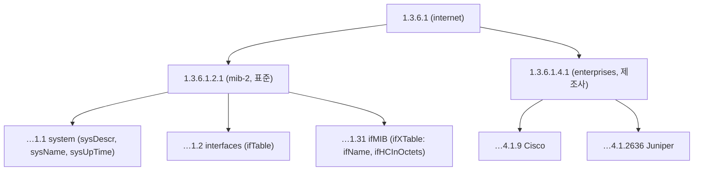
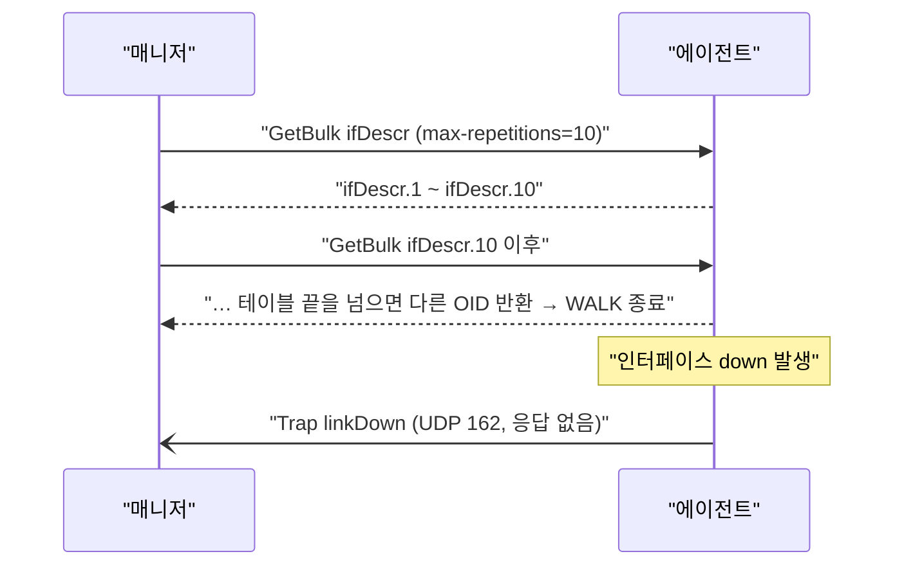

## 한 줄 정의

**SNMP(Simple Network Management Protocol)** 는 네트워크 장비·서버의 상태를 **묻고(GET), 바꾸고(SET), 알림을 받는(TRAP)** 표준 관리 프로토콜이다. UDP 위에서 돌고, 1988년(v1)부터 쓰여 거의 모든 스위치·라우터·방화벽·UPS·프린터에 기본 내장돼 있다.

## 구성 요소

| 요소 | 역할 | 예 |
|---|---|---|
| **매니저(Manager)** | 물어보고 알림을 받는 쪽 | NMS, Zabbix 서버, `snmpwalk` |
| **에이전트(Agent)** | 장비 안에서 질문에 답하는 프로세스 | 스위치 펌웨어 내장, Linux `snmpd` |
| **MIB** | "무엇을 물을 수 있나"를 정의한 스키마(사전) | IF-MIB, SNMPv2-MIB, ENTITY-MIB |
| **OID** | OID 트리에서 항목 하나를 가리키는 경로 | `1.3.6.1.2.1.1.5.0` = sysName |


> 장비 쪽을 "에이전트"라 부르지만 따로 설치하는 프로그램이 아니라 펌웨어에 들어 있는 기능이다. 그래서 SNMP 수집을 보통 **agentless**로 분류한다.

## OID와 MIB

OID는 전 세계가 함께 쓰는 숫자 트리(OID 트리)에서 노드 하나를 가리키는 **경로**다. 루트부터 각 단계의 번호(arc)를 점으로 이어 쓴다(`1.3.6.1` = iso.org.dod.internet). 트리 자체는 SNMP 전용이 아니라 ITU-T X.660 · ISO/IEC 9834가 정한 등록 트리라서 X.509 인증서·LDAP도 같은 트리를 쓴다. 표준 관리 정보는 대부분 `1.3.6.1.2.1` (mib-2) 아래, 제조사 전용은 `1.3.6.1.4.1.{기업번호}` (enterprises) 아래에 있다.



| 자주 쓰는 MIB | 가져오는 것 |
|---|---|
| SNMPv2-MIB (system) | 장비 설명, 이름, 가동 시간, 위치 |
| IF-MIB | 인터페이스 목록·상태(up/down)·트래픽 카운터·오류 |
| ENTITY-MIB | 섀시·모듈·포트·전원 등 물리 구성품, 시리얼 |
| IP-MIB | IP 주소, ARP(ipNetToPhysicalTable) |
| BRIDGE-MIB / Q-BRIDGE-MIB | MAC 주소 테이블, VLAN |
| LLDP-MIB | 이웃 장비·포트 (토폴로지 링크 근거) |
| HOST-RESOURCES-MIB | 서버 CPU·메모리·디스크·프로세스 |

### 스칼라 vs 테이블

- **스칼라**: 값이 하나. OID 끝에 `.0` → `sysName.0`
- **테이블**: 행이 여러 개. 끝이 인덱스 → `ifDescr.3` = 인덱스 3번 인터페이스 이름
- 테이블 전체는 **WALK**(GETNEXT/GETBULK 반복)로 읽는다

## 오퍼레이션(PDU)

| PDU | 방향 | 용도 | 버전 |
|---|---|---|---|
| GetRequest | 매니저 → 에이전트 | OID 값 하나(여러 개) 읽기 | v1+ |
| GetNextRequest | 매니저 → 에이전트 | 다음 OID 읽기 → WALK의 기반 | v1+ |
| GetBulkRequest | 매니저 → 에이전트 | 다음 N개를 한 번에 (테이블 읽기 효율) | v2c+ |
| SetRequest | 매니저 → 에이전트 | 값 쓰기 (포트 shutdown 등) | v1+ |
| Response | 에이전트 → 매니저 | 위 요청에 대한 응답 | v1+ |
| Trap | 에이전트 → 매니저 | 이벤트 알림, **응답 없음**(유실 가능) | v1+ |
| InformRequest | 에이전트 → 매니저 | 확인 응답을 받는 알림(재전송) | v2c+ |



## 버전 비교

| 버전 | 인증 | 암호화 | 특징 | 현실 |
|---|---|---|---|---|
| **v1** | community 문자열(평문) | 없음 | 32비트 카운터만 | 레거시 |
| **v2c** | community 문자열(평문) | 없음 | GetBulk, Inform, **64비트 카운터** | 가장 많이 씀. 내부망 한정 |
| **v3** | USM: 사용자 + 인증(MD5/SHA) | 선택(DES/AES) | 보안 레벨 3단계 | 보안 요구 환경 표준 |

v3 보안 레벨:

| 레벨 | 인증 | 암호화 |
|---|---|---|
| noAuthNoPriv | X | X |
| authNoPriv | O | X |
| authPriv | O | O ← 권장 |

> community 문자열은 사실상 비밀번호인데 평문으로 날아간다. 기본값 `public`/`private`를 그대로 두는 장비가 많아 보안 점검 단골 항목이다. v2c를 쓴다면 읽기 전용(RO) + ACL로 매니저 IP만 허용하는 게 기본.

## 카운터와 트래픽 계산

인터페이스 트래픽은 SNMP가 "현재 bps"를 주는 게 아니라 **누적 바이트 카운터**를 준다. 매니저가 두 번 읽어서 차이로 계산한다.

```
bps = (ifHCInOctets(t2) - ifHCInOctets(t1)) × 8 / (t2 - t1)
```

| 주의점 | 설명 |
|---|---|
| 32비트 랩(wrap) | `ifInOctets`(32bit)는 1Gbps에서 약 34초 만에 한 바퀴 → 고속 링크는 **`ifHCInOctets`(64bit, v2c+)** 필수 |
| 카운터 리셋 | 장비 재부팅 시 0으로 → `sysUpTime` 감소로 감지하고 그 구간 버린다 |
| 폴링 주기 | 보통 1~5분. 짧은 버스트는 평균에 묻힌다 |

## 포트

| 포트 | 용도 |
|---|---|
| UDP 161 | 에이전트가 요청 수신 (GET/SET) |
| UDP 162 | 매니저가 Trap/Inform 수신 |
| (TLS/DTLS 10161/10162) | SNMP over TLS, 드물게 사용 |

## 장점과 한계

| 장점 | 한계 |
|---|---|
| 거의 모든 장비가 지원, 설치 불필요 | 폴링 주기 한계 → 초 단위 감시 어려움 |
| 표준 MIB로 제조사 무관하게 기본 정보 수집 | 대형 테이블 WALK 시 장비 CPU 부담·타임아웃 |
| 라이브러리·도구 풍부 (net-snmp, pysnmp, SNMP4J) | UDP라 trap 유실 가능 |
| pull 방식이라 응답 없음 = 장애 즉시 판단 | 제조사 MIB 해석 필요, MIB 품질 편차 |
| | SET은 보안·안정성 문제로 실무에서 잘 안 씀 (설정은 NETCONF/CLI) |

## 대안·보완 기술과의 관계

| 기술 | 방향 | SNMP 대비 |
|---|---|---|
| SNMP Trap | push | 같은 SNMP 안의 이벤트 알림 |
| syslog | push | 텍스트 로그, 구조화 안 됨 |
| NETCONF/RESTCONF + YANG | pull | 설정 관리까지 표준화, 최신 장비 |
| gNMI 스트리밍 텔레메트리 | push | 초 단위, 대규모 데이터센터 |
| NetFlow/IPFIX/sFlow | push | "누가 누구와 얼마나" 흐름 정보 (SNMP는 총량만) |

정리하면 SNMP는 **"가장 낡았지만 가장 보편적인"** 수집 수단이다. 신규 NMS도 기본 인벤토리·인터페이스·LLDP 토폴로지는 SNMP 폴링으로, 즉시 알림은 trap/syslog로, 고해상도가 필요한 곳만 텔레메트리로 보완하는 구성이 일반적이다.

## 직접 해보기 (net-snmp)

```bash
# 장비 이름
snmpget -v2c -c public 10.0.0.1 SNMPv2-MIB::sysName.0
# 인터페이스 이름 전체
snmpwalk -v2c -c public 10.0.0.1 IF-MIB::ifName
# 64비트 수신 바이트
snmpbulkwalk -v2c -c public 10.0.0.1 IF-MIB::ifHCInOctets
# LLDP 이웃
snmpwalk -v2c -c public 10.0.0.1 LLDP-MIB::lldpRemSysName
# v3 authPriv
snmpget -v3 -l authPriv -u monuser -a SHA -A 'authpass' -x AES -X 'privpass' 10.0.0.1 sysUpTime.0
```
