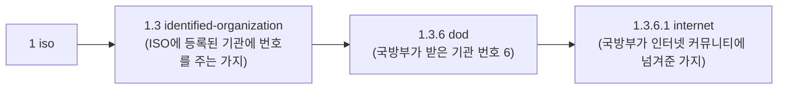

인터넷이 원래 미 국방부(DoD)의 프로젝트였고, OID를 정하던 1988년 무렵에도 공식적으로는 국방부 관할 망이었기 때문입니다.

**경위**

| 시기 | 일 |
|---|---|
| 1969 | 국방부 산하 연구기관 ARPA(지금의 DARPA)가 지원한 **ARPANET** 시작. 인터넷의 전신 |
| 1983 | ARPANET이 TCP/IP로 전환. TCP/IP는 국방부 표준(MIL-STD-1777/1778)이기도 했다 |
| 1988 | SNMP를 만들면서 MIB 항목에 붙일 OID 가지가 필요해졌다(RFC 1065, 이후 RFC 1155) |
| 지금 | `1.3.6.1` 아래는 IANA가 관리한다. 제조사 번호(`1.3.6.1.4.1.{번호}`)도 IANA가 준다 |

**왜 dod 밑에 internet을 두었나**



- OID 가지는 아무나 만들 수 없고, 이미 번호를 받은 기관이 자기 아래 가지를 나눠 주는 방식입니다.
- 당시 인터넷 커뮤니티는 ISO에 직접 등록된 기관이 아니었습니다. 반면 국방부는 이미 `1.3` 아래에 6번을 받아 두었습니다.
- 그래서 가장 빠른 방법은 국방부가 자기 가지 `1.3.6` 밑의 1번을 인터넷 커뮤니티에 넘겨주는 것이었습니다. RFC 1155에도 국방부가 노드 하나를 인터넷 커뮤니티에 할당하고, 그 관리를 IAB(Internet Activities Board)가 맡는다고 적혀 있습니다.

```
internet OBJECT IDENTIFIER ::= { iso org(3) dod(6) 1 }
```

지금 국방부가 SNMP나 OID를 관리하지는 않습니다. `dod`는 처음 가지를 받아 온 경로가 이름에 남은 것입니다. 인터넷 주소가 `.mil`이 아니라 `.com`이어도 IP의 뿌리가 ARPANET인 것과 비슷한 흔적입니다.
