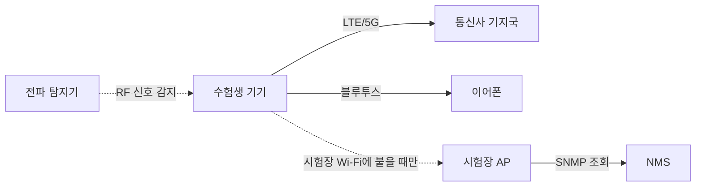

## 결론

**거의 못 잡는다.** SNMP는 "내가 관리하는 네트워크 장비"의 상태를 묻는 프로토콜이라서, 수험생이 몰래 쓰는 기기를 보는 도구가 아니다.

## 왜 안 되나

1. **SNMP는 관리 대상 장비에 agent가 있어야 한다**
   - 스위치·라우터·AP·서버처럼 관리자가 설정한 장비에 SNMP agent가 돌고, 매니저가 그 장비에 OID로 값을 물어본다.
   - 수험생 폰이나 스마트워치에는 내 SNMP agent가 없다. 물어볼 대상 자체가 아니다.
2. **부정행위 기기는 시험장 네트워크를 안 탄다**
   - LTE/5G는 통신사 기지국으로 바로 붙는다. 시험장 스위치·AP를 거치지 않으니 SNMP로 볼 수 있는 장비에 흔적이 없다.
   - 블루투스 이어폰, 무선 이어피스, 미리 저장해 둔 기기도 마찬가지로 네트워크를 안 탄다.

## 그나마 볼 수 있는 경우

시험장에 **자체 Wi-Fi AP나 유선망**이 있고, 누가 그 망에 붙었을 때만 일부 흔적을 볼 수 있다.

| SNMP로 볼 수 있는 것 | 의미 | 한계 |
|---|---|---|
| AP·무선 컨트롤러의 접속 단말 수 / 단말 MAC | 시험 중 누가 시험장 Wi-Fi에 붙었는지 | 시험장 Wi-Fi를 안 쓰면 아무것도 안 보임 |
| 스위치 MAC 주소 테이블(BRIDGE-MIB) | 어느 포트에 어떤 MAC이 붙었는지 | 유선 포트에 꽂아야만 보임 |
| 인터페이스 트래픽 카운터(ifInOctets/ifOutOctets) | 시험 시간에 트래픽이 튀는지 | 누가 왜 썼는지는 모름 |
| 단말 접속 trap(벤더 MIB) | 새 단말이 붙는 순간 알림 | 벤더 장비 지원 필요 |

즉, "시험장 망에 몰래 붙은 기기"는 탐지 보조 수단이 될 수 있지만, 실제 부정행위 대부분이 쓰는 셀룰러·블루투스는 못 본다.

## 실제로 쓰는 쪽은 전파 탐지

부정행위 기기를 찾으려면 네트워크 관리가 아니라 **무선 신호 자체**를 봐야 한다.

| 방법 | 보는 대상 | SNMP와 차이 |
|---|---|---|
| SNMP | 내가 관리하는 장비의 상태값 | 협조하는 장비만 보임 |
| 전파 탐지기 / 스펙트럼 분석기 | 공중에 나오는 RF 신호(셀룰러·BT·Wi-Fi) | 기기가 협조하지 않아도 송신하면 잡힘 |
| 금속 탐지기 | 몸에 지닌 전자기기 | 전원이 꺼져 있어도 잡힘 |
| 휴대폰 사전 수거 + 감독 | 기기 반입 자체 | 가장 기본 |

## 한 줄 정리

SNMP는 **내 장비가 어떤지** 묻는 도구고, 부정행위 탐지는 **남의 기기가 신호를 내는지** 보는 문제라서 방향이 다르다. 시험장 망에 붙는 기기를 잡는 보조 수단 정도만 된다.
