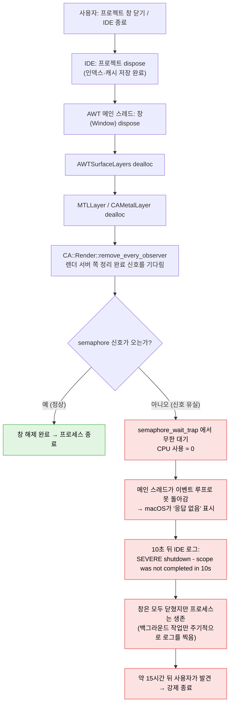

브라우저에서 부하 테스트 페이지를 띄워 둔 채 IDE가 "응답 없음"이 되었는데, 로그로 따라가 보니 **전날 IDE를 종료하다가 그대로 멈춰 있던 것**이었다. 부하 테스트와는 무관.

## 플로우차트



## 타임라인

| 시각 | 사건 | 근거 |
|---|---|---|
| D-1 17:03:07 | 프로젝트 창 닫기 → IDE 종료 시작 | IDE 로그 `Project was disposed`, `Release frame on closed project` |
| D-1 17:03:17 | 종료가 10초 안에 안 끝남 | `SEVERE ... scope was not completed in 10s` |
| 이후 ~15시간 | 창은 없는데 프로세스는 살아 있음. 20분마다 `Project has already been disposed` 경고만 찍힘 | IDE 로그 |
| D 07:55:36 | 강제 종료 | macOS hang 리포트 End time |

macOS 진단 리포트(`/Library/Logs/DiagnosticReports/*.hang`)에도 동일하게 찍힌다.

```
Date/Time:  D-1 17:03:07   ← 응답 없음 시작
End time:   D   07:55:36
Duration:   53548s (약 14.9시간)
```

## 멈춘 지점 (메인 스레드 스택)

```
-[AWTSurfaceLayers dealloc]
 └ -[CAMetalLayer dealloc]
    └ CA::Render::remove_every_observer
       └ semaphore_wait_trap   ← 여기서 무한 대기
```

- 창을 닫으면서 렌더링(Metal) 레이어를 해제하다가 **세마포어 신호를 영원히 기다림** = 데드락
- 샘플링 동안 CPU 시간 < 0.001s → 바빠서가 아니라 **완전히 멈춘 상태**
- 활동 모니터의 CPU 1.5%, 메모리 2GB도 이 상황과 일치 (메모리는 힙 최대치 근처였지만 로그상 메모리 경고는 없음)
- IDE 번들 런타임(JBR)의 macOS Metal 렌더링 파이프라인에서 창 해제 시 생기는 버그로 추정. 이전에도 같은 `scope was not completed` 종료 지연이 1회 있었음

## 결론

- 원인은 **IDE 종료 과정의 데드락**. 브라우저에서 돌던 그래프 라이브러리·부하 테스트·메모리 부족과 무관
- 렌더링은 브라우저 프로세스, dev 서버는 별도 node 프로세스라 애초에 IDE를 멈추게 할 수 없음
- 테스트하다가 우연히 발견했을 뿐

## 대처

1. 종료 후에도 Dock에 IDE가 남아 있으면 그냥 **강제 종료**해도 된다 (저장은 이미 끝난 상태)
2. IDE 업데이트 (JBR 수정 포함)
3. 반복되면 Help → Edit Custom VM Options에 `-Dsun.java2d.metal=false` 추가해서 OpenGL 렌더링으로 전환 (렌더링이 약간 느려질 수 있으니 반복 시에만)
4. 다시 멈추면 바로 죽이지 말고 10초쯤 기다려 freeze thread dump가 남게 한다

## 덤: 같은 IDE의 다른 freeze

다른 날 생긴 freeze dump에서는 UI 스레드가 `CInputMethod.getNativeLocale`(macOS 입력기 locale 조회)에서 멈춰 있었다. 콘솔에서 한글 입력 중 발생한 것으로, macOS + 한글 IME + JBR 조합의 별개 이슈다.
