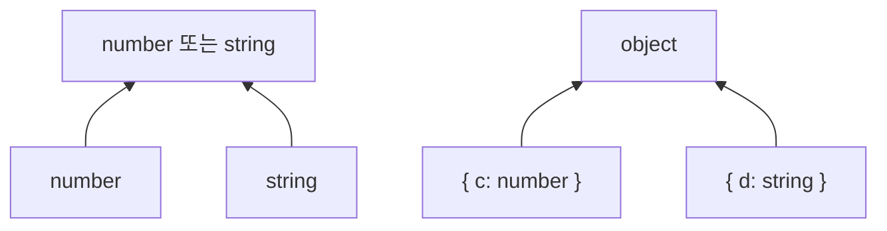

## 질문

타입의 관계를 설명하는 글에서 나온 기호의 의미는?

> 타입은 다음 4가지 중 하나만 만족한다.
> a ≳ b / a ≲ b / a ≳ b 이면서 a ≲ b / a ≄ b

## 기호의 의미

`≥`, `≤`, `=`에 물결(`~`)이 붙은 버전이다. 물결은 "**같다(=)가 아니라 동등하다(~)**"는 뉘앙스를 준다. 글쓴이가 숫자의 크기 비교와 구분하려고 일부러 다른 기호를 쓴 것이다.

| 기호 | 읽기 | 타입에서의 의미 (일반적 관례) |
|---|---|---|
| a ≲ b | less than or equivalent to | a는 b의 **서브타입** (a 값을 b 자리에 넣을 수 있음). 흔히 `a <: b`로도 씀 |
| a ≳ b | greater than or equivalent to | a는 b의 **슈퍼타입** (b ≲ a) |
| a ≲ b 이면서 a ≳ b | — | 서로가 서로의 서브타입 → **동등(equivalent)**, a ≃ b |
| a ≄ b | not equivalent / 비교 불가 | 어느 쪽도 서브타입이 아님 → **비교할 수 없음**. 수학에서는 보통 `a ∥ b`로 씀 |

> 서브타입을 "작은 쪽(≲)"에 두는 게 일반적인 관례(`number ≲ number | string`)지만, 방향은 글마다 다를 수 있으니 원문의 정의를 한 번 확인하는 게 좋다.

`≄`는 원래 수학에서 "점근적으로 같지 않다", "동형/동등이 아니다"는 뜻의 기호인데, 이 글에서는 "**서로 비교할 수 없다**"는 뜻으로 빌려 쓴 것이다.

## 왜 ≥, ≤, = 를 그대로 쓰지 않나

숫자 같은 **전순서**와 타입의 순서는 성질이 다르기 때문이다.

| 성질 | 숫자 (전순서) | 타입 (서브타입 관계) |
|---|---|---|
| 반사성 a ≤ a | O | O |
| 추이성 a ≤ b, b ≤ c → a ≤ c | O | O |
| 반대칭성 a ≤ b, b ≤ a → **a = b** | O | **X** — 서로 서브타입이어도 "같은 타입"이 아니라 "동등한 타입"일 수 있음 |
| 전체성 (항상 a ≤ b 또는 b ≤ a) | O | **X** — 비교 불가능한 쌍이 존재 |

- 전체성이 깨짐 → 4번째 경우 `a ≄ b`가 생긴다. 숫자는 항상 둘 중 하나가 크거나 같지만, 타입은 아무 관계도 없을 수 있다.
- 반대칭성이 깨짐 → 3번째 경우를 `a = b`가 아니라 "동등"으로 표현해야 한다. 그래서 물결 기호를 쓴다.

| 순서 구조 | 만족하는 성질 | 예 |
|---|---|---|
| 전순서 (total order) | 반사·반대칭·추이·전체 | 정수의 ≤ |
| 부분순서 (partial order) | 반사·반대칭·추이 | 집합의 ⊆ |
| 전순서 아닌 준순서 (preorder) | 반사·추이 | 구조적 타입의 서브타입 관계 |

원문의 "엄밀하게는 몇 가지 조건이 붙지만"이 바로 이 반사성·반대칭성·추이성·전체성 조건이다.

## TypeScript 예

```ts
// a ≲ b : number 는 number | string 의 서브타입
let x: number | string = 1 as number;      // OK

// a ≳ b 이면서 a ≲ b : 이름은 다르지만 서로 대입 가능 → 동등
type A = { x: number };
interface B { x: number }
let a: A = {} as B;  // OK
let b: B = {} as A;  // OK  (같은 타입은 아니지만 동등)

// a ≄ b : 어느 쪽으로도 대입 불가 → 비교 불가
type C = { c: number };
type D = { d: string };
// let c: C = {} as D;  // Error
// let d: D = {} as C;  // Error
```



위 그림에서 화살표(아래 → 위)가 ≲ 관계다. `number`와 `string`, `{c}`와 `{d}`는 서로 연결된 경로가 없으므로 ≄(비교 불가)이다.

## 객체 타입 규칙 식 읽기

> 객체 타입은 개별 속성의 방향이 일치할 때, 전체의 대소 방향도 똑같이 따라간다.
>
> ∀p∈prop(A) : A[p] ≳ B[p] ⇒ A ≳ B

### 기호

| 기호 | 이름 | 의미 | 유래 |
|---|---|---|---|
| ∀ | 전칭 기호 (universal quantifier) | **모든**, for all | **A**ll의 A를 뒤집음 |
| ∃ | 존재 기호 (existential quantifier) | **어떤 ~가 존재한다**, there exists | **E**xists의 E를 뒤집음 |
| ∈ | 원소 기호 | ~에 속한다, ~의 원소 | |
| : | — | "~에 대해", "~가 성립한다" (such that) | |
| ⇒ | 함의 (implies) | 왼쪽이 참이면 오른쪽도 참 | |

`prop(A)`는 타입 A가 가진 속성 이름들의 집합, `A[p]`는 A의 속성 p의 타입이다.

### 한 줄씩 읽기

| 부분 | 읽기 |
|---|---|
| ∀p∈prop(A) | A가 가진 **모든** 속성 p에 대해 |
| A[p] ≳ B[p] | A의 p 타입이 B의 p 타입의 슈퍼타입이면 |
| ⇒ A ≳ B | A 전체도 B 전체의 슈퍼타입이다 |

→ "**A에 있는 속성마다 A 쪽이 B 쪽보다 넓은 타입이면, 객체 A도 객체 B보다 넓은 타입이다**."

```ts
type A = { x: number | string };
type B = { x: number; y: boolean };

// prop(A) = { x }
// A[x] = number | string  ≳  B[x] = number   → 모든 p에 대해 성립
// ⇒ A ≳ B  (B 값을 A 자리에 넣을 수 있음)
let a: A = { x: 1, y: true } as B;  // OK
```

### 왜 prop(B)가 아니라 prop(A)인가

슈퍼타입(넓은 쪽) A의 속성만 검사하기 때문에, **B에 A에 없는 속성(y)이 더 있어도 상관없다**. 속성이 많을수록 조건이 더 구체적이므로 오히려 서브타입(좁은 쪽)이 된다.

| 서브타입 규칙 | 내용 |
|---|---|
| 너비(width) | 속성이 더 많은 객체가 서브타입 — `{x, y} ≲ {x}` |
| 깊이(depth) | 같은 속성의 타입이 더 좁으면 서브타입 — `{x: number} ≲ {x: number \| string}` |

위 식은 이 두 규칙을 한 번에 표현한 것이다. (A의 모든 속성 p가 B에도 있어야 B[p]를 비교할 수 있으므로, B가 A의 속성을 전부 가져야 한다는 조건도 암묵적으로 들어 있다.)
