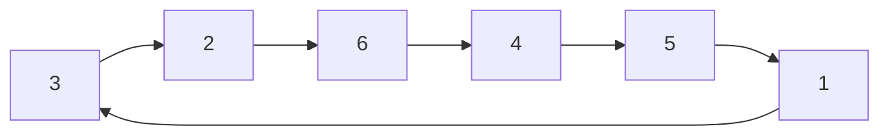
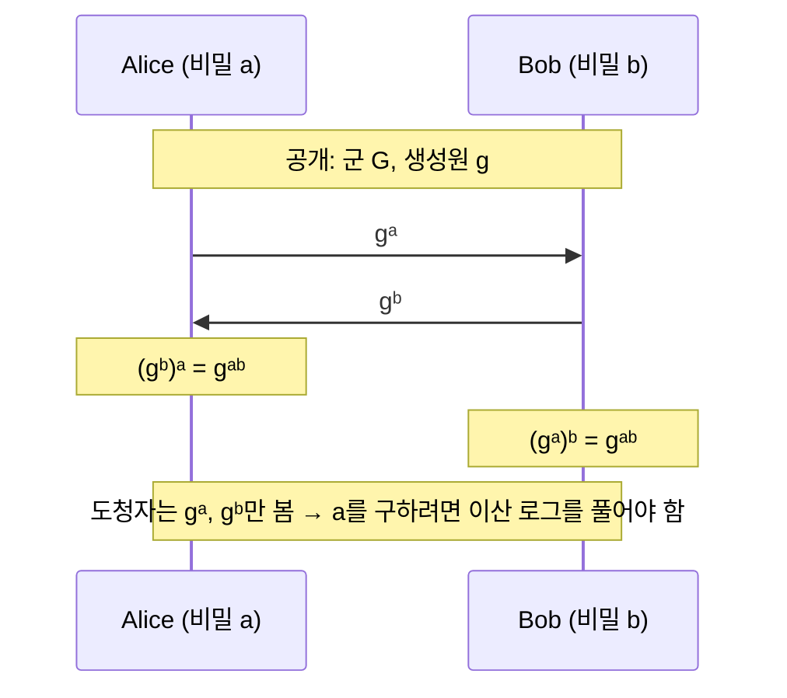

## 1. 군(Group)

### 정의

집합 G와 **이항연산** `☆` 하나가 다음 4가지를 만족하면 **군**이다. 이항연산은 G의 원소 두 개 a, b를 받아 G의 원소 하나 a☆b를 돌려주는 함수다. (이 문서에서는 실제 곱셈과 구분하기 위해 임의의 연산을 `☆`로 쓴다.)

```
(a, b)  ↦  a☆b        (a, b ∈ G, a☆b ∈ G)
```

| 조건 | 의미 |
|---|---|
| 닫힘 | a, b ∈ G → a☆b ∈ G (연산의 결과가 G 안에 있다는 정의에 포함됨) |
| 결합법칙 | (a☆b)☆c = a☆(b☆c) |
| 항등원 | a☆e = e☆a = a 인 e 존재 |
| 역원 | 모든 a에 a☆a⁻¹ = e 인 a⁻¹ 존재 |

### 표기: 곱셈 표기와 덧셈 표기

임의의 연산 `☆`를 교과서·논문에서는 보통 곱셈 표기(`·`)나 덧셈 표기(`+`)로 적는다. 어느 쪽이든 표기 관례일 뿐이고, 같은 군을 어느 쪽으로 써도 내용은 같다. 보통 교환법칙이 성립하는 군에 덧셈 표기를 쓴다.

| 표기 | 연산 | 항등원 | 역원 | 반복 연산 |
|---|---|---|---|---|
| 곱셈 표기 | a·b | e 또는 1 | a⁻¹ | gⁿ |
| 덧셈 표기 | a+b | 0 | −a | n·g |

타원곡선 암호는 덧셈 표기를 써서 "gˣ" 대신 "x·P"로 쓰고, 이산 로그 문제도 "Q = xP에서 x 찾기"로 쓴다.

### 연산의 예

| 군 | 연산 |
|---|---|
| (Zₙ, +) | mod n 덧셈 |
| Zₚ* | mod p 곱셈 |
| 순열(치환) 군 | 함수 합성 (σ∘τ) |
| 가역 행렬 군 | 행렬 곱 (교환법칙 X) |
| 비트열 | XOR |
| 회전 군 | 회전을 이어서 하기 |
| 타원곡선 점 군 | 두 점을 잇는 직선이 곡선과 만나는 세 번째 점을 x축 대칭한 점 (기하학적 정의) |

타원곡선 점 덧셈은 실제 계산할 때 유한체의 +, −, ×, ÷를 **섞은 공식**으로 구한다. 이처럼 여러 연산을 조합해 만든 새 연산도 공리만 만족하면 군의 연산이 된다.

예: 정수에서 `a ☆ b = a + b + 1` 도 군이다.
- 결합: (a☆b)☆c = a+b+c+2 = a☆(b☆c)
- 항등원: a + e + 1 = a → e = −1
- 역원: a + b + 1 = −1 → b = −a − 2

### 군이 되지 않는 예

- 정수 뺄셈: (5−3)−1 ≠ 5−(3−1) → 결합법칙 실패
- 정수 곱셈: 2의 역원 1/2가 정수가 아님 → 역원 실패
- mod 12 곱셈 전체: 2, 3, 4 등에 역원 없음 → 역원 실패 (12와 서로소인 {1, 5, 7, 11}만 모으면 군)

### 연산이 두 개인 구조: 환·체

군은 **연산 하나**짜리 구조다. 두 연산을 분배법칙으로 엮은 구조는 **환(ring)**·**체(field)**라고 부른다.

| 구조 | 연산 | 예 |
|---|---|---|
| 군 | 1개 | (Zₙ, +), (Zₚ*, ×) |
| 환 | 2개 (+는 교환 군, ×는 결합법칙, 분배법칙으로 연결) | (Z, +, ×), (Zₙ, +, ×) |
| 체 | 2개 (환 + 0을 뺀 원소들이 ×에 대해 교환 군) | (Zₚ, +, ×), 실수 |

Zₚ는 +, ×를 다 가진 체이고, 덧셈만 보면 군 (Zₚ, +), 0을 빼고 곱셈만 보면 군 Zₚ*이다. 이산 로그 암호는 이 곱셈군 하나만 쓴다.

## 2. 유한 순환군

**원소 하나(생성원 g)에 연산을 반복 적용하는 것만으로 군의 모든 원소를 만들 수 있으면 순환군**이다.

```
G = ⟨g⟩ = { g⁰, g¹, g², …, gⁿ⁻¹ },   gⁿ = e
```

여기서 gᵏ 는 실제 거듭제곱이 아니라 g에 연산을 k번 적용한 것이다: gᵏ = g☆g☆…☆g (k개), g⁰ = e.

원소 개수 n(**위수, order**)이 유한하면 유한 순환군이다.

### gⁿ = e 가 성립하는 이유

gⁿ = e는 공리가 아니라 **닫힘 + 유한 + 역원**이 합쳐져서 나오는 결과다.

| 조건 | 하는 역할 |
|---|---|
| 닫힘 | g, g², g³, … 이 계속 G 안에 머문다 |
| 유한 | 원소가 유한하니 언젠가 같은 값이 반복된다 (비둘기집 원리): gⁱ = gʲ (i < j) |
| 역원 | 양변에 g⁻ⁱ 를 곱하면 gʲ⁻ⁱ = e → 반복이 **반드시 e로 돌아오는 원**이 된다 |

하나라도 빠지면 성립하지 않는다.

- **무한**: 정수 덧셈군 Z에서 1, 2, 3, … 은 닫혀 있지만 영원히 0(항등원)으로 돌아오지 않는다.
- **역원 없음**: mod 12 곱셈에서 2를 거듭제곱하면 `2 → 4 → 8 → 4 → 8 → …`. 반복은 생기지만 1로도, 2로도 돌아오지 않는 **ρ(로) 모양**이 된다. gcd(2, 12) ≠ 1이라 2는 mod 12에서 역원이 없다.


역원이 있으면 "꼬리"가 생길 수 없다. gⁱ = gʲ 에서 양변에 g⁻¹을 곱해 거슬러 올라가면 g⁰ = gʲ⁻ⁱ 가 되므로, 순환은 항상 출발점 e를 지나는 **완전한 원**이다.

### 예 1: Z₇* (mod 7 곱셈군), 생성원 3

| k | 1 | 2 | 3 | 4 | 5 | 6 |
|---|---|---|---|---|---|---|
| 3ᵏ mod 7 | 3 | 2 | 6 | 4 | 5 | **1** |

1~6이 전부 한 번씩 나오므로 3은 생성원(= 원시근)이다. Zₚ*는 1~p−1이 모두 p와 서로소라 전부 역원이 있다.



반면 2는 `2 → 4 → 1`로 3개만 돌고 끝 → 생성원이 아니고, 위수 3인 **부분군** {1, 2, 4}만 만든다.

### 예 2: Zₙ (mod n 덧셈군), 생성원 1

1, 1+1, 1+1+1, … 로 0~n−1을 모두 만든다. 덧셈 표기라 gᵏ 가 k·g 로 쓰인다.

### 핵심 성질

| 성질 | 내용 |
|---|---|
| 구조 유일성 | 위수 n인 순환군은 모두 Zₙ과 **동형**(구조가 같음) |
| 부분군 | 부분군도 모두 순환군. n의 약수 d마다 위수 d인 부분군이 정확히 1개 |
| 생성원 개수 | φ(n)개 (오일러 피 함수) |
| 원소 위수 | gᵏ 의 위수 = n / gcd(k, n) |
| Zₚ* | p가 소수면 Zₚ*는 항상 위수 p−1인 순환군 |

## 3. 이산 로그(Discrete Logarithm)

순환군 G = ⟨g⟩에서는 모든 원소 h를 **h = gˣ (0 ≤ x < n)** 으로 유일하게 쓸 수 있다. 이 지수 x가 **이산 로그** `x = log_g h` 이다.

> 예: Z₇*, g = 3, h = 4 → 3⁴ ≡ 4 (mod 7) 이므로 log₃ 4 = 4

실수 로그와 달리 값이 연속적으로 커지지 않고 mod로 뒤섞이기 때문에 "대충 크기로 짐작"하는 게 불가능하다.

### 왜 암호에 쓰이나 — 비대칭성

| 방향 | 연산 | 난이도 |
|---|---|---|
| 정방향 | x → gˣ | **쉬움** — 제곱-곱셈(square-and-multiply)으로 O(log x)번 연산 |
| 역방향 | gˣ → x | **어려움** — 적절한 군에서는 효율적인 알고리즘이 알려져 있지 않음 (DLP) |

이 "한쪽은 쉽고 반대쪽은 어려운" 성질이 **일방향 함수**이고, 공개키 암호의 기반이 된다.

### 주의: 모든 순환군에서 어려운 건 아니다

모든 위수 n 순환군은 Zₙ과 동형인데, **Zₙ(덧셈군)에서는 이산 로그가 쉽다**. h = x·g mod n 이므로 확장 유클리드로 g의 역원을 구해 바로 x를 얻는다.
즉 난이도는 군의 "추상 구조"가 아니라 **원소를 어떻게 표현하고 계산하느냐**에 달려 있다. (Zₚ*나 타원곡선 군을 Zₙ으로 옮기는 동형사상을 계산하는 것 자체가 이산 로그를 푸는 일이다.)

## 4. 이산 로그 공격 알고리즘

| 알고리즘 | 복잡도 | 적용 대상 / 시사점 |
|---|---|---|
| 전수 탐색 | O(n) | 모든 군 |
| Baby-step Giant-step | O(√n) 시간·공간 | 모든 군 (일반 군의 하한에 해당) |
| Pollard's rho | O(√n) 시간, O(1) 공간 | 모든 군, 실전 표준 |
| Pohlig–Hellman | n의 가장 큰 소인수 q에 대해 O(√q) | n이 작은 소인수로 쪼개지면 무너짐 → **위수가 큰 소수인 부분군을 사용**하는 이유 |
| Index calculus | 준지수 시간 | Zₚ* 같은 유한체 곱셈군에 통함. 타원곡선엔 일반적으로 안 통함 → **ECC 키가 짧은 이유** |
| Shor (양자) | 다항 시간 | 양자컴퓨터가 실용화되면 모두 깨짐 → 양자내성 암호(PQC) 필요 |

같은 128비트 보안 기준으로 유한체 DH는 약 3072비트, 타원곡선은 약 256비트 키가 필요하다.

## 5. 응용: Diffie–Hellman 키 교환



| 암호 방식 | 사용 군 |
|---|---|
| DH, ElGamal, DSA | Zₚ*의 큰 소수 위수 부분군 |
| ECDH, ECDSA, Ed25519 | 타원곡선 위 점들의 군 (TLS, SSH 등) |

## 요약

- **군**: 결합법칙·항등원·역원을 만족하는 이항연산 하나를 가진 집합. 연산은 이 공리만 만족하면 어떤 함수든 된다
- **유한 순환군**: 생성원 하나에 연산을 반복해 모든 원소를 만들고, n번 후 e로 돌아오는 군 (닫힘 + 유한 + 역원의 결과)
- **이산 로그**: 그 군에서 h = gˣ 의 지수 x를 찾는 문제
- 거듭제곱은 쉽고 로그는 어렵다는 비대칭성이 DH·ECC 같은 공개키 암호의 안전성 근거
- 단, 어려움은 군의 표현에 달려 있어 Zₙ 덧셈군은 쉽고, Zₚ*·타원곡선의 **큰 소수 위수** 부분군을 써야 한다
