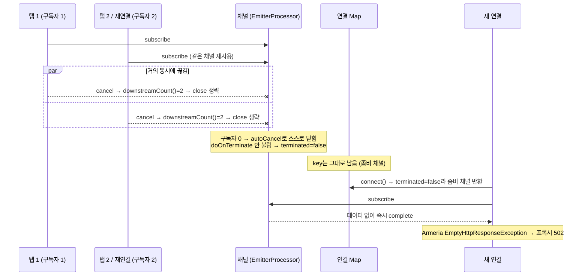

> 이전 글(「한 사용자만 SSE 연결이 502로 실패한 이유」)에서 "백엔드에 죽은 emitter가 남아 있다"는 데까지 추적한 사건의 후속 기록이다. 백엔드 코드를 읽고, 같은 Reactor 버전으로 race를 재현했다.

## 증상

- 브라우저 대시보드에서 "서버와 연결이 끊어졌습니다" 알림. EventSource `onerror`가 발생한다
- Network 탭: `GET /event/connect/{userId}` → **502**
- 프론트 dev 서버(Nuxt/Nitro 프록시) 로그

  ```
  GET /event/connect/{userId}
  ✖ Error (502): Bad Gateway
    Caused by: TypeError: fetch failed
      Caused by: SocketError [UND_ERR_SOCKET]: other side closed
  ```

- 백엔드에 직접 요청해도(HTTP/1.1·2 모두) `Empty reply from server`
- **실제로 로그인해서 쓰던 사용자 ID 하나만** 100% 재현. 다른 ID는 모두 200 `text/event-stream`으로 정상 스트리밍
- 백엔드(Armeria) 로그

  ```
  WARN ... [/event/connect/{userId}#GET] Response:
    {length=0B, duration=0ns, cause=com.linecorp.armeria.common.EmptyHttpResponseException, headers=[:status=0]}
  ```

  예외가 터진 게 아니라, 컨트롤러가 돌려준 `Flux`가 **데이터 한 건 없이 바로 완료**돼서 보낼 응답 헤더가 없으니 연결을 닫은 것이다. curl에는 `Empty reply`, 프록시에는 `other side closed`로 보이고, 프록시가 이를 502로 브라우저에 전달한다.

## 배제한 가설

| 가설 | 결과 |
| --- | --- |
| 프록시·백엔드가 일정 시간 뒤 끊음 | 90초 스트리밍 정상(프록시 경유·직접 모두) |
| 같은 ID로 두 번 연결하면 이전 연결을 끊음 | 두 연결 모두 유지됨 |
| 브라우저식 EventSource 동작 차이 | Node 내장 EventSource로 30초 정상 |
| 쿠키 헤더가 커서 431 | 8KB를 넘으면 431이 나긴 하지만, 실제 브라우저는 쿠키 2개에 상태 502라 무관 |
| 화면 모드 요청의 "SSE 재연결 필요" 에러 | SSE 연결이 실패한 **결과**일 뿐 원인 아님 |

## 백엔드 구조

사용자별 SSE 채널을 메모리의 `ConcurrentHashMap`으로 관리한다. 채널은 `EmitterProcessor`(Reactor) 래퍼다.

```java
// 연결 목록 (싱글톤 빈)
ConcurrentHashMap<String, EventChannel> map;

synchronized EventChannel connect(String key) {
    EventChannel ec = map.computeIfAbsent(key, k -> new EventChannel().onClose(() -> map.remove(key)));
    if (ec.isTerminated()) {                 // 끝난 채널이면 새로 만든다
        ec = new EventChannel().onClose(() -> map.remove(key));
        map.put(key, ec);
    }
    return ec;                               // 아니면 기존 채널을 같이 쓴다
}
```

```java
// 채널
processor = EmitterProcessor.create();
sink = processor.sink();
flux = processor
    .doOnCancel(() -> {
        if (processor.downstreamCount() <= 1) close();   // 마지막 구독자면 정리
    })
    .doOnTerminate(() -> terminated = true);             // complete/error를 받으면 "끝남" 표시

void close() { closeCallback.run(); /* map.remove(key) */ sink.complete(); }
```

설계 의도는 이렇다.

- 같은 사용자의 연결(탭 여러 개, 재연결)은 채널 하나를 함께 구독한다
- 구독자가 끊길 때 **그게 마지막이면** 맵에서 지우고 sink를 닫는다
- 끝난 채널은 `terminated` 표시로 걸러서 다음 `connect()`에서 새로 만든다

## 원인 — 동시 취소가 맵에 좀비 채널을 남김

1. **"마지막 구독자" 판정이 원자적이지 않다.** `doOnCancel` 안에서 `downstreamCount()`를 읽는 시점에는 끊기는 구독자 자신이 아직 숫자에 포함돼 있다. 구독자 두 개가 **동시에** 끊기면 둘 다 `2`를 읽고, 둘 다 `close()`를 건너뛸 수 있다
2. **`terminated`는 구독자가 complete/error를 받아야만 켜진다.** 취소(cancel)로 끝나면 `doOnTerminate`가 불리지 않는다. 브라우저 탭을 닫거나 새로고침하면 complete가 아니라 cancel이다

두 개가 겹치면 이런 채널이 맵에 남는다.

- 맵에 그대로 있다 (`close()`가 안 불림)
- `terminated == false` (아무도 complete를 못 받음)
- 그런데 `EmitterProcessor`는 기본값 `autoCancel = true`라서, 구독자가 0이 되는 순간 **스스로 닫혀 버린다**

즉 **살아 있는 척하는 죽은 채널(좀비)**이다.

깨지는 순서:

1. 같은 사용자로 연결이 2개 열린다(탭 2개, 새로고침 직후 이전 연결이 서버에 아직 남은 경우, HMR·EventSource 자동 재연결로 잠깐 겹친 경우)
2. 두 연결이 거의 동시에 취소된다. 양쪽 `doOnCancel` 모두 `downstreamCount()`를 2로 봐서 "아직 다른 연결이 있다"고 판단하고, **아무도 `close()`를 부르지 않는다**
3. 실제로는 구독자가 0이 되어 `EmitterProcessor`가 autoCancel로 스스로 종료된다. 하지만 `terminated`는 `false`인 채로 맵에 남는다
4. 이후 그 사용자의 `connect()`는 죽은 채널을 받아 바로 완료된다. 결과는 `EmptyHttpResponseException`, 프록시에서는 502다



1. **check-then-act race**: "내가 마지막 구독자인가?"를 `downstreamCount()`로 읽고 판단하는 사이에 다른 구독자도 같은 값을 읽는다
2. **상태 플래그가 종료 경로 하나만 본다**: `terminated`는 complete/error에서만 켜지고 cancel에서는 안 켜진다
3. **Processor는 따로 닫힌다**: `autoCancel` 때문에 앱이 모르는 사이에 채널이 죽는다. 앱의 장부(Map + 플래그)와 실제 상태가 어긋난다

부수적으로 같은 이유로 생기는 증상도 있었다. 좀비 채널에 첫 연결이 붙어 complete를 받으면 `terminated=true`가 되지만, 여전히 `close()`가 안 불려 **맵에 남는다**. 이때 "SSE 연결이 있어야만 성공하는" 화면 모드 API를 부르면 채널을 찾았는데 끝난 상태라 **"SSE 재연결 필요(5001)"**가 난다. 실제 백엔드 로그에도 이 오류가 같이 찍혀 있었다.

## 정상 disconnect와의 차이

끊기는 방식 자체는 정상이다. "동시에 끊김"을 고려하지 않은 **경쟁 상태(race condition)** 버그다.

**정상(연결 1개)**
1. 탭을 닫거나 페이지를 이동하면 `doOnCancel`이 불린다. 연결 수는 1이다
2. 1 이하이므로 `close()`가 돌아 맵에서 지워지고 채널이 끝난다
3. 다음 접속 때 새 채널이 만들어진다

**버그(연결 2개가 겹침)**
- 앞의 "깨지는 순서" 1~4

개발 중에는 새로고침·HMR이 잦아 연결이 자주 겹친다. 그래서 실사용 계정만 걸리고, 처음 써 보는 ID는 겹친 적이 없어서 멀쩡했다.

## 재현

백엔드와 같은 Reactor 버전(3.7.19, 3.6.4)으로 채널·저장소 코드를 그대로 옮겨서 시나리오별로 돌렸다.

```java
// 시나리오 3: 같은 채널의 구독자 두 개를 두 스레드에서 동시에 dispose
CyclicBarrier b = new CyclicBarrier(2);
new Thread(() -> { b.await(); s1.dispose(); }).start();
new Thread(() -> { b.await(); s2.dispose(); }).start();
// → 맵에 key가 남았는지 확인, 남았으면 새 연결을 붙여 본다
```

| 시나리오 | 결과 |
|---|---|
| 1. 구독자 1개가 끊김 | `downstream=1` → 정리됨 |
| 2. 구독자 2개가 **차례로** 끊김 | `2` → `1` → 정리됨 |
| 3. 구독자 2개가 **동시에** 끊김 (2000회) | **20회(1%) 맵에 남음.** `terminated=false`, `downstream=0` |
| 3-1. 남은 채널에 새 연결 | **데이터 0건, 즉시 complete** → 실제 환경이면 빈 응답 |
| 3-2. 그다음 새 연결 | 새 채널이 만들어지고 정상 수신 |
| 4. `connect()`로 채널을 받은 뒤, 구독하기 전에 이전 연결이 끊김 | **즉시 complete** (맵에서는 이미 지워짐) |

```text
== 3. 구독자 2개가 동시에 끊김 (2000회)
  정리 안 되고 map 에 남은 횟수: 20 / 2000
  남은 채널: ch22 terminated=false processor.isTerminated=false downstream=0
  새 연결 1: ch22 수신=0 결과=즉시 complete terminated=true map=ch22
  새 연결 2: ch2003 수신=1 결과=열린 채 대기 terminated=false map=ch2003
```

시나리오 3과 4 모두 **새 연결이 데이터 없이 즉시 complete**된다. 로그의 `EmptyHttpResponseException`과 정확히 같은 모양이다.

## 재현으로 설명되지 않은 부분

처음 기록할 때는 "autoCancel로 종료된 `EmitterProcessor`에 새로 구독하면 어떤 신호(완료/에러/무신호)가 오는가"를 확인하지 못했다. 재현으로 이 부분은 풀렸다. **새 구독자는 데이터 없이 즉시 complete를 받는다.** 그래서 `doOnTerminate`가 돌아 `terminated=true`가 되고, 그다음 `connect()`는 새 채널을 만든다.

재현에서는 좀비 채널에 **첫 연결만** 빈 응답을 받고, 그 연결이 `terminated`를 켜 주기 때문에 **다음 연결은 새 채널로 복구**됐다. 실제 환경에서는 같은 사용자가 몇 분 간격으로 여러 번 연결해도 매번 빈 응답이었고, 백엔드를 재시작해서야 풀렸다.

이 차이는 아직 확인하지 못했다. 후보는 이렇다.

- 운영 중이던 백엔드 빌드가 지금 읽은 코드와 다를 수 있다 (재구성 작업 중이었다)
- Armeria가 빈 스트림을 처리하는 방식이 단순 `subscribe()`와 다를 수 있다 (예: complete 전에 구독을 취소해서 `doOnTerminate`가 안 불리는 경로)

그래서 이 race는 "빈 응답이 나오는 메커니즘"으로는 확인됐지만, "재시작 전까지 계속 실패한 이유"의 전부라고 단정하지는 않는다.

## 확인과 임시 조치

- 백엔드를 재시작하자 맵이 비워져 해당 사용자도 즉시 정상 연결됐다. "죽은 채널이 맵에 남는다"는 방향이 맞다는 확인이다
- 코드를 고치기 전까지는 재발할 때마다 재시작해야 한다

## 함께 발견한 버그

- `get(key)`가 `map.get()` 결과를 null 확인 없이 `isTerminated()` 호출 → 키가 없으면 NPE
- 주기 전송 루프에서 끝난 채널 하나가 try 밖에서 예외를 던져 **그 회차 전체 사용자 전송이 중단**됨
- `onClose(() -> map.remove(key))`처럼 키로만 지우면, 이미 교체된 새 채널을 지울 수 있음

## 고치는 방향

| 문제 | 수정 |
|---|---|
| 마지막 구독자 판정 race | `downstreamCount()` 추정 대신 구독 수를 직접 센다. 세는 것과 "0이면 제거"를 **같은 키의 잠금 안**(`map.compute`)에서 한다 |
| cancel 경로에서 상태가 안 바뀜 | 정리를 `doFinally` 한 곳에서 한다. cancel·complete·error를 모두 받는다 |
| Processor가 몰래 닫힘 | `EmitterProcessor`(deprecated) 대신 `Sinks.many().multicast().onBackpressureBuffer(n, false)`(`autoCancel=false`) 또는 `directBestEffort()` — 구독자가 0이 돼도 닫히지 않게 해서 채널 수명을 앱이 직접 관리 |
| 다른 채널을 지울 수 있음 | 제거할 때 맵의 현재 값이 자기 자신인지 확인한다 (`cur == ch`, 또는 `map.remove(key, ch)`) |
| 조회 시 NPE | `Optional.ofNullable(map.get(key)).filter(c -> !c.isTerminated())` |
| 주기 전송이 한 채널 예외로 중단 | 예외가 나는 범위(`orElseThrow` 등)를 키별 `try` 안으로 옮긴다 |

```java
// 개념 코드 — 고르기·세기·제거를 모두 같은 키의 compute 잠금 안에서
EventChannel ch = map.compute(key, (k, old) -> {
    EventChannel c = (old == null || old.isClosed()) ? new EventChannel() : old;
    c.subscribers.incrementAndGet();          // 구독 전에, 채널을 내줄 때 미리 센다
    return c;
});

return ch.asFlux()                            // Sinks.many().multicast().onBackpressureBuffer(256, false)
    .doFinally(sig -> map.computeIfPresent(key, (k, cur) -> {
        int left = ch.subscribers.decrementAndGet();
        if (cur == ch && left == 0) {         // 내가 마지막이고, 맵의 채널이 아직 나일 때만
            ch.close();
            return null;                      // null 반환 = 키 제거
        }
        return cur;
    }));
```

처음엔 `doOnSubscribe`에서 increment, `doFinally`에서 `decrementAndGet() == 0`이면 제거하는 식으로 생각했다. 카운터가 원자적이니 "마지막"은 한 번만 판정된다. 하지만 **0이 된 직후 새 연결이 같은 채널을 받아 가고, 곧바로 제거·close가 실행되는 틈**이 남는다. 시나리오 4와 같은 모양이다. 그래서 위 코드처럼 두 가지를 바꿨다.

- **세는 시점을 `connect()` 안으로 당긴다.** 채널을 내주는 순간 센다. 실제 구독(Armeria가 나중에 함)까지 기다리지 않는다
- **증가와 "감소 후 0이면 제거"를 같은 키의 `compute` 잠금 안에서 한다.** 둘이 끼어들 수 없다

남는 주의점이 하나 있다. 채널을 내줬는데 클라이언트가 구독 전에 사라져 `Flux`가 끝내 구독되지 않으면 `doFinally`가 안 불려 카운트가 줄지 않는다. 연결 수명을 HTTP 요청 수명(예: 요청 취소 콜백)과 묶거나, 주기적으로 구독자 없는 채널을 청소하는 안전망이 필요하다.

검증: 같은 ID로 연결 2개를 연 뒤 동시에 취소하고, 같은 ID로 다시 연결했을 때 데이터를 받는지 단위 테스트한다. 현재 코드로 먼저 실패를 재현(`CyclicBarrier`로 수천 회)한 뒤 수정한다.

## 재현·확인 명령

```bash
# 정상이면 200 text/event-stream 후 타임아웃(exit 28), 버그면 000 / Empty reply
curl -sk -N -m 4 -o /dev/null -w '%{http_code} %{content_type}\n' https://<backend>/event/connect/<userId>
```

## 정리

- **`EmptyHttpResponseException`·빈 응답은 "예외"가 아니라 "이미 끝난 스트림"을 의심하라.** 새 연결이 왜 끝난 스트림을 받는지가 핵심이다
- **"읽고 판단하고 행동"하는 정리 로직은 동시 호출에서 둘 다 건너뛸 수 있다.** 콜백 안의 `count <= 1` 같은 판정이 대표적이다
- **상태 플래그는 모든 종료 경로(complete·error·cancel)에서 갱신해야 한다.** Reactor에서는 `doFinally`가 그 자리다
- **라이브러리가 스스로 상태를 바꾸는 옵션(`autoCancel`)이 있으면 앱의 장부와 어긋난다.** 수명을 앱이 관리할 거면 그 옵션을 끈다
- race는 "가끔"이라 재현이 어렵다. 같은 라이브러리 버전으로 핵심 코드만 떼어 내 `CyclicBarrier`로 수천 번 돌리면 1% 확률도 바로 보인다

## 관련 개념

| 항목 | 내용 |
|---|---|
| check-then-act race | 상태를 읽고(check) 그 결과로 행동(act)하는 사이에 다른 스레드가 상태를 바꾸는 경쟁 조건. `if (!map.containsKey(k)) map.put(k, v)` 가 고전적 예 |
| `doOnCancel` / `doOnTerminate` / `doFinally` | 각각 cancel만 / complete·error만 / 세 가지 모두에서 호출. 정리 로직은 `doFinally` |
| `EmitterProcessor` `autoCancel` | 기본 `true`. 구독자가 모두 떠나면 processor 자체가 닫힌다. 3.5부터 deprecated |
| `Sinks.many().multicast()` | Processor 대체 API. `onBackpressureBuffer(size, autoCancel)`로 자동 종료 여부를 고른다 |
| `ConcurrentHashMap.remove(key, value)` | 현재 값이 `value`와 같을 때만 제거. 교체된 새 항목을 실수로 지우지 않는다 |
| `compute` / `computeIfAbsent` | 키 단위로 원자적 갱신. 단, 콜백 바깥의 후속 판정은 원자성이 보장되지 않는다 |
