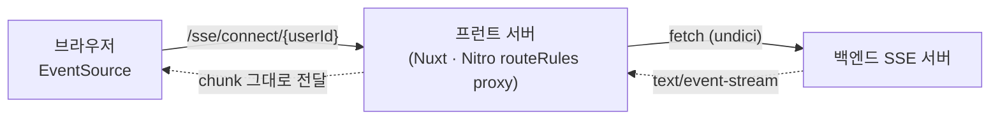
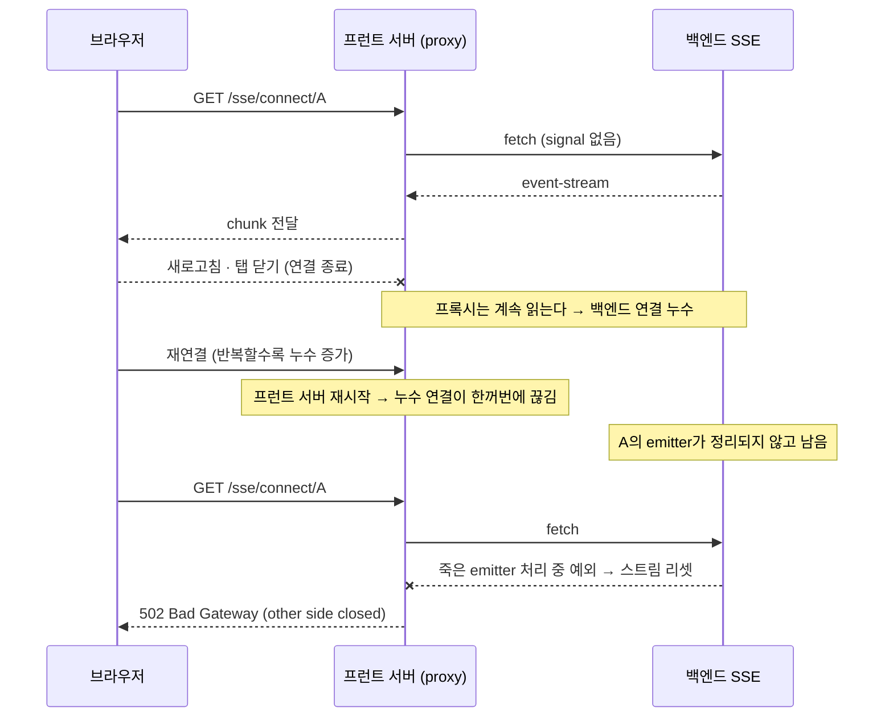

## 증상

브라우저가 SSE(Server-Sent Events)로 실시간 데이터를 받는 관리자 화면에서, 연결 요청(`GET /sse/connect/{userId}`)이 계속 실패했다. 브라우저를 다시 시작한 뒤에는 Network 탭에 **502 Bad Gateway**가 찍혔다.

구성은 이렇다.



- 프런트는 Nuxt SPA다. `/sse/**` 요청은 Nitro `routeRules`의 `proxy`로 백엔드에 넘긴다
- 백엔드는 사용자별로 SSE 연결(emitter)을 등록하고, 주기적으로 전체 데이터를 흘려보낸다
- 화면 모드를 바꾸는 별도 REST API가 있다. 이 API는 그 사용자의 SSE 연결이 서버에 등록돼 있을 때만 성공하고, 없으면 "SSE 재연결 필요" 오류를 돌려준다

## 추적

### 1단계: 백엔드와 프록시를 나눠서 확인 — 둘 다 정상

브라우저 문제인지 서버 문제인지부터 갈랐다. curl로 백엔드에 바로, 그리고 프록시를 거쳐서 같은 요청을 보냈다.

```bash
# 백엔드 직접
curl -sk -m 5 -N -o /dev/null -w "%{http_code} %{content_type}\n" https://<backend>/sse/connect/1
# 프런트 서버(프록시) 경유
curl -sk -m 40 -N -o /dev/null -w "%{http_code} %{size_download}\n" https://localhost:<port>/sse/connect/1
```

| 확인 | 결과 |
|---|---|
| 백엔드 직접 | 200 `text/event-stream` |
| 프록시 경유 | 200, 데이터 계속 수신 |
| 40초 연결 유지 | 끊김 없음 (약 350KB) |
| 브라우저 헤더 흉내 (`Accept`, `Origin`, `Cookie`, `Accept-Encoding`, `Sec-Fetch-*`, 큰 쿠키) | 전부 200 |
| 같은 사용자로 두 개 동시 연결 | 둘 다 유지 |

모두 정상이었다. 그래서 처음엔 브라우저 쪽 원인을 의심했다. 개발 서버 응답이 `HTTP/1.1`이라 Chrome은 한 origin에 동시 연결을 6개까지만 연다. SSE는 연결을 계속 잡고 있으니, 탭을 여러 개 열면 새 요청이 pending에 멈출 수 있다. 하지만 브라우저를 다시 시작한 뒤에도 502가 나서 이 가설은 맞지 않았다.

### 2단계: 프런트 서버가 백엔드에 연 연결 수 세기 — 누수 발견

502는 프록시가 만든 응답이니, 프런트 서버 프로세스가 연 TCP 연결을 봤다.

```bash
lsof -nP -a -p <dev-server-pid> -iTCP | awk '{print $9, $10}'
```

```text
127.0.0.1:<port>->127.0.0.1:63641 (ESTABLISHED)        ← 브라우저 → 프런트 서버: 1개
<host>:64195-><backend>:<sse-port> (ESTABLISHED)        ← 프런트 서버 → 백엔드: 17개
<host>:64176-><backend>:<sse-port> (ESTABLISHED)
...
```

**브라우저 쪽 연결은 1개인데 백엔드 쪽 SSE 연결은 17개**가 열려 있었다. curl을 몇 번 더 보내자 29개, 30개로 늘었고 20초를 기다려도 줄지 않았다. 클라이언트가 끊겨도 프록시가 백엔드 연결을 닫지 않는 것이다.

프록시 구현(h3 1.x의 `sendProxy`)을 열어 보니 이유가 바로 보였다.

```js
// h3 sendProxy (요약)
try {
  response = await fetch(target, { ...opts.fetchOptions }); // ① abort signal 없음
} catch (error) {
  throw createError({ status: 502, statusMessage: 'Bad Gateway', cause: error }); // ③
}
// ...헤더 복사...
for await (const chunk of response.body) {
  event.node.res.write(chunk); // ② 클라이언트가 끊겨도 계속 읽는다
}
return event.node.res.end();
```

1. 백엔드로 fetch할 때 `AbortSignal`을 넘기지 않는다
2. 응답 본문을 `for await`로 끝까지 읽는다. 클라이언트 소켓이 닫혀도 `res.write()`는 예외를 던지지 않으니 루프가 끝나지 않는다
3. **fetch 자체가 예외를 던질 때만 502**를 만든다

일반 REST 응답은 금방 끝나니 문제가 없다. 하지만 SSE는 응답이 끝나지 않는 스트림이라, 새로고침·탭 닫기·재연결을 할 때마다 백엔드 연결이 하나씩 쌓인다. 로그의 `MaxListenersExceededWarning: 11 close listeners added to [ServerResponse]` 경고도 같은 신호였다.

### 3단계: 서버 로그와 실제 사용자 id — 그 사용자만 실패

다만 연결이 쌓여도 내 curl은 여전히 200이었다. 프런트 서버 로그에서 502의 `cause`를 확인했다.

```text
GET /sse/connect/{userA}
✖ Error (502): Bad Gateway
  Caused by: TypeError: fetch failed
    Caused by: SocketError [UND_ERR_SOCKET]: other side closed
```

**백엔드가 응답을 보내기 전에 소켓을 닫았다.** 그리고 요청 id가 내가 시험하던 id가 아니라 실제 로그인한 사용자(A)였다. 그 id로 백엔드에 바로 보내 봤다.

| 요청 (백엔드 직접) | 결과 |
|---|---|
| 사용자 A | 응답 없이 끊김 — HTTP/2 `INTERNAL_ERROR (err 2)`, HTTP/1.1로는 `Empty reply from server` |
| 다른 id 6개 | 200 정상 |

프록시를 거치지 않아도 실패하니, **백엔드가 사용자 A의 요청만 처리하다 예외를 내고** 있었다. 프록시는 그 리셋을 `other side closed`로 받아 502로 바꿨을 뿐이다.

### 4단계: 프런트 서버를 재시작해도 실패 — 백엔드에 남은 죽은 연결

처음에는 "쌓인 누수 연결 때문에 백엔드가 A의 상태를 감당하지 못한다"고 추정했다. 그래서 프런트 서버를 재시작해 백엔드 연결을 모두 끊었다.

- 프런트 서버 → 백엔드 연결: **0개**
- 사용자 A 연결 요청: **여전히 실패**

그러면 백엔드는 A를 어떻게 알고 있을까. "SSE 연결이 등록돼 있을 때만 성공하는" 화면 모드 API를 단서로 썼다.

| 요청 | 결과 |
|---|---|
| 화면 모드 변경 — 사용자 A | **204 성공** |
| 화면 모드 변경 — 다른 사용자, 없는 사용자 | 403 "SSE 재연결 필요" |

이쪽에서 A의 연결을 하나도 잡고 있지 않은데 백엔드는 **A의 SSE 연결이 아직 있다고 판단**하고 있었다. 이미 끊긴 연결(죽은 emitter)이 등록된 채 남아 있고, A로 새로 연결하면 그 죽은 emitter를 처리하다 예외가 나는 것으로 보인다.

같은 조건을 다른 id로 만들어 봤지만(연결 두 개 + 화면 모드 설정) 재현되지 않았다. 그때는 첫 연결이 살아 있었기 때문으로 보인다. 죽은 emitter가 만들어진 시점은 누수된 연결들이 한꺼번에 끊긴 순간(프런트 서버 재시작 등)으로 추정한다.

## 원인

두 가지 문제가 이어져 있다.



1. **프록시가 클라이언트 종료를 백엔드로 전달하지 않는다.** 응답이 끝나지 않는 SSE에서 업스트림 연결이 계속 새어 나간다
2. **백엔드가 끊긴 emitter를 정리하지 못한다.** 그 사용자의 다음 연결이 예외로 끊기고, 프록시가 이를 502로 바꾼다

502의 직접 원인은 2번이다. 1번은 2번 같은 상태를 만들기 쉽게 하는 배경이다.

## 해결

| 위치 | 조치 |
|---|---|
| 백엔드 (즉시) | 서버 재시작으로 죽은 emitter 제거 |
| 백엔드 (근본) | emitter의 완료·오류·타임아웃 콜백에서 등록 해제. 같은 사용자의 새 연결이 오면 기존 emitter를 예외 없이 정리하고 교체 |
| 프런트 프록시 | SSE 경로는 `routeRules` proxy 대신 서버 라우트로 직접 중계. 클라이언트 요청이 닫히면 `AbortController`로 백엔드 fetch도 끊는다 |

프록시 쪽 수정의 핵심은 이 정도다.

```ts
// server/routes/sse/[...path].get.ts (개념 코드)
export default defineEventHandler(async event => {
  const controller = new AbortController();
  event.node.req.on('close', () => controller.abort()); // 클라이언트가 끊기면 업스트림도 끊는다

  const upstream = await fetch(`${SSE_URL}${event.path}`, {
    headers: { accept: 'text/event-stream', cookie: getHeader(event, 'cookie') ?? '' },
    signal: controller.signal
  });
  setResponseHeaders(event, { 'content-type': 'text/event-stream', 'cache-control': 'no-cache' });
  return sendStream(event, upstream.body!);
});
```

## 정리

- **curl이 200이어도 "서버는 정상"이 아니다.** 실제 실패한 요청의 파라미터(여기서는 사용자 id)로 다시 보내야 한다. 처음 몇 단계는 시험용 id로만 확인해서 원인에서 멀어졌다
- **502는 프록시의 표현일 뿐이다.** 프록시 로그의 `cause`(`other side closed`, `ECONNREFUSED`, TLS 오류 등)를 먼저 봐야 백엔드 문제인지 프록시 문제인지 갈린다
- **응답이 끝나지 않는 스트림(SSE·long polling)은 프록시가 클라이언트 종료를 업스트림에 전달하는지 확인해야 한다.** `lsof`로 양쪽 연결 수를 비교하면 바로 보인다
- **"연결이 등록돼 있어야만 성공하는 API"는 서버 내부 상태를 들여다보는 창이 된다.** 서버 로그를 볼 수 없을 때 유용했다

## 관련 개념

| 항목 | 내용 |
|---|---|
| HTTP/1.1 동시 연결 한도 | 브라우저는 origin당 약 6개. SSE가 연결을 계속 차지하므로 탭이 많으면 다른 요청이 막힌다. HTTP/2는 한 연결에 여러 스트림이라 해당 없음 |
| 502 Bad Gateway | 프록시가 업스트림에서 유효한 응답을 받지 못함 (연결 거부·리셋·잘못된 응답) |
| 504 Gateway Timeout | 프록시가 업스트림 응답을 제한 시간 안에 받지 못함 |
| HTTP/2 `INTERNAL_ERROR` | 서버가 스트림을 `RST_STREAM`으로 끊음. 보통 서버 내부 예외 |
| `UND_ERR_SOCKET: other side closed` | Node(undici) fetch 중 상대가 소켓을 닫음 |
