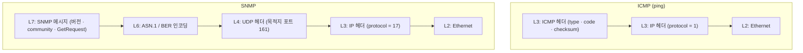

## 질문

NMS가 데이터를 모으는 기본 방법이 ICMP(ping)와 SNMP다. 둘 다 "장비 상태를 확인한다"는데, OSI 계층으로 보면 각각 어디에 있고 그 차이가 실무에서 무엇을 바꾸는가?

> 계층 설명은 [[001_osi_layers|OSI 7계층과 TCP/IP 4계층]], NMS 데이터 수집 방법은 [[Network/003_what_is_nms|NMS란 무엇인가]] 참고

## 답

| 항목 | ICMP | SNMP |
| --- | --- | --- |
| OSI 계층 | **L3 네트워크 계층** | **L7 응용 계층** |
| 아래에서 타는 것 | IP 위에 직접 (IP 프로토콜 번호 1) | **UDP** 위 (L4) → IP (L3) |
| 포트 | 없음 | UDP **161** (조회), **162** (Trap 수신) |
| 알 수 있는 것 | "이 IP까지 패킷이 오가는가", 왕복 시간 | CPU·메모리·포트 상태·트래픽 등 장비 내부 값 |
| 장비 쪽 준비 | IP 스택이면 기본 응답 | SNMP 에이전트 활성화, community 또는 v3 계정 설정 |



## ICMP: L3의 "제어 메시지"

ICMP는 IP 망에서 **오류와 상태를 알리는 L3 제어 프로토콜**이다. 데이터를 나르는 용도가 아니라 "패킷이 못 갔다", "TTL이 다 됐다" 같은 사실을 알린다. 포트가 없기 때문에 L4가 없다.

| Type | 이름 | 쓰이는 곳 |
| --- | --- | --- |
| 8 / 0 | Echo Request / Echo Reply | `ping` |
| 3 | Destination Unreachable | 목적지·포트에 도달 불가 |
| 11 | Time Exceeded | TTL 소진. `traceroute`가 이것으로 경로를 그린다 |

> ICMP를 L3로 분류하는 이유: IP 헤더 바로 다음에 붙고, IP 계층 자체의 동작(라우팅 실패, TTL)을 보고하기 때문이다. 엄밀히는 IP 위에 실리지만 IP와 한 몸으로 동작하는 L3 구성 요소로 본다.

## SNMP: UDP 위의 L7 관리 프로토콜

SNMP는 **장비 내부의 관리 정보(MIB)를 묻고 받는 응용 계층 프로토콜**이다. TCP가 아닌 UDP를 쓴다.

| 동작 | 방향 | 포트 |
| --- | --- | --- |
| Get / GetNext / GetBulk / Set | NMS → 장비 | 장비의 UDP 161 |
| Response | 장비 → NMS | NMS의 출발 포트로 응답 |
| Trap / Inform | 장비 → NMS | NMS의 UDP 162 |

UDP를 쓰는 이유는 가볍기 때문이다. 연결 수립 없이 수천 대 장비를 짧은 주기로 폴링할 수 있다. 대신 L4에서 재전송을 해 주지 않으므로, **재시도와 타임아웃은 NMS(응용 계층)가 직접 처리**한다. Trap은 응답이 없어 유실돼도 모르고, SNMPv2c부터 있는 **Inform**은 수신 확인을 받는다.

## 계층 차이가 실무에서 바꾸는 것

### 1. ping은 되는데 SNMP는 안 된다

L3까지는 정상이고 L4·L7 어딘가가 막힌 상황이다.

| 확인 순서 | 계층 | 원인 예시 |
| --- | --- | --- |
| 1 | L4 | 방화벽·ACL이 UDP 161을 막음 |
| 2 | L7 | 장비에 SNMP 에이전트가 꺼져 있음 |
| 3 | L7 | community 문자열·SNMPv3 계정 불일치, 장비 ACL에 NMS IP 미등록 |

### 2. ping은 안 되는데 SNMP는 된다

보안 정책으로 **ICMP만 차단**한 경우다. 장비는 살아 있지만 NMS가 ping 결과만 보고 "다운"으로 판단할 수 있다. 그래서 NMS는 보통 ping과 SNMP 응답을 함께 보고 장비 상태를 판정한다.

### 3. 방화벽 규칙을 쓰는 방식이 다르다

| 대상 | 규칙 기준 |
| --- | --- |
| ICMP | 프로토콜(ICMP)과 Type으로 허용. 포트 개념 없음 |
| SNMP 폴링 | NMS → 장비 UDP 161 허용 |
| SNMP Trap | 장비 → NMS UDP 162 허용 |

### 4. 패킷 캡처로 확인하기

```bash
# ICMP만 보기 (L3 프로토콜로 필터)
tcpdump -n icmp

# SNMP만 보기 (L4 포트로 필터)
tcpdump -n 'udp port 161 or udp port 162'
```

필터를 거는 기준 자체가 계층 차이를 보여 준다. ICMP는 **프로토콜**로, SNMP는 **포트**로 거른다.

## 정리

- **ICMP**는 IP와 한 몸으로 도는 **L3** 제어 프로토콜이다. 포트가 없고, "도달 가능한가"만 알 수 있다.
- **SNMP**는 **UDP(L4) 위의 L7** 프로토콜이다. 포트 161/162를 쓰고, 장비 내부 값을 알 수 있다.
- 장애를 진단할 때는 아래 계층부터 올라가며 본다. ping(L3) → UDP 161 도달(L4) → SNMP 인증·응답(L7) 순이다.
