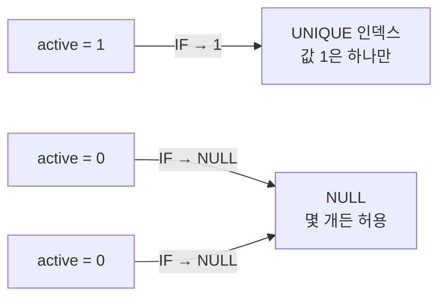

## 의문

"활성 행은 테이블 전체에서 최대 1개"라는 규칙을 DB에서 강제하려고 이런 SQL을 썼다.

```sql
ALTER TABLE account
  ADD COLUMN active_guard TINYINT AS (IF(active = 1, 1, NULL)) PERSISTENT,
  ADD UNIQUE KEY uk_active_guard (active_guard);
```

여기서 `PERSISTENT`는 무엇이고, 이 키워드 없이 `ADD COLUMN`만 해도 되는가?

## 답

- `PERSISTENT`는 **생성 컬럼(generated column)의 값을 디스크에 실제로 저장하라**는 MariaDB 키워드다. 표준 표기는 `STORED`이고, 둘은 같은 뜻이다.
- 키워드를 생략하면 **`VIRTUAL`이 기본값**이다. 가상 컬럼은 테이블에 값을 저장하지 않고 조회할 때마다 계산한다.
- 가상 컬럼에도 인덱스를 걸 수 있다(MariaDB 10.2.3+, MySQL 5.7+ InnoDB). 이때 값은 **인덱스에만** 저장되고, UNIQUE 검사도 정상적으로 이뤄진다.
- 그래서 최신 버전이라면 **생략해도 된다**. 행이 적은 테이블이라면 성능 차이도 사실상 없다.

## 생성 컬럼 저장 방식 비교

| 구분 | `VIRTUAL` (기본값) | `STORED` / `PERSISTENT` |
|---|---|---|
| 값을 계산하는 시점 | 조회할 때 | INSERT / UPDATE 할 때 |
| 테이블 저장 공간 | 사용 안 함 | 사용함 |
| 인덱스를 걸면 | 인덱스에만 값 저장 | 일반 컬럼과 동일 |
| 지원 키워드 | MySQL, MariaDB 공통 | `STORED`: 공통 (MariaDB 10.2.1+) / `PERSISTENT`: MariaDB 전용 |
| 적합한 경우 | 계산이 가볍고 공간을 아끼고 싶을 때 | 계산이 무겁거나, 아주 오래된 버전과 호환해야 할 때 |

> 이식성을 생각한다면 `PERSISTENT` 대신 `STORED`를 쓰는 편이 낫다. MySQL은 `PERSISTENT`를 모른다.

## 이 패턴이 동작하는 이유: UNIQUE는 NULL 중복을 허용한다



| id | active | active_guard |
|---|---|---|
| 1 | 1 | 1 |
| 2 | 0 | NULL |
| 3 | 0 | NULL |

여기에 `active = 1`인 행을 하나 더 넣으면 `active_guard = 1`이 중복되어 **Duplicate entry** 오류가 난다. 반대로 inactive 행은 몇 개를 넣어도 된다. PostgreSQL의 부분 인덱스(`CREATE UNIQUE INDEX ... WHERE active`)를 MySQL/MariaDB에서 흉내 내는 방법이다.

## "조건부 UNIQUE"를 구현하는 방법 비교

| 방법 | DB | 특징 |
|---|---|---|
| 부분 인덱스 `UNIQUE ... WHERE cond` | PostgreSQL, SQLite | 가장 직관적이다. MySQL/MariaDB는 지원하지 않는다 |
| 생성 컬럼 + UNIQUE (이 글) | MySQL 5.7+, MariaDB 10.2+ | 조건에 맞지 않는 행을 NULL로 만들어 UNIQUE 검사에서 빠지게 한다 |
| 함수 기반 인덱스 `UNIQUE ((IF(...)))` | MySQL 8.0.13+ | 내부적으로는 숨겨진 가상 컬럼이다. 컬럼을 따로 추가하지 않아도 된다 |
| 활성 행을 별도 테이블로 분리 | 공통 | `active_account(account_id)` 테이블에 행을 1개만 둔다. 설계가 바뀐다 |
| 애플리케이션 로직 | 공통 | DB를 직접 수정하는 경로는 막지 못한다 |

## 주의할 점: 전환 순서

활성 행을 A에서 B로 옮길 때는 **A를 0으로 바꾼 다음 B를 1로** 바꿔야 한다. MySQL/MariaDB는 UNIQUE 검사를 트랜잭션 끝까지 미루지 않고 문장마다(행마다) 한다. 그래서 B를 먼저 1로 바꾸면 그 순간 중복이 되어 실패한다. `UPDATE ... SET active = (id = ?)`처럼 한 문장으로 처리하는 방식도, 행을 처리하는 순서에 따라 같은 문제가 생길 수 있다.

## 정리

- `PERSISTENT` = `STORED` = 값을 저장하는 생성 컬럼이고, 생략하면 `VIRTUAL`이다.
- 가상 컬럼에도 UNIQUE를 걸 수 있으므로, 최신 버전이라면 키워드를 생략해도 된다.
- 키워드를 쓰려면 이식성을 위해 `STORED`를 쓴다.
- "조건부 UNIQUE"는 조건 밖의 행을 NULL로 만드는 생성 컬럼으로 구현한다.
