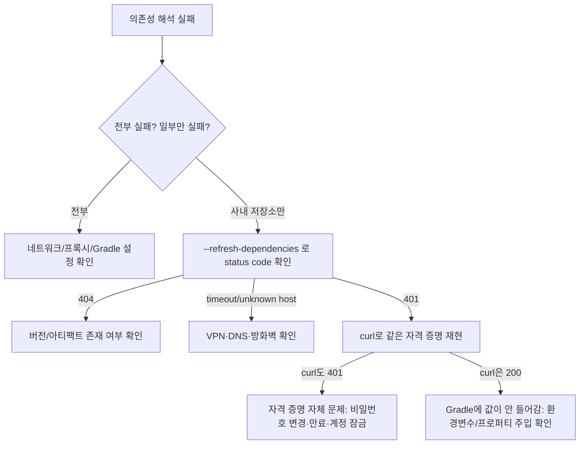

## 증상

IDE에서 프로젝트를 열었더니 `build.gradle`이 의존성을 못 읽는다. 일부 클래스 import가 빨간 줄로 표시되고, `compileJava`도 실패한다.

## 추적

### 1. 어떤 의존성이 실패하는지 좁히기

```bash
./gradlew dependencies --configuration compileClasspath | grep FAILED
```

결과를 보니 **사내 저장소에서 받는 아티팩트만** `FAILED`였다. Maven Central에서 받는 Spring 계열 의존성은 정상이었다. 그래서 build.gradle 문법이나 Gradle 버전 문제가 아니라 **특정 저장소 쪽 문제**라고 판단했다.

### 2. 실제 실패 이유 보기

```bash
./gradlew compileJava --refresh-dependencies
```

```
> Could not GET 'http://<private-repo>/.../lib-core-x.y.z.pom'.
  Received status code 401 from server: Unauthorized
```

`401`은 "인증 실패"라는 뜻이다. 네트워크 단절(timeout, unknown host)이나 아티팩트 없음(404)과는 다른 상황이다.

### 3. Gradle 바깥에서 재현하기

Gradle 설정이 원인인지, 자격 증명 자체가 원인인지 나누기 위해 curl로 같은 요청을 보냈다.

```bash
# 서버가 살아 있는지
curl -s -o /dev/null -w "%{http_code}\n" http://<private-repo>/service/rest/v1/status      # 200

# 같은 자격 증명으로 pom 요청
curl -s -o /dev/null -w "%{http_code}\n" -u "user:$REPO_PASSWORD" http://<private-repo>/.../lib-core-x.y.z.pom   # 401
```

서버는 응답하는데 **curl로 보내도 401**이 나왔다. 그러면 Gradle이 자격 증명을 잘못 전달한 게 아니라, **저장소가 이 계정/비밀번호를 거부하고 있다**는 뜻이다.



## 원인

저장소 계정 비밀번호가 틀렸거나 만료·잠김 상태였다. 환경변수와 `~/.gradle/gradle.properties`에 들어 있는 값이 같았기 때문에, 주입 경로 문제가 아니라 **값 자체가 유효하지 않은 것**이었다.

## 401일 때 흔한 원인 비교

| 원인 | 구별 방법 |
|---|---|
| 비밀번호 변경·만료·계정 잠금 | curl로도 401 |
| 환경변수가 IDE에 안 들어감 (`.zshrc`에만 export, IDE는 Dock에서 실행) | 터미널 `./gradlew`는 성공, IDE만 실패 |
| `?: ""` fallback 때문에 빈 비밀번호로 요청 | 환경변수 미설정 시 조용히 401 |
| 비밀번호에 공백·개행 섞임 | 값의 길이와 공백 여부 확인 |
| 사용자명 오타 | curl로 다른 계정과 비교 |

## 해결 / 주의

- 저장소 관리자에게 비밀번호를 다시 받거나 계정 잠금을 풀어 달라고 요청한다.
- 디버깅하면서 `println "password: ${...}"` 같은 코드를 build.gradle에 넣었다면 반드시 지운다. 빌드 로그나 CI 로그에 평문 비밀번호가 남는다.
- `?: ""` fallback은 "비밀번호 없음"을 401로 숨긴다. 값이 없을 때 바로 실패하게 만드는 편이 원인 찾기 쉽다.
