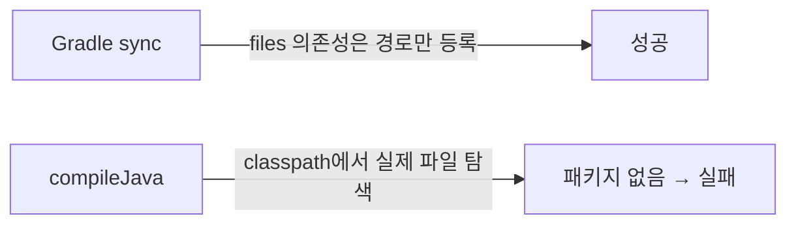

## 증상

- IDE에서 `build.gradle` 새로고침(Gradle sync)은 **성공**
- 그런데 애플리케이션 실행(Run)은 실패

sync가 통과했으니 의존성 문제는 아니라고 생각하기 쉽지만, 실제 원인은 의존성이었다.

## 추적

실행 대신 컴파일만 먼저 돌려 본다.

```bash
./gradlew compileJava -q
```

```
error: package com.example.vendor.crypto does not exist
import com.example.vendor.crypto.ModuleApi;
```

외부 라이브러리 패키지를 찾지 못한다. 해당 라이브러리는 Maven 저장소가 아니라 프로젝트 내 `libs/` 폴더의 jar로 선언돼 있었다.

```groovy
dependencies {
    implementation files('libs/vendor-crypto-1.0.0.jar')
    implementation files('libs/log4jdbc4-1.4.jar')
}
```

`libs/`를 보니 jar가 **하나도 없었다.** `.gitignore`에 `*.jar`가 걸려 있어서 클론한 저장소에는 README만 있었던 것.

## 원인: 왜 sync는 성공했나



| 의존성 선언 방식 | 파일/아티팩트가 없을 때 sync | 컴파일 |
|---|---|---|
| `implementation 'group:name:ver'` (저장소) | **실패** (Could not resolve) | — |
| `implementation files('libs/x.jar')` | **성공** (경고 없음) | 실패 |
| `implementation fileTree(dir: 'libs', include: '*.jar')` | 성공 (빈 트리) | 실패 |

`files()`는 "이 경로를 classpath에 넣어라"라는 선언일 뿐 존재 여부를 검사하지 않는다. 그래서 sync는 조용히 통과하고, 컴파일·실행 시점에야 터진다.

추가로 JDBC 래퍼 드라이버(log4jdbc) jar도 없었는데, 이건 코드에서 import하지 않고 설정 파일의 `driver-class-name`으로만 참조되므로 **컴파일은 통과하고 기동 시점에** `ClassNotFoundException`으로 실패한다. 하나를 고쳐도 다음 단계에서 또 실패하는 구조.

## 해결

1. 누락된 jar를 확보해 `libs/`에 넣는다.
2. 재발 방지로 `files()` 경로 존재를 빌드 시작 시 검사하면 sync 단계에서 바로 드러난다.

```groovy
['libs/vendor-crypto-1.0.0.jar', 'libs/log4jdbc4-1.4.jar'].each {
    if (!file(it).exists()) throw new GradleException("Missing local jar: $it (see libs/README.md)")
}
```

## 정리

- "sync 성공 = 의존성 OK"가 아니다. 로컬 `files()` 의존성은 sync가 검증하지 않는다.
- 실행이 안 되면 `./gradlew compileJava`로 단계를 쪼개 보면 원인이 바로 보인다.
- `.gitignore`의 `*.jar`는 로컬 jar를 조용히 누락시키는 단골 원인이다.
