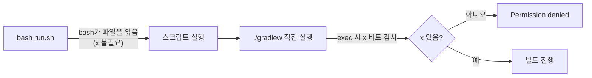

## 증상

로컬 실행용 셸 스크립트를 `bash scripts/run.sh`로 돌리면 빌드 단계에서 바로 실패한다.

```
scripts/run.sh: line 33: ./gradlew: Permission denied
```

스크립트 자체는 `bash`로 실행했으니 문제없이 시작되는데, 그 안의 `./gradlew` 호출에서 막힌다.

## 원인

`./gradlew`처럼 **경로로 파일을 직접 실행**하면 커널이 그 파일의 실행 비트(x)를 검사한다. 확인해 보니 래퍼에 실행 권한이 없었다.

```bash
$ ls -l gradlew
-rw-r--r--  1 user  staff  8714  gradlew     # x 없음

$ git ls-files -s gradlew
100644 ... gradlew                           # git에도 비실행 파일로 기록
```

- 저장소에 `gradlew`가 `100644`(일반 파일)로 커밋되어 있어서 clone/checkout 할 때마다 x 없이 풀린다.
- Windows 환경이나 IDE·압축 도구를 거쳐 래퍼를 생성/복사하면 실행 비트가 흔히 사라진다.
- 반면 `bash scripts/run.sh`는 bash가 파일을 **읽어서** 해석하므로 x가 없어도 돌아간다. 그래서 바깥 스크립트는 실행되고 안쪽 `./gradlew`만 실패한 것.



| 실행 방식 | 실행 비트 필요? |
|---|---|
| `./gradlew` | 필요 (exec) |
| `bash gradlew` / `sh gradlew` | 불필요 (인터프리터가 읽음) |
| `bash scripts/run.sh` | 불필요 |

## 해결

```bash
chmod +x gradlew                      # 로컬 즉시 해결
git update-index --chmod=+x gradlew   # 저장소에 100755로 기록 → 커밋
```

두 번째 명령까지 커밋해야 다른 사람·CI 환경에서도 재발하지 않는다. (`core.fileMode=false`라면 로컬 chmod만으로는 git이 변경을 감지하지 못하므로 `update-index`가 필수.)

임시 우회로는 스크립트에서 `bash ./gradlew ...`로 호출하는 방법도 있지만, 근본 해결은 실행 비트를 저장소에 기록하는 것이다.

## 이어서 만난 에러: GradleWrapperMain을 찾을 수 없음

권한을 고치자마자 다음 에러가 나왔다.

```
Error: Could not find or load main class org.gradle.wrapper.GradleWrapperMain
Caused by: java.lang.ClassNotFoundException: org.gradle.wrapper.GradleWrapperMain
```

`gradlew`는 `gradle/wrapper/gradle-wrapper.jar`를 띄우는 얇은 셸 스크립트일 뿐이라, jar가 없으면 이렇게 실패한다. 원인은 `.gitignore`의 `*.jar` 규칙이었다. 빌드 산출물을 막으려던 규칙이 wrapper jar까지 막아서 저장소에 jar가 아예 올라가 있지 않았다.

```bash
$ git check-ignore -v gradle/wrapper/gradle-wrapper.jar
.gitignore:20:*.jar	gradle/wrapper/gradle-wrapper.jar
```

- 복구: 로컬에 캐시된 같은 버전의 Gradle 배포판(`~/.gradle/wrapper/dists/...`)으로 `gradle wrapper --gradle-version <버전>`을 실행해 jar를 다시 생성
- 주의: `wrapper` 태스크는 `gradlew`/`gradlew.bat`도 새로 쓰기 때문에 기존에 직접 넣어 둔 JVM 옵션(예: `-Dfile.encoding=UTF-8`)이 사라질 수 있다. diff를 확인하고 스크립트는 되돌린 뒤 jar만 남겼다.
- 근본 해결: `.gitignore`에 `!gradle/wrapper/gradle-wrapper.jar` 예외를 추가하고 jar를 커밋
