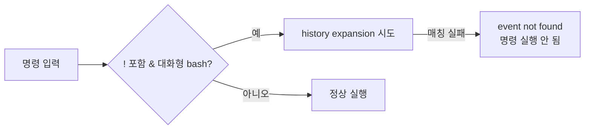

## 증상

컨테이너 안의 DB를 덤프하려고 비밀번호를 커맨드라인에 그대로 넣었더니, 명령이 실행조차 되지 않고 셸이 바로 에러를 냈다.

```bash
docker exec -i db-container mariadb-dump -uuser -pabc123!@# --databases mydb > dump.sql
-bash: !@#: event not found
```

## 원인: bash history expansion

에러는 DB나 docker가 아니라 **bash 자체**가 낸 것이다. 대화형 bash에서는 `!`가 **history expansion**(이전 명령 재사용) 문자다.

| 문법 | 의미 |
|---|---|
| `!!` | 직전 명령 |
| `!n` | history n번 명령 |
| `!str` | `str`로 시작하는 가장 최근 명령 |
| `!$` | 직전 명령의 마지막 인자 |

`!@#`를 "`@#`로 시작하는 이전 명령"으로 해석하려다 찾지 못해서 `event not found`가 나고, 명령 전체가 실행되지 않는다.



참고로 스크립트(`bash script.sh`)에서는 history expansion이 기본으로 꺼져 있어서 이 문제가 생기지 않는다. 대화형 셸에서만 생긴다.

## 해결

```bash
# 1) 작은따옴표로 감싸기 (가장 확실함). 큰따옴표 안에서는 ! 가 여전히 확장된다.
-p'abc123!@#'

# 2) 백슬래시로 이스케이프
-pabc123\!@#

# 3) 현재 셸에서 history expansion 끄기
set +H

# 4) 환경변수로 전달 (history와 ps에 비밀번호가 안 남음)
docker exec -e MYSQL_PWD='abc123!@#' db-container mariadb-dump -uuser ...
```

## 따옴표별 동작 비교

| 표기 | `!` 확장 | `$` 변수 확장 |
|---|:---:|:---:|
| `abc!@#` (따옴표 없음) | O | O |
| `"abc!@#"` (큰따옴표) | **O** | O |
| `'abc!@#'` (작은따옴표) | X | X |
| `abc\!@#` (이스케이프) | X | 해당 없음 |

## 덤으로: `--databases`는 값을 받지 않는다

`--databases=mydb`처럼 쓰면 안 된다. `--databases`는 "뒤에 오는 인자들을 모두 DB 이름으로 본다"는 **플래그**라서 `--databases mydb`처럼 띄어 써야 한다.
