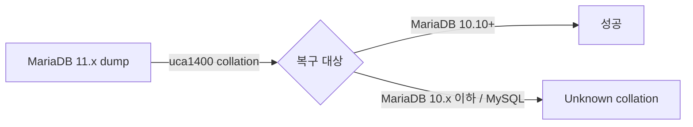

## 증상

신버전 MariaDB에서 `mariadb-dump`로 뜬 덤프를 다른 DB 컨테이너에 `docker exec -i <컨테이너> mariadb ... < dump.sql`로 넣으면 다음 에러가 난다.

```
ERROR 1273 (HY000) at line N: Unknown collation: 'utf8mb4_uca1400_ai_ci'
```

반대 방향(MySQL 8+ 덤프 → MariaDB)에서는 `utf8mb4_0900_ai_ci`로 같은 에러가 난다.

## 원인

collation 이름은 엔진·버전마다 다르다. 덤프 파일에는 원본 서버의 collation이 그대로 적혀 있는데, 복구 대상 서버에 그 collation이 없으면 실패한다.

| collation | 지원 서버 |
|---|---|
| `utf8mb4_general_ci` / `utf8mb4_unicode_ci` | MySQL 5.5+, MariaDB 전 버전 (공통 분모) |
| `utf8mb4_0900_ai_ci` | MySQL 8.0+ 전용 |
| `utf8mb4_uca1400_ai_ci` | MariaDB 10.10+ 전용 (11.x 기본값) |

또 MariaDB 11.x 덤프는 첫 줄에 `/*M!999999\- enable the sandbox mode */`가 붙는데, 구버전 클라이언트나 MySQL은 이 줄에서 문법 에러가 난다.



## 해결

### 1. 대상 서버가 지원하는 collation 확인

```bash
docker exec -i <컨테이너> mariadb -uroot -p -e "SELECT VERSION(); SHOW COLLATION LIKE 'utf8mb4%';"
```

### 2. 덤프의 collation을 공통 collation으로 치환

```bash
sed -e 's/utf8mb4_uca1400_ai_ci/utf8mb4_unicode_ci/g' \
    -e 's/utf8mb4_0900_ai_ci/utf8mb4_unicode_ci/g' \
    -e '/enable the sandbox mode/d' \
    dump.sql > dump_fixed.sql

docker exec -i <컨테이너> mariadb -uroot -p<pw> <db> < dump_fixed.sql
```

macOS BSD sed도 위 형태(출력 리다이렉트)는 그대로 동작한다.

### 3. 근본 해결

- 복구 대상 DB 이미지 버전을 원본과 맞춘다 (가장 깔끔).
- 혹은 원본 테이블을 처음부터 `utf8mb4_unicode_ci`로 명시 생성해 이식성을 확보한다.

## 정리

- `Unknown collation`은 데이터 문제가 아니라 **원본·대상 서버 버전/엔진 불일치** 문제다.
- 덤프 내 collation 목록은 `grep -oE "COLLATE[= ]+[a-z0-9_]+" dump.sql | sort | uniq -c`로 먼저 확인한다.
