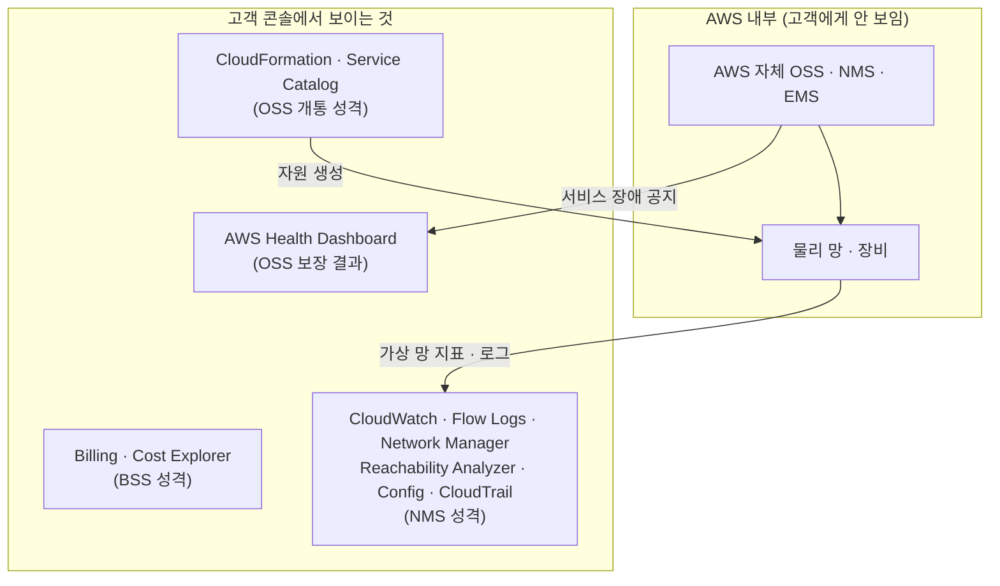

## 질문

망 관리는 보통 EMS → NMS → OSS → BSS 계층으로 나눈다. AWS 콘솔에도 네트워크 모니터링 기능이 많은데, 이건 OSS 계층에 해당하는가?

> 계층 구분은 [[001_nms_oss_architecture|NMS와 OSS의 차이와 연결]] 참고

## 답: 대부분 NMS 계층이다

- **OSS**는 고객에게 **파는 서비스**를 관리한다. 주문 → 개통 → SLA → 장애 티켓 → 과금으로 이어지는 흐름이다.
- AWS 네트워크 모니터링은 **자원(VPC, 서브넷, Transit Gateway, VPN, 로드밸런서)의 상태·트래픽·경로**를 본다. "어느 연결이 문제인가"까지만 보는 **NMS의 시야**다.

통신사에 빗대면 AWS가 망 운영자이고 고객은 그 망을 빌려 쓰는 쪽이다. AWS 내부에는 당연히 자체 OSS·NMS·EMS가 있지만 고객에게는 보이지 않는다. 고객이 보는 것은 **"내 몫의 가상 망"을 관리하는 NMS 화면**이다.

## AWS 네트워크 기능을 FCAPS로 대응하면

NMS 기능은 보통 FCAPS(장애·구성·사용량·성능·보안)로 분류한다. AWS 기능도 이 칸에 그대로 들어간다.

| FCAPS | AWS 기능 | 하는 일 | 전통 NMS 대응 |
| --- | --- | --- | --- |
| F 장애 | CloudWatch Alarms | 지표 임계치 경보 | 알람·통보 |
| F 장애 | Reachability Analyzer | 설정을 분석해 A→B 통신 가능 여부와 막힌 지점 판단 | 경로 진단, 장애 위치 판단 |
| F·P | CloudWatch Network Monitor | 온프레미스–AWS 구간 지연·패킷 손실 측정 | ping·지연 감시 |
| C 구성 | AWS Config | 보안 그룹·라우팅 테이블 변경 이력, 규칙 위반 감지 | 설정 백업·비교 |
| C 구성 | Network Manager (Cloud WAN, Transit Gateway) | 전체 연결 토폴로지, 연결 상태 이벤트 | 토폴로지 맵 |
| A 사용량 | VPC Flow Logs | 누가 누구와 얼마나 통신했는지 | NetFlow / IPFIX |
| P 성능 | CloudWatch Metrics | NAT Gateway·로드밸런서·VPN 터널 처리량·오류·지연 | SNMP 성능 폴링 |
| P 성능 | CloudWatch Internet Monitor | 인터넷 구간에서 사용자가 겪는 지연·가용성 | 종단 간 품질 감시 |
| S 보안 | CloudTrail | 누가 언제 네트워크 설정을 바꿨는지 | 감사 로그 |
| S 보안 | Network Access Analyzer, GuardDuty | 의도치 않은 접근 경로, 비정상 트래픽 탐지 | 보안 관리 |

## 그럼 OSS·BSS 성격의 기능은 없나

모니터링이 아닌 쪽에 있다.

| 계층 | AWS 기능 | 이유 |
| --- | --- | --- |
| BSS | Billing, Cost Explorer | 사용량에 따른 요금 청구 |
| OSS (개통) | CloudFormation, Service Catalog | "이 구성의 망을 만들어 달라"는 요청을 받아 자원을 자동 생성. 주문 → 프로비저닝 흐름 |
| OSS (보장 결과) | AWS Health Dashboard | AWS 내부 OSS가 판단한 서비스 장애를 "내 계정의 어떤 자원이 영향받나" 단위로 알려 주는 창구 |

## AWS를 쓰는 회사 입장의 배치

| 역할 | 맡는 것 |
| --- | --- |
| NMS | CloudWatch 등 AWS 기능, 또는 Datadog·Prometheus/Grafana 같은 외부 모니터링으로 온프레미스와 AWS를 한 화면에 통합 |
| OSS | 회사 ITSM(인시던트 티켓, 변경 관리). CloudWatch 알람 → SNS → 티켓 시스템 연결이 흔함 |

마지막 줄의 "알람 → 티켓" 연결이 전통 망 관리에서 말하는 **NMS → OSS Northbound 연동의 클라우드판**이다.

## 정리

- AWS 콘솔의 네트워크 모니터링은 고객 관점의 **NMS**다.
- AWS 자체 OSS는 고객에게 보이지 않고, 그 결과만 **Health Dashboard**로 나온다.
- 고객 쪽에서 OSS 역할은 **회사 ITSM**이, 개통 역할은 **CloudFormation 같은 IaC**가, BSS 역할은 **Billing**이 맡는다.
