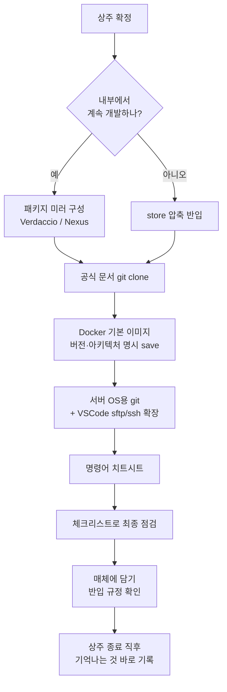

## 배경

몇 달 동안 인터넷이 차단된 폐쇄망 환경에 상주하며 개발했다.

상주 전에는 프론트엔드 monorepo를 폐쇄망에서 설치·빌드할 수 있게 pnpm store를 압축해 가져가는 스크립트를 만들었다. 서비스 전체를 하나의 번들로 묶어 설치 스크립트 한 번으로 올리는 배포 도구도 만들었다. 그 과정의 시행착오는 이 시리즈와 [[Projects/frontend-offline-deployment/index|프론트엔드 오프라인 배포]] 시리즈에 정리해 두었다.

그런데 준비를 아무리 해도 들어가 보면 빠진 게 보인다. 이 글은 **들어가 보니 정말 필요했던 것**, **아쉬웠던 점**, 그리고 의외로 **좋았던 점**에 대한 기록이다.


---

## 환경 제약

폐쇄망 환경이라면 대체로 비슷하게 겪는 제약이다. 이후 내용의 전제가 된다.

| 제약 | 내용 | 결과 |
|---|---|---|
| 망 분리 | 개발 PC는 인터넷 불가. 인터넷 PC가 따로 있어도 쓸 수 있는 범위가 좁다 | 검색·문서 열람이 사실상 어려움 |
| 외부 서비스 제한 | 인터넷 PC에서도 외부 서비스 이용이 제한적 | AI 도구를 쓸 수 없음 |
| 물리 매체 반입 | 필요한 파일은 광디스크 같은 매체에 담아 반입 | 반입 후 내용을 고치기 어려움 |
| 자료 반출 제한 | 내부에서 만든 자료는 밖으로 가지고 나오기 어려움 | 공부한 내용을 기록으로 남기기 어려움 |
| CLI 반영 | 서버에 ssh·sftp로 직접 반영 | 명령어를 외워야 함 |

---

## 1. 들어가 보니 정말 필요했던 것

준비할 때 챙길 목록은 많았다. 그런데 실제로 써 보니 **없으면 일이 멈추는** 것은 세 가지로 좁혀졌다. 나머지 세부 목록은 [[005_airgapped_dev_environment_checklist|폐쇄망 개발 환경 반입 체크리스트]]에 정리했다.

### 1) 공식 문서

폐쇄망 안에서 바로 열어볼 수 있는 문서가 있으면 훨씬 편하다. 프레임워크·라이브러리 공식 문서는 대부분 GitHub에 Markdown으로 관리되고 용량도 작다. 그래서 `git clone`으로 받아가면 Obsidian에서 바로 열고 전문 검색까지 할 수 있다. **가장 가성비가 좋은 준비물**이었다.

### 2) Docker 기본 이미지

node, java(OpenJDK), mariadb, linux(ubuntu 등) 같은 기본 이미지는 두 상황에서 필요했다.

- **새 이미지를 만들 때**: `FROM`에 쓸 베이스 이미지가 내부에 없으면 빌드 자체가 안 된다.
- **반영 전 테스트할 때**: 운영에 올리기 전에 같은 구성을 로컬에서 띄워 봐야 한다.

인터넷이 되는 환경에서는 `docker pull` 한 줄이면 되는 일이다. 폐쇄망에서는 `docker save`로 저장한 tar가 없으면 그 자리에서 막힌다. 버전 태그를 명시해서, 서버의 CPU 아키텍처(amd64 등)에 맞춰 받아가야 한다.

### 3) 패키지 미러 (Verdaccio, Nexus)

상주 전에는 pnpm store를 통째로 압축해 가져가는 방식을 택했다. 정해진 프로젝트를 설치하는 데는 충분했지만, 상주 중에는 한계가 분명했다.

| | store 압축 반입 | 패키지 미러 (Verdaccio / Nexus) |
|---|---|---|
| 준비 | 프로젝트별로 store를 만들어 압축 | 미러 서버 + 패키지 캐시를 반입 |
| 의존성 추가 | ❌ 새 패키지를 넣으려면 다시 반입해야 함 | ✅ 캐시에 있으면 바로 설치 |
| 여러 PC 공유 | 매번 압축 파일을 복사 | 레지스트리 주소만 맞추면 됨 |
| OS별 바이너리 | 준비할 때 대상 OS를 빠뜨리면 누락 | 같은 문제는 있지만 관리 지점이 한 곳 |
| 적합한 경우 | 고정된 프로젝트 1회 설치 | 내부에서 계속 개발하는 경우 |

상주 전 준비 단계에서도 이미 비슷한 문제를 겪었다. store를 만든 OS와 대상 OS가 달라서 native 바이너리가 빠지는 문제, 빌드할 때 외부 폰트 서버로 요청을 보내는 문제 같은 것들이다. 이런 문제는 **"한 번 담아서 가져가는"** 방식에서 특히 치명적이다. 내부에서 개발이 계속되는 상주라면, 처음부터 미러를 구성해 가는 쪽이 맞았다.

---

## 2. 아쉬웠던 점

### 기록과 도구

**① 공부한 걸 기록으로 남기기 어렵다**

자료를 가지고 나오기 어려우니, 내부에서 부딪히고 해결한 것들이 대부분 머릿속에만 남았다. 다음에는 상주가 끝난 **직후 바로**, 일반화한 키워드 수준이라도 기억나는 것을 적어두는 습관이 필요하다.

**② AI를 쓸 수 없다**

평소 개발 흐름의 상당 부분을 차지하던 "모르면 바로 물어보기"가 통째로 사라졌다.

**③ 개발 속도가 느리다**

①과 ②의 결과다. 자동완성 이상의 도움 없이 문서를 뒤지고, 직접 시행착오를 거치며 작성하다 보니 같은 기능도 시간이 몇 배로 들었다.

### 사람과 코드

**④ 원격으로 묻고 답하기는 어렵다**

모르는 코드가 생기면 작성자에게 원격으로 물어봐야 했다. 같은 화면을 보면서 묻는 게 아니면 서로 전달하기가 쉽지 않다. "이 함수에서 이 값이 이렇게 나와요"를 말로만 설명하는 일은 생각보다 어렵고, 답하는 쪽도 코드를 보지 못한 채 기억을 더듬어야 한다.

**⑤ 낯선 코드는 직접 읽으며 익혀야 한다**

처음 보는 코드베이스는 직접 읽으며 파악하는 게 가장 확실했다. 검색도 AI도 없으니 구조를 익히는 데 평소보다 시간이 더 들었다.

> ④와 ⑤를 겪으며, 폐쇄망에서는 **코드 밖에 남겨둔 맥락**(README, 설계 의도, 알려진 이슈)이 큰 도움이 된다는 걸 느꼈다. 나도 다음 사람을 위해 이런 기록을 남겨두려고 한다.

### 반영과 반입

**⑥ 명령어를 외워야 한다**

반영은 CLI로 직접 했다. `ssh`, `sftp`, `zip`/`unzip`, `tar` 같은 명령어와 옵션을 검색 없이 외워서 써야 했다. VSCode의 sftp·ssh 확장을 챙겨갔다면 GUI로 훨씬 편하게 했을 일이다. 다음엔 확장 `.vsix`와 명령어 치트시트를 꼭 챙긴다.

**⑦ 서버용 git을 안 가져갔다**

가장 뼈아픈 실수다. 서버에서 파일을 직접 수정·교체하며 반영하는데 버전 관리가 없으니, **뭐 하나 잘못 치면 되돌릴 방법이 없었다.** 매번 수동으로 백업 복사본을 만들며 조심하는 수밖에 없었다.

다음에 또 간다면 **서버 OS용 git 설치 패키지**(deb/rpm 또는 정적 바이너리)를 반드시 가져간다. 원격 저장소가 없어도, 반영 디렉토리에서 `git init` 후 반영할 때마다 커밋만 해도 롤백 지점이 생긴다.

```bash
cd /path/to/deploy
git init && git add -A && git commit -m "baseline"
# 반영 후
git add -A && git commit -m "release: 기능 A"
# 문제 시
git diff HEAD~1 --stat
git checkout HEAD~1 -- <파일>
```

**⑧ 한 번 구운 디스크는 고칠 수 없다**

반입 매체가 CD-R 같은 한 번 쓰기 디스크면 내용을 고칠 수 없다. 그래서 빠뜨린 게 없는지 확인하고 또 확인하며 신중히 구워야 했다.

"DVD는 안 되나?" 싶어서 찾아보니 이렇게 정리된다.

| 매체 | 용량 | 다시 쓰기 | 비고 |
|---|---|---|---|
| CD-R | ~700MB | ❌ (멀티세션이면 **추가 기록**만 가능) | |
| CD-RW | ~700MB | ✅ 지우고 다시 쓰기 | |
| DVD-R / DVD+R | 4.7GB (DL 8.5GB) | ❌ (멀티세션 추가 기록만) | 용량이 커서 이미지 반입에 유리 |
| DVD±RW | 4.7GB | ✅ | |

- DVD도 **R은 한 번 쓰기**라 수정이 안 되는 건 같다. 다만 용량이 약 7배라 Docker 이미지처럼 큰 파일을 담기 좋다.
- 다시 쓰고 싶으면 RW 계열이 기술적으로는 답이다. 하지만 폐쇄망은 대개 **반입 가능한 매체 종류가 정해져 있다.** 실제로 쓸 수 있는지는 반입 규정을 먼저 확인해야 한다.
- 멀티세션으로 구우면 같은 디스크에 나중에 파일을 **추가**할 수는 있다. 기존 파일을 고치거나 지울 수는 없다.

결국 "한 번에 제대로 담기"가 핵심이다. 그래서 반입 체크리스트를 만들었다.

---

## 3. 좋았던 점(?)

**① 머리를 쓰게 된다**

AI도 검색도 없으니 모든 걸 직접 생각해야 했다. 에러 메시지를 끝까지 읽고, 소스를 따라가고, 가설을 세워 하나씩 확인하는 과정을 오랜만에 온전히 내 힘으로 했다. 느리지만 이렇게 익힌 건 오래 남는다.

**② 일상의 소중함을 알게 된다**

검색 한 번, 질문 한 번, 패키지 설치 한 줄이 얼마나 많은 일을 대신해 주고 있었는지 체감했다. 평소에는 너무 당연해서 보이지 않던 것들이다.

**③ 도파민에서 벗어난 삶을 체험한다**

업무 시간에 인터넷이 없다는 건 알림도 피드도 없다는 뜻이다. 처음엔 답답했지만, 한 가지 일에 오래 집중하는 감각을 되찾은 건 의외의 수확이었다.

---

## 다음에 다시 간다면



| 이번에 | 다음에는 |
|---|---|
| pnpm store 압축 | 패키지 미러(Verdaccio/Nexus) 구성 |
| 서버에 git 없음 | 서버 OS용 git 반드시 반입, 반영 디렉토리 `git init` |
| 명령어 암기 | VSCode sftp·ssh 확장 + 치트시트 |
| 한 번 쓰기 디스크에 신중하게 | 반입 규정 확인 후 용량 큰 매체, 체크리스트로 검증 |
| 낯선 코드 파악에 시간이 듦 | 나도 README·알려진 이슈를 정리해 두고 나오기 |
| 기록이 머릿속에만 남음 | 종료 직후 일반화된 형태로 바로 회고 |

## 맺음말

폐쇄망 개발은 **"인터넷이 대신 해주던 일을 미리 파일로 챙겨가는 일"**이다. 아무리 준비해도 빠진 게 생긴다. 그래도 공식 문서, 기본 이미지, 패키지 미러, 그리고 git만 있으면 대부분은 버틸 수 있다.

불편함 덕분에 오히려 개발을 직접 생각하며 하는 감각을 되찾은 시간이었다.

## 관련 글

- [[005_airgapped_dev_environment_checklist|폐쇄망 개발 환경 반입 체크리스트]]
- [[003_airgapped_deploy_checklist|폐쇄망 배포 체크리스트]]
- [[004_airgapped_deploy_troubleshooting|폐쇄망 배포 트러블슈팅]]
- [[003_pnpm_install_in_airgapped|03. 폐쇄망 pnpm 설치 방법 비교]]
- [[001_pnpm_offline_store_native_binding_missing|pnpm 오프라인 store 네이티브 바이너리 누락]]
