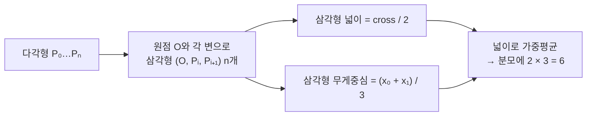

## 의문

지도에서 행정구역 다각형의 라벨 위치를 잡으려고 무게중심을 구하는 코드를 보면, 합계를 `3 * area2`로 나눈다. 세 꼭짓점 평균이라 3으로 나누는 건 알겠는데, 넓이에 왜 3을 곱해서 나누는 걸까?

```ts
let area2 = 0; // 넓이 × 2
for (/* 각 변 (x0,y0) → (x1,y1) */) {
  const cross = x0 * y1 - x1 * y0;
  area2 += cross;
  cx += (x0 + x1) * cross;
  cy += (y0 + y1) * cross;
}
center = [cx / (3 * area2), cy / (3 * area2)];
```

## 답: 실제로는 넓이의 6배(6A)로 나누는 공식이다

`area2`는 넓이가 아니라 **넓이의 2배**다. 그래서 `3 * area2`는 **6A**이고, 이건 다각형 무게중심 공식 그대로다.

$$C_x = \frac{1}{6A}\sum (x_i + x_{i+1})(x_i y_{i+1} - x_{i+1} y_i)$$

## 왜 6A인가: 원점에서 삼각형으로 쪼개기

신발끈 공식(shoelace formula)은 다각형을 **원점 O와 변 하나씩으로 만든 삼각형** (O, Pᵢ, Pᵢ₊₁)들로 쪼개서 계산한다.



| 항목 | 삼각형 하나 (O, Pᵢ, Pᵢ₊₁) | 코드 |
|---|---|---|
| 부호 있는 넓이 | `cross / 2` | `cross = x0*y1 - x1*y0` |
| 무게중심 | `(0 + x0 + x1) / 3` (세 꼭짓점 평균, O는 0) | `(x0 + x1)` |

전체 무게중심은 **각 삼각형의 무게중심을 넓이로 가중평균**한 값이다.

$$C_x = \frac{\sum \frac{cross}{2}\cdot\frac{x_0+x_1}{3}}{A} = \frac{\sum (x_0+x_1)\cdot cross}{6A}$$

- **2**: 삼각형 넓이가 외적의 절반이라서 생긴다.
- **3**: 삼각형 무게중심이 세 꼭짓점의 평균이라서 생긴다.
- 2 × 3 = 6이 분모로 묶여 나온다.

코드는 `/2`와 `/3`을 루프마다 하지 않고 합계를 다 구한 뒤 한 번에 나눈다. `area2 = 2A`이니 `3 * area2 = 6A`가 된다.

## 부호는 신경 쓰지 않아도 되는 이유

- 원점이 다각형 밖에 있으면 일부 삼각형은 음수 넓이가 된다. 이 음수가 다각형 밖으로 튀어나온 부분을 정확히 빼 준다.
- 꼭짓점 순서가 시계 방향이면 `cx`와 `area2`의 부호가 **같이** 뒤집혀서 나눗셈 결과는 그대로다. 그래서 무게중심 계산에는 `Math.abs`가 필요 없고, 넓이를 따로 쓸 때만 절댓값을 붙인다.

## 관련 개념: 다각형의 "중심" 종류

라벨 위치로 무게중심이 항상 정답은 아니다.

| 중심 | 계산 | 특징 |
|---|---|---|
| 꼭짓점 평균 | 꼭짓점 좌표의 단순 평균 | 꼭짓점이 몰린 쪽으로 쏠림 |
| bbox 중심 | 경계 상자의 중앙 | 가장 빠름, 모양 무시 |
| **무게중심 (centroid)** | 위 6A 공식 | 넓이 기준으로 정확. 오목하거나 C자 모양이면 **다각형 밖**에 찍힐 수 있음 |
| 내부 최원점 (pole of inaccessibility) | 경계에서 가장 먼 내부 점 (polylabel 등) | 항상 내부, 라벨 배치에 가장 적합 |
