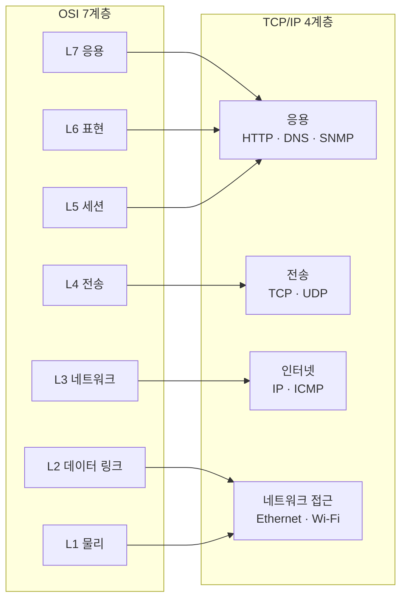

## OSI 7계층이란?

**OSI(Open Systems Interconnection) 참조 모델**은 ISO가 정의한 통신 기능의 7단계 분류다. 실제 인터넷은 더 단순한 TCP/IP 모델로 동작하지만, "몇 계층 문제인가", "L4 로드밸런서"처럼 **계층 번호는 OSI 기준으로 부르는 것이 업계 관례**다.

| 계층 | 이름                    | 맡는 일                          | 데이터 단위           | 주소·식별자   | 대표 프로토콜·장비                   |
| ---- | ----------------------- | -------------------------------- | --------------------- | ------------- | ------------------------------------ |
| L7   | 응용 (Application)      | 사용자·프로그램이 쓰는 서비스    | 메시지                | URL, OID 등   | HTTP, DNS, SSH, **SNMP**, Syslog     |
| L6   | 표현 (Presentation)     | 데이터 형식 변환, 인코딩, 암호화 |                       |               | TLS(일부), ASN.1/BER, JSON           |
| L5   | 세션 (Session)          | 통신 세션 수립·유지·종료         |                       |               | (TCP/IP에서는 응용 계층이 직접 처리) |
| L4   | 전송 (Transport)        | 프로세스 간 전달, 신뢰성·순서    | 세그먼트 / 데이터그램 | **포트 번호** | TCP, UDP / L4 로드밸런서             |
| L3   | 네트워크 (Network)      | 망 사이 경로 찾기(라우팅)        | 패킷                  | **IP 주소**   | IP, **ICMP** / 라우터, L3 스위치     |
| L2   | 데이터 링크 (Data Link) | 같은 망 안에서 다음 장비로 전달  | 프레임                | **MAC 주소**  | Ethernet, Wi-Fi, ARP(경계) / 스위치  |
| L1   | 물리 (Physical)         | 비트를 전기·빛·전파 신호로       | 비트                  |               | 케이블, 광 모듈, 허브                |

## TCP/IP 4계층이란?

**TCP/IP 모델**은 인터넷이 실제로 동작하는 방식을 4개 층으로 정리한 모델이다. 미 국방부 ARPANET 프로젝트에서 나왔고, IETF 표준(RFC 1122)이 이 구분을 쓴다. OSI가 "이론을 먼저 설계하고 프로토콜을 맞춘" 모델이라면, TCP/IP는 "프로토콜이 먼저 있고 계층을 나중에 정리한" 모델이다.

| 계층 | 이름 | 맡는 일 | 데이터 단위 | 주소·식별자 | 대표 프로토콜 |
| --- | --- | --- | --- | --- | --- |
| 4 | 응용 (Application) | 프로그램이 쓰는 서비스. 형식 변환·세션 관리까지 직접 처리 | 메시지 | URL, 도메인 등 | HTTP, DNS, SSH, SMTP, **SNMP**, TLS |
| 3 | 전송 (Transport) | 프로세스 간 전달. 신뢰성(TCP) 또는 단순 전달(UDP) | 세그먼트 / 데이터그램 | **포트 번호** | TCP, UDP, QUIC |
| 2 | 인터넷 (Internet) | 망과 망 사이 경로 찾기, 주소 지정 | 패킷 | **IP 주소** | IPv4, IPv6, **ICMP**, IPsec |
| 1 | 네트워크 접근 (Network Access / Link) | 같은 망 안 전달 + 물리 신호 | 프레임 / 비트 | **MAC 주소** | Ethernet, Wi-Fi, ARP, PPP |

> 교과서에 따라 맨 아래 층을 데이터 링크와 물리로 다시 나눈 **5계층 모델**(응용·전송·네트워크·데이터 링크·물리)도 자주 쓴다. 실무에서 "L2", "L3"라고 부를 때는 이 5계층 또는 OSI 번호를 따른다.

## 두 모델의 대응

| OSI 7계층 | TCP/IP 4계층 | 대응 방식 |
| --- | --- | --- |
| L7 응용 | 응용 | **세 층이 응용 계층 하나로 합쳐짐** |
| L6 표현 | 응용 | 인코딩·암호화를 응용 프로그램이나 라이브러리(TLS, JSON, ASN.1)가 직접 처리 |
| L5 세션 | 응용 | 세션 관리를 응용 프로토콜이 직접 처리 (HTTP 쿠키, TLS 세션 등) |
| L4 전송 | 전송 | **1:1 대응** |
| L3 네트워크 | 인터넷 | **1:1 대응** |
| L2 데이터 링크 | 네트워크 접근 | **두 층이 하나로 합쳐짐** |
| L1 물리 | 네트워크 접근 | TCP/IP는 물리 매체를 따로 정의하지 않고 Ethernet·Wi-Fi 표준(IEEE)에 맡김 |



### 두 모델의 차이

| 항목 | OSI 7계층 | TCP/IP 4계층 |
| --- | --- | --- |
| 만든 곳 | ISO (국제 표준화 기구) | ARPANET 연구 → IETF |
| 만든 방식 | 모델을 먼저 설계, 프로토콜을 나중에 정의 | 프로토콜이 먼저 쓰이고, 모델을 나중에 정리 |
| 계층 수 | 7 | 4 (교과서에 따라 5) |
| 실제 사용 | OSI 전용 프로토콜은 거의 사라짐. **계층 번호와 용어**만 남음 | **인터넷이 실제로 이 구조로 동작** |
| 쓰임새 | 설명·분류·장애 위치 표현 ("L4 문제") | 실제 구현·프로토콜 설계 |

### 경계가 애매한 프로토콜

모든 프로토콜이 한 층에 딱 떨어지지는 않는다. 자주 헷갈리는 것들:

| 프로토콜 | OSI 기준 | TCP/IP 기준 | 애매한 이유 |
| --- | --- | --- | --- |
| ARP | L2와 L3 사이 | 네트워크 접근 | IP 주소(L3)로 MAC 주소(L2)를 찾는 연결 고리 |
| ICMP | L3 | 인터넷 | IP 위에 실리지만 IP 계층의 동작(오류·TTL)을 보고하는 L3 구성 요소 |
| TLS | L5~L6 | 응용 (TCP 위) | 암호화(L6)와 세션 관리(L5)를 함께 맡음. 흔히 "L4와 L7 사이"라고도 부름 |
| OSPF | L3 | 인터넷 | IP 위에 직접 실리는 라우팅 프로토콜 (IP 프로토콜 번호 89) |
| BGP | L7 | 응용 | 경로(L3)를 다루지만 TCP 179번 포트 위에서 도는 응용 프로토콜 |
| QUIC | L4 | 전송 | UDP 위에서 동작하지만 TCP처럼 신뢰성·순서를 직접 구현 |
| SNMP | L7 | 응용 | UDP 위의 관리 프로토콜. 메시지 인코딩(ASN.1/BER)은 L6 성격 |

## 캡슐화: 계층마다 헤더를 붙인다

보내는 쪽은 위에서 아래로 내려가며 헤더를 하나씩 붙이고, 받는 쪽은 아래에서 위로 올라가며 하나씩 뗀다.

```text
L7  [ 응용 데이터 ]
L4  [ TCP/UDP 헤더 | 응용 데이터 ]                    ← 포트 번호
L3  [ IP 헤더 | TCP/UDP 헤더 | 응용 데이터 ]          ← IP 주소, 상위 프로토콜 번호
L2  [ Ethernet 헤더 | IP 헤더 | ... | FCS ]           ← MAC 주소
L1  010110100101...                                   ← 신호
```

## 계층 번호가 실무에서 쓰이는 곳

| 표현                | 의미                              |
| ------------------- | --------------------------------- |
| L2 스위치           | MAC 주소만 보고 전달              |
| L3 스위치 / 라우터  | IP 주소를 보고 경로 결정          |
| L4 로드밸런서       | IP + 포트까지 보고 분산           |
| L7 로드밸런서 / WAF | HTTP 경로·헤더 내용까지 보고 판단 |
| "L1 문제"           | 케이블·광 모듈·포트 물리 장애     |

## 관련 글

- [[002_icmp_snmp_osi_layers|ICMP와 SNMP는 OSI 몇 계층인가]]
- [[network/003_what_is_nms|NMS란 무엇인가]]
