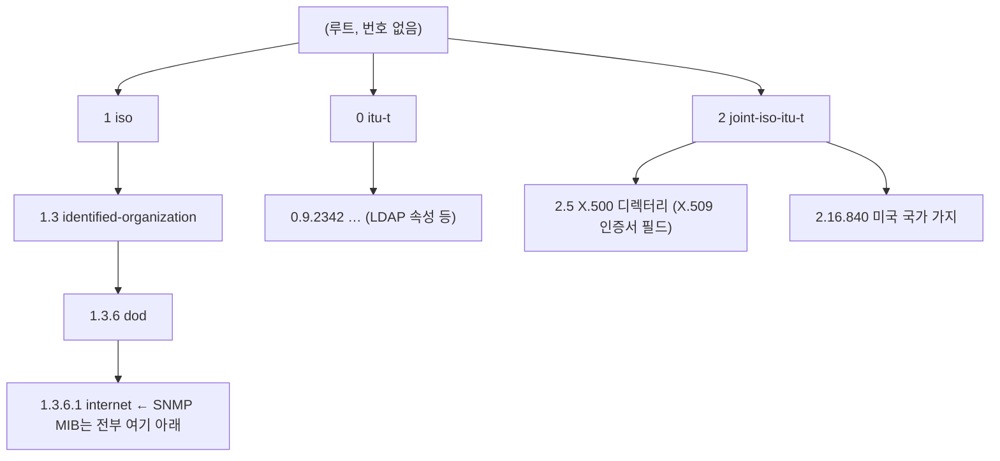

## 의문

SNMP를 다루다 보면 보는 OID가 전부 `1.3.6.1.…`로 시작한다. 그럼 OID 트리는 1부터 시작하는 걸까? 0번 가지는 없을까?

## 답: 0부터 있다. SNMP가 1번 가지만 쓸 뿐이다

OID 트리의 루트에는 번호가 없고, 루트 바로 아래 첫 번째 번호(arc)는 **0, 1, 2 세 개**뿐이다(ITU-T X.660 · ISO/IEC 9834).

| 첫 번호 | 관리 주체 | 실제로 쓰는 예 |
|---|---|---|
| 0 | ITU-T | `0.9.2342.19200300.100.1.25` = LDAP `dc`(domainComponent) |
| 1 | ISO | `1.3.6.1.…` = 인터넷(SNMP MIB 전부), `1.2.840.113549` = RSA(PKCS) |
| 2 | ITU-T와 ISO 공동 | `2.5.4.3` = X.509 인증서의 CN(commonName), `2.25.…` = UUID 기반 OID |

SNMP 관리 정보는 모두 `1.3.6.1`(iso.identified-organization.dod.internet) 아래에 정의돼 있다. 그래서 SNMP만 보면 트리가 1부터 시작하는 것처럼 보인다.

## 함께 알아 둘 것

### 첫 번호가 0·1·2뿐인 이유

| 규칙 | 내용 |
|---|---|
| 첫 번째 arc | 0, 1, 2만 허용 |
| 두 번째 arc | 첫 번호가 0·1이면 **0~39**, 2이면 제한 없음 |
| 이유 | BER 인코딩에서 첫 두 번호를 `40 × 첫째 + 둘째` 한 값으로 합쳐 저장한다. 둘째가 40 이상이면 첫째를 구분할 수 없으므로 0·1 아래는 39까지로 막는다 |

예: `1.3` → 40 × 1 + 3 = 43 = `0x2B`. 그래서 SNMP 패킷의 OID는 거의 항상 `2B 06 01 …`로 시작한다.

### 하위 단계에서도 0을 쓴다

| 위치 | 0의 뜻 | 예 |
|---|---|---|
| 첫 번째 arc | ITU-T 가지 | `0.9.2342…` |
| SNMP 스칼라 끝 | 이 객체의 값 한 개(인스턴스 번호) | `sysName.0` = `1.3.6.1.2.1.1.5.0` |
| SNMP 테이블 끝 | 0이 아니라 행 인덱스가 붙는다 | `ifDescr.3` |

### OID 트리를 쓰는 곳

| 분야 | 가지 | 예 |
|---|---|---|
| SNMP MIB | `1.3.6.1` | `1.3.6.1.2.1.2.2.1.2` = `ifDescr` |
| X.509 인증서 | `2.5.4`, `1.2.840.113549` | CN, 서명 알고리즘 |
| LDAP 스키마 | `0.9.2342`, `2.5.4` | `dc`, `cn` |
| 제조사 MIB | `1.3.6.1.4.1.{번호}` | IANA가 주는 기업 번호(PEN) |

## 정리

- OID 트리는 0·1·2 세 가지로 시작한다. 1부터 시작하는 게 아니다.
- SNMP는 그중 1(iso) 가지의 `1.3.6.1` 아래만 쓰기 때문에 늘 `1.`로 보인다.
- 0은 첫 번째 arc(ITU-T)로도, SNMP 스칼라 인스턴스 번호(`.0`)로도 쓰인다.
