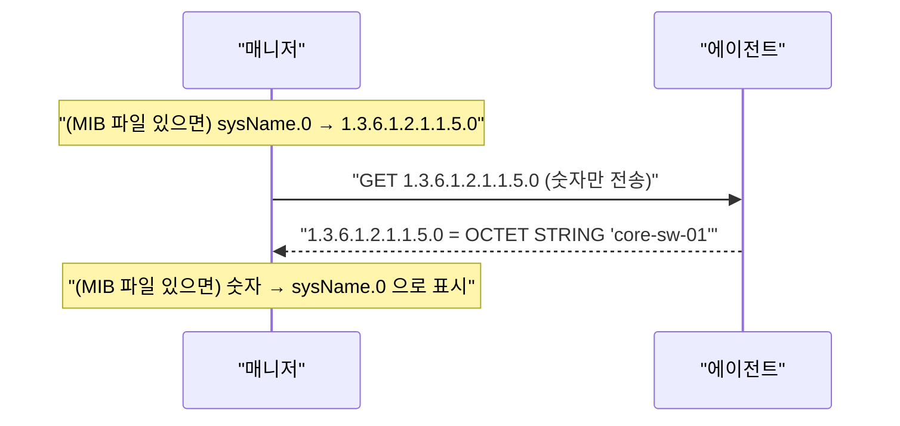

## 의문

SNMP를 공부하면 "매니저가 MIB의 OID로 물어보면 에이전트가 답한다"고 배운다. 그러면 몇 가지가 헷갈린다.

1. MIB는 답하는 쪽(에이전트)이 가지고 있는 건가?
2. 매니저가 처음에 MIB를 받아 와야 질문할 수 있는 건가?
3. 그렇게 물어보면 MIB에 정의된 항목은 다 받을 수 있는 건가?

## 답 1: MIB는 정의서이고, 값은 에이전트에 있다

"MIB"라는 말이 **정의서**와 **장비가 가진 값**을 둘 다 가리켜서 헷갈린다.

| 구분 | 실체 | 어디에 있나 |
|---|---|---|
| MIB 모듈(정의) | "`1.3.6.1.2.1.1.5`는 `sysName`이고 문자열이다" 같은 정의를 적은 텍스트 파일(SMI 문법) | RFC · 제조사 문서, 매니저 쪽 MIB 폴더 |
| 실제 값(인스턴스) | `sysName.0 = "core-sw-01"` | **에이전트**. 제조사가 정의대로 코드를 짜서 펌웨어에 넣은 값 |

에이전트는 MIB 파일을 들고 있지 않다. 정의대로 구현된 값을 가지고 있을 뿐이다.

## 답 2: 매니저는 MIB 없이도 질문할 수 있다

SNMP 메시지에는 **숫자 OID만** 실린다. `sysName` 같은 이름은 패킷에 실리지 않는다.



| 매니저에 MIB 파일이 | 질문 | 응답 해석 |
|---|---|---|
| 있음 | 이름으로 질문 가능 | 이름, 값의 뜻(`ifOperStatus` 1 = up), 단위, 테이블 구조 |
| 없음 | 숫자 OID로 그대로 가능 | 숫자 OID와 원시 값만 보임 |

- MIB 파일은 SNMP로 받는 게 아니다. SNMP에는 그런 기능이 없다. 표준 MIB는 RFC에서 나오고 도구에 기본으로 들어 있으며, 제조사 MIB는 제조사 사이트에서 받아 NMS에 넣는다.
- 장비 종류는 `sysObjectID`로 알아낸다. NMS는 이 값으로 어떤 제조사 MIB와 수집 템플릿을 쓸지 고른다.

```bash
# MIB를 하나도 읽지 않고 숫자로 질문
snmpget -v2c -c public -m "" 10.0.0.1 1.3.6.1.2.1.1.5.0
```

## 답 3: MIB에 있어도 다 받지는 못한다

MIB는 **물어볼 수 있는 목록**이다. 실제로 받는 값은 여러 단계를 거치며 줄어든다.


| 이유 | 설명 | 응답 |
|---|---|---|
| 장비가 구현 안 함 | MIB는 필수·선택 그룹을 나눠 둔다(`MODULE-COMPLIANCE`). 전부 구현할 의무는 없다 | `noSuchObject` |
| 해당 행이 없음 | 포트가 24개면 `ifDescr.25`는 없다 | `noSuchInstance` |
| 권한 밖 | v3 VACM · community별 view가 볼 수 있는 범위를 제한한다 | `noSuchObject`, WALK에서는 안 보임 |
| 원래 읽을 수 없음 | `MAX-ACCESS`가 `not-accessible`(테이블 · 인덱스)이나 `accessible-for-notify`(trap 전용) | 읽기 불가 |
| 버전 제한 | SNMPv1은 64비트 카운터를 못 실어 `ifHCInOctets`를 v1로 못 읽는다 | v1에서 제외 |
| 한 번에 너무 많이 | 응답은 UDP 메시지 하나에 담겨야 한다 | `tooBig` → GetBulk · WALK로 나눠 받기 |
| 값만 오고 의미 없음 | 구현은 했지만 늘 0을 주는 장비도 있다 | 정상 응답 |

### 버전별 "없음" 응답

| v2c / v3 | v1 | 뜻 |
|---|---|---|
| `noSuchObject` | `noSuchName` | 객체가 없거나 볼 권한이 없음 |
| `noSuchInstance` | `noSuchName` | 객체는 있는데 그 행이 없음 |
| `endOfMibView` | `noSuchName` | WALK 중 더 이상 다음 OID가 없음 |

v2c 이상은 항목별로 "없음"을 알려 주고 나머지는 정상으로 돌려준다. v1은 하나만 없어도 요청 전체가 실패한다.

## 정리

- **MIB 정의**는 문서이고, **값**은 에이전트가 가지고 있다.
- 패킷에는 숫자 OID만 실리므로, 매니저는 MIB 파일 없이도 질문할 수 있다. MIB 파일은 사람이 읽고 해석하는 데 쓴다.
- "MIB에 있다"는 "물어볼 수 있다"일 뿐이다. 실제로 받을 수 있는지는 그 장비에 WALK를 돌려 확인해야 안다.

자세한 정리는 [[cs/network/nms/2.collection/1.snmp#mib-정의와-실제-값|SNMP › MIB 정의와 실제 값]], OID 자체는 [[standards/001_oid|OID(Object Identifier)]].
