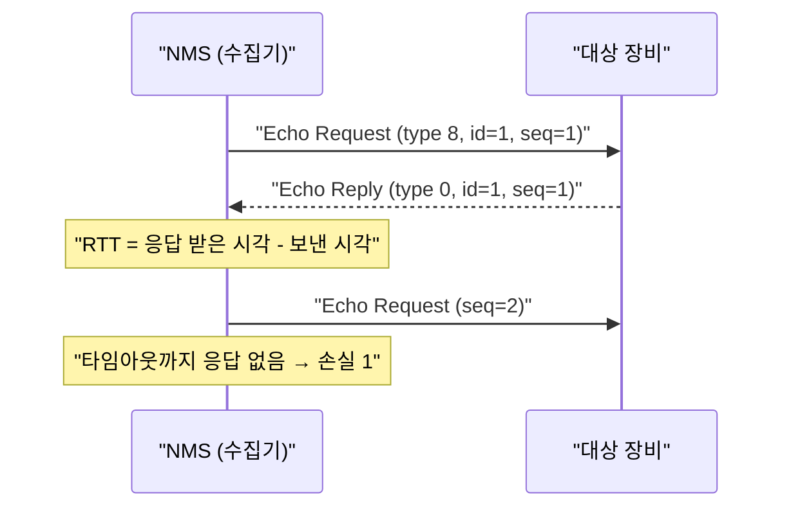

대상에 **ICMP Echo Request**를 보내고 **Echo Reply**가 오는지, 얼마나 걸리는지 보는 가장 단순한 수집 방법. 장비 설정이 거의 필요 없어 NMS 가용성 감시의 기본이다. 수집 방법 전체에서의 위치는 [[cs/network/nms/collection/index|수집]], 측정값으로서의 ping은 [[cs/network/nms/data/monitoring/metric|감시 › 측정값]], 용어는 [[cs/network/nms/glossary|용어]].

## ICMP의 위치

| 항목 | 뜻 | 출처 |
|---|---|---|
| ICMP | IP의 제어·오류 메시지 프로토콜. IP 헤더 바로 위에 실린다(IP 프로토콜 번호 1) | RFC 792 |
| ICMPv6 | IPv6용 ICMP(프로토콜 번호 58). 이웃 탐색(NDP)도 맡아 IPv6에서는 막으면 통신이 깨진다 | RFC 4443 |
| 포트 | **없다.** TCP·UDP가 아니라서 방화벽 규칙도 "ICMP type"으로 연다 | RFC 792 |
| 계층 | L3(네트워크 계층). 응답 = 대상의 IP 스택이 살아 있다는 뜻이지, 서비스가 살아 있다는 뜻은 아니다 | — |



## 메시지 구조

| 필드 | 크기 | 뜻 |
|---|---|---|
| Type | 1바이트 | 8 = Echo Request, 0 = Echo Reply (ICMPv6는 128 / 129) |
| Code | 1바이트 | Echo는 0 |
| Checksum | 2바이트 | ICMP 메시지 오류 검사 |
| Identifier | 2바이트 | 어느 ping 프로세스가 보냈는지(응답을 짝짓는 데 씀) |
| Sequence Number | 2바이트 | 몇 번째 요청인지 → 손실·순서 판단 |
| Data | 가변 | 보낸 그대로 되돌아온다. 보통 보낸 시각을 넣어 RTT를 계산 |

- 기본 크기: Linux `ping`은 데이터 56바이트 → ICMP 64바이트 → IP 84바이트. Windows는 데이터 32바이트, 4회.

### ping과 관련된 다른 ICMP 메시지

| Type | 이름 | 언제 오나 |
|---|---|---|
| 3 | Destination Unreachable | 경로·호스트·포트에 닿을 수 없을 때 라우터나 대상이 보냄 |
| 11 | Time Exceeded | TTL이 0이 됐을 때 라우터가 보냄 → **traceroute**의 원리 |
| 5 | Redirect | 더 좋은 게이트웨이가 있다고 알려줌. 보안상 보통 끈다 |

## 얻는 값

| 값 | 뜻 | 계산 |
|---|---|---|
| 도달성(up / down) | 응답이 오나 | N개 중 하나라도 응답하면 up 등, 제품마다 기준이 다르다 |
| RTT | 왕복 지연 | min / avg / max. 보통 3~5개 보내 평균 |
| 손실률(packet loss) | 몇 %가 안 돌아왔나 | (보낸 수 - 받은 수) ÷ 보낸 수 |
| 지터(jitter) | RTT가 얼마나 흔들리나 | Linux `ping`의 `mdev`(편차). 음성·영상 품질 지표 |
| TTL | 응답 패킷의 남은 홉 수 | 초기값(Linux 64, Windows 128, 네트워크 장비 255)과 비교해 대략의 홉 수·OS를 추정 |

## NMS에서 쓰는 방식

| 관행 | 이유 |
|---|---|
| 주기마다 여러 개 보내기(예: 1분마다 3~5개) | 한 개 유실로 장애 판정하지 않으려고 |
| **연속 N회 실패 시 down** | 일시 손실과 실제 장애 구분. 판정이 그만큼 늦어진다 |
| fping 같은 병렬 도구 | 대상 수천 개를 한 프로세스가 비동기로 보내고 받는다(Zabbix `icmpping`이 fping 사용) |
| ping + SNMP 함께 보기 | ping O · SNMP X = **수집 실패**(설정·인증 문제), ping X · SNMP X = 장비 또는 경로 장애([[cs/network/nms/data/monitoring/metric\|감시 › 측정값]]) |
| 상위 장비 기준 경보 억제 | 코어 스위치가 죽으면 뒤의 장비가 전부 ping 실패 → 원인 장비 하나만 경보(토폴로지가 필요한 이유) |
| 대역 스캔(ping sweep) | 지정 IP 대역에 ping을 돌려 응답하는 주소를 장비 후보로([[cs/network/nms/data/topology/node#등록-경로\|노드 › 등록 경로]]) |

## 한계

| 한계 | 설명 |
|---|---|
| ICMP 차단 | 방화벽·보안 정책이 막으면 살아 있어도 down. Windows는 기본적으로 들어오는 Echo를 막는다 |
| 장비가 ICMP를 뒤로 미룸 | 라우터·스위치는 자기에게 오는 ICMP를 CPU에서 낮은 우선순위로 처리하고 속도 제한(CoPP)을 건다 → **장비 RTT가 높게 나와도 통과 트래픽은 정상**일 수 있다 |
| 서비스 상태는 모름 | IP 스택만 응답해도 성공. 웹·DB가 죽어도 ping은 된다 → TCP 포트·HTTP 확인을 따로 한다 |
| 경로 비대칭 | 왕복 합계만 보이고 어느 방향이 느린지는 모른다 |
| 권한 | ICMP를 직접 만들려면 raw 소켓 = root 또는 `CAP_NET_RAW`. Linux는 `net.ipv4.ping_group_range`로 권한 없는 ICMP 소켓을 허용할 수 있다 |

## 대안·보완

| 방법 | 무엇을 보나 | 언제 쓰나 | 출처 |
|---|---|---|---|
| TCP 접속 확인("TCP ping") | 특정 포트에 SYN을 보내 응답 확인 | ICMP가 막힌 곳, 서비스 포트 확인 | — |
| ARP ping | 같은 L2 망에서 ARP 응답 확인 | ICMP를 막은 호스트도 ARP에는 답한다 | RFC 826 |
| traceroute | TTL을 1씩 늘려 경로의 라우터 목록 | 어느 구간에서 끊기는지 | RFC 792 (Time Exceeded) |
| TWAMP · OWAMP | 양방향 · 단방향 지연·손실을 정밀 측정 | 통신사 SLA, 방향별 지연 | RFC 5357, RFC 4656 |
| 장비 내장 측정 | 장비가 스스로 대상에 ping·지연 측정 후 SNMP로 결과 제공 | 지사 ↔ 본사 구간 품질 | 참고: Cisco IP SLA, DISMAN-PING-MIB(RFC 4560) |

## 보안

- ping 대역 스캔은 IDS에서 **정찰 행위**로 탐지될 수 있다 → 수집기 주소를 보안 담당과 공유([[cs/network/nms/security/collection|보안 › 수집 경로]]).
- 막을 때도 Echo만 수집기 주소에 허용하는 식으로 좁게 연다. ICMP 전체를 막으면 Destination Unreachable·Packet Too Big(경로 MTU 탐색)도 막혀 통신 문제가 생긴다.

## 직접 해보기

```bash
# 5개, 0.2초 간격, 응답 대기 1초
ping -c 5 -i 0.2 -W 1 10.0.0.1
# 대역 전체에서 살아 있는 주소만
fping -a -q -g 10.0.0.0/24
# 대상별 3회 결과 요약
fping -c 3 -q 10.0.0.1 10.0.0.2
# IPv6
ping -6 -c 3 2001:db8::1
# 경로 확인
traceroute -n 10.0.0.1
```
