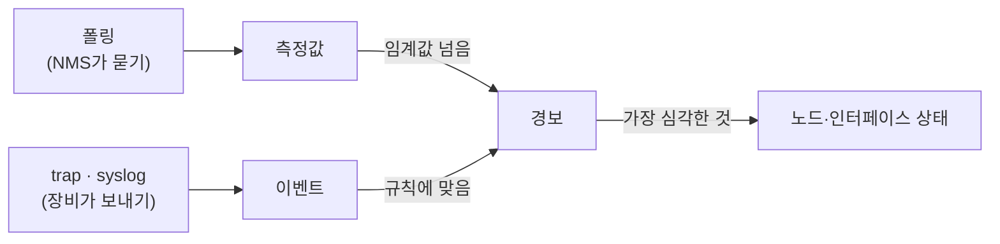

[[cs/network/nms/data/topology/index|토폴로지]]가 **무엇이 있고 어떻게 연결됐나**를 다룬다면, 감시는 그것이 **지금 어떤 상태인가**를 다룬다. 감시 데이터는 토폴로지 객체(노드·인터페이스·링크·서비스)를 **참조**할 뿐, 그 속성이 아니다.

| | 토폴로지 | 감시 |
|---|---|---|
| 데이터 모양 | 객체 + 속성 | 대상 + 시각 + 값([[cs/network/nms/data/monitoring/metric|측정값]]), 대상 + 시각 + 내용([[cs/network/nms/data/monitoring/event|이벤트]]) |
| 바뀌는 빈도 | 가끔(장비 추가, 케이블 변경) | 계속(수십 초~수 분마다) |
| 토폴로지에 남는 것 | — | **결과**만: 노드 상태, 인터페이스 `ifOperStatus`, 마지막 수집 시각 |

## 무엇을 감시하나

| 영역 | 묻는 것 | 예 | 문서 |
|---|---|---|---|
| 가용성 | 살아 있나 | ping 응답·지연·손실, SNMP 응답, 재부팅 | [[cs/network/nms/data/monitoring/metric#가용성|측정값]] |
| 성능 | 얼마나 바쁜가 | CPU, 메모리, 디스크, 인터페이스 트래픽·오류 | [[cs/network/nms/data/monitoring/metric#성능|측정값]] |
| 하드웨어 | 부품은 괜찮나 | 온도, 팬, 전원 공급장치, 광 모듈 수신 세기 | [[cs/network/nms/data/monitoring/metric#하드웨어|측정값]] |
| 이벤트 | 무슨 일이 있었나 | 포트 up/down, 재시작, 로그인 실패 | [[cs/network/nms/data/monitoring/event|이벤트]] |
| 변경 | 무엇이 바뀌었나 | 설정 변경, 모듈 교체, 이웃 변경 | [[cs/network/nms/data/monitoring/event#변경-감지|이벤트]] |

측정값·이벤트가 기준(임계값·규칙)을 넘으면 **경보**가 되고, 경보가 노드 상태를 정한다([[cs/network/nms/data/monitoring/event#경보alarm|경보]]).

## 수집 방식

측정값은 주로 **폴링**(NMS가 묻기: SNMP, ping)과 **텔레메트리**(장비가 보내기: gNMI)로, 이벤트는 **trap · syslog**(장비가 보내기)로 받는다. 서버는 에이전트를 쓰기도 한다. 방식 목록과 방향(pull / push) 비교는 [[cs/network/nms/collection/index|수집]], 주기 · 보관 기간은 [[cs/network/nms/data/resolution|데이터 해상도]].

## 출처 문서

| 문서 | 풀이 | 표준 | 상태 | 쓰는 곳 |
|---|---|---|---|---|
| IF-MIB | Interfaces Group MIB | [RFC 2863](https://www.rfc-editor.org/rfc/rfc2863) | Draft Standard | 인터페이스 트래픽·오류 카운터 |
| SNMPv2-MIB | SNMP version 2 MIB | [RFC 3418](https://www.rfc-editor.org/rfc/rfc3418) | Internet Standard | `sysUpTime`, `coldStart` / `warmStart` trap |
| HOST-RESOURCES-MIB | Host Resources MIB | [RFC 2790](https://www.rfc-editor.org/rfc/rfc2790) | Draft Standard | 서버 CPU·메모리·디스크 |
| ENTITY-SENSOR-MIB | Entity Sensor MIB | [RFC 3433](https://www.rfc-editor.org/rfc/rfc3433) | Proposed Standard | 온도·전압·팬 센서 값 |
| ENTITY-STATE-MIB | Entity State MIB | [RFC 4268](https://www.rfc-editor.org/rfc/rfc4268) | Proposed Standard | 부품 운용 상태 |
| Syslog | Syslog Protocol | [RFC 5424](https://www.rfc-editor.org/rfc/rfc5424) | Proposed Standard | 장비 로그 |
| Alarm YANG | YANG Alarm Management | [RFC 8632](https://www.rfc-editor.org/rfc/rfc8632) | Proposed Standard | 경보 구조 |
| X.733 | Alarm Reporting Function | ITU-T X.733 | ITU-T 권고 | 경보 심각도 |
| UCD-SNMP-MIB | UC Davis SNMP MIB | 참고: Net-SNMP | 표준 아님 | Linux load average, 메모리 |
| 제조사 MIB | 예: CISCO-PROCESS-MIB, CISCO-MEMORY-POOL-MIB, CISCO-ENVMON-MIB | 참고: 제조사 문서 | 표준 아님 | 네트워크 장비 CPU·메모리·환경 |

- **CPU·메모리는 표준 MIB가 약하다.** 서버는 HOST-RESOURCES-MIB, 네트워크 장비는 제조사 MIB를 쓴다. 그래서 NMS 제품은 제조사별 수집 템플릿을 둔다.

## 용어

약어·용어는 [[cs/network/nms/glossary|용어]] 한곳에 모았다.
