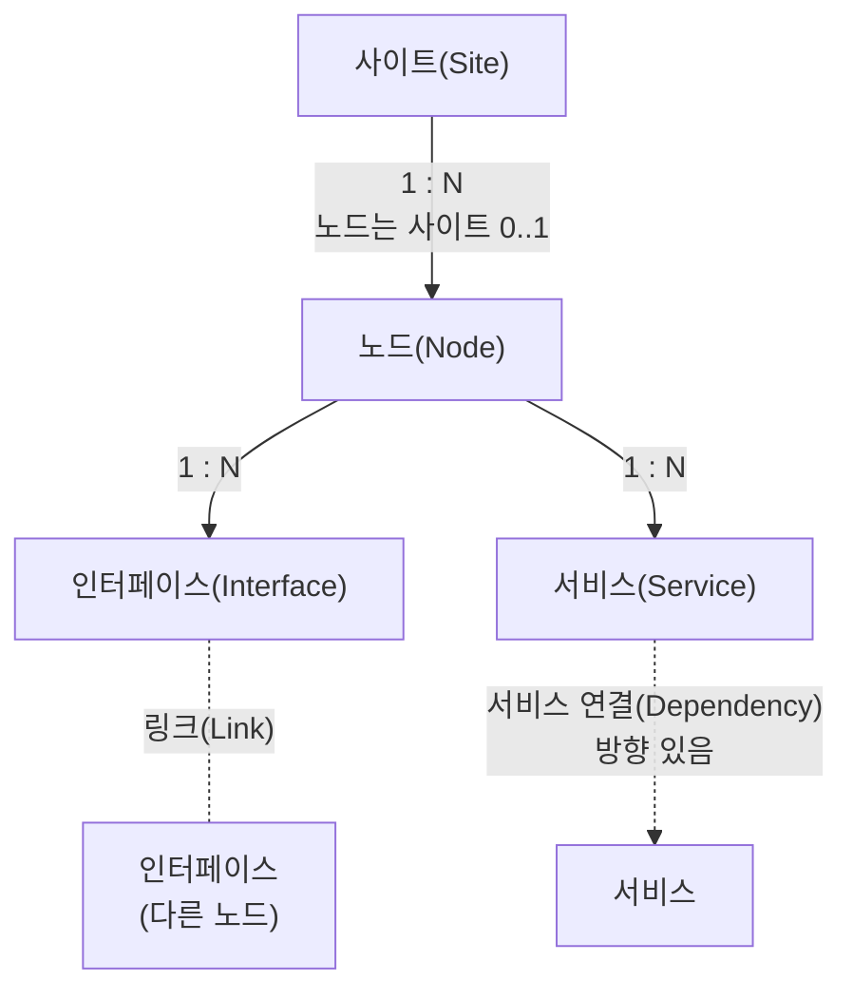

> NMS 토폴로지 맵을 그리는 데 필요한 데이터를 대상별로 정의하고, 각 항목을 정의하는 표준을 출처로 남긴다.

| 대상                                       | 내용                               | 출처                                               |
| ---------------------------------------- | -------------------------------- | ------------------------------------------------ |
| [[cs/network/nms/data/site|사이트(Site)]]                | 장비가 설치된 장소. 지도의 최소 단위, 사이트 간 회선  | ITU-T M.3100, RFC 3418, RFC 8299, RFC 9179       |
| [[cs/network/nms/data/topology/node|노드(Node)]]                 | 장비                               | RFC 8345, RFC 3418, RFC 6933, IEEE 802.1AB       |
| [[cs/network/nms/data/topology/interface|인터페이스(Interface)]]    | 장비의 물리 포트                        | RFC 8345, RFC 2863, RFC 4293, RFC 4363, RFC 4836 |
| [[cs/network/nms/data/topology/link|링크(Link)]]                 | 인터페이스 2개를 잇는 케이블                 | RFC 8345, RFC 2863, IEEE 802.1AB                 |
| [[cs/network/nms/data/topology/service|서비스(Service)]]          | 장비 위의 컨테이너·프로세스                  | RFC 8345 (소속 관계만)                                |
| [[cs/network/nms/data/topology/dependency|서비스 연결(Dependency)]] | 서비스 → 서비스 호출 관계                  | 없음                                               |
| [[cs/network/nms/data/resolution|데이터 해상도(Resolution)]]     | 얼마나 잘게·자주·정밀하게 다루는가              | RFC 2863, RFC 6933, IEEE 802.1AB                 |
| [[cs/network/nms/data/topology/index|토폴로지 데이터 표준(Standard)]]     | RFC 8345 구조, 출처 문서 목록, 용어        | RFC 8345                                         |
| [[cs/network/nms/extension|범위 밖 단위(Extension)]]       | 경보, 인터페이스 계층, 구성품, 측정값, 네트워크 층 등 | RFC 8632, RFC 8343, RFC 8348 외                   |

출처 문서의 상태·링크와 `참고:` 문서는 [[cs/network/nms/data/topology/index#출처-문서|토폴로지 데이터 표준 › 출처 문서]].

## 데이터 관계

실선 = **포함**(부모 하나에 속함, 트리), 점선 = **연결**(양 끝을 참조, 그래프).

- 링크·서비스 연결은 어디에도 속하지 않고 양 끝만 참조한다. 사이트 간 회선은 양 끝 장비의 사이트가 서로 다른 링크다(링크 → 인터페이스 → 노드 → 사이트).
- 범위 밖: 사이트와 노드 사이에 로케이션(건물·층)·랙, 노드와 인터페이스 사이에 하드웨어 구성품이 들어갈 수 있다([[cs/network/nms/extension|범위 밖 단위]]).
