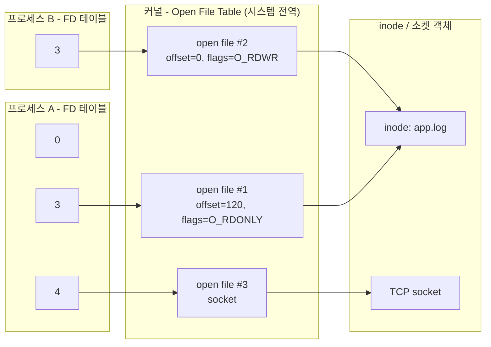

## 의문의 출발

`Too many open files` 에러, `lsof` 출력의 `3u`, `4r` 같은 숫자, "리눅스에서는 소켓도 파일이다"라는 말. 모두 **파일 디스크립터(FD)** 라는 개념으로 이어진다.

> FD는 정확히 무엇이고, 왜 **정수 하나**로 파일·소켓·파이프를 모두 다룰 수 있는가?

결론부터: FD는 **프로세스가 커널에 열어둔 I/O 자원을 가리키는 번호표**다. 실제 자원(파일, 소켓 등)은 커널 안에 있고, 프로세스는 그 자원을 직접 만지지 못한 채 "몇 번 자원에 read 해줘"라고 번호로만 요청한다. 번호 뒤에 무엇이 있는지는 커널이 알아서 처리하기 때문에 정수 하나로 모든 종류의 I/O를 통일할 수 있다.

## FD는 "인덱스"다

`open()`을 호출하면 커널은 자원을 열고, 프로세스의 **FD 테이블에서 비어 있는 가장 작은 번호**를 돌려준다.

```c
int fd = open("app.log", O_RDONLY);  // 예: 3
read(fd, buf, 1024);                 // "3번 자원에서 읽어줘"
close(fd);                           // 3번 반납 → 다음 open에서 재사용
```

프로세스가 시작되면 0, 1, 2번은 이미 열려 있다. 그래서 처음 여는 파일은 보통 3번을 받는다.

| FD | 이름 | 기본 연결 대상 |
|:---:|---|---|
| 0 | stdin | 키보드(터미널) 입력 |
| 1 | stdout | 터미널 출력 |
| 2 | stderr | 터미널 에러 출력 |
| 3~ | - | 프로세스가 직접 연 자원 |

셸의 `2>&1`이 "2번 FD를 1번이 가리키는 곳으로 복제하라"는 뜻인 이유도 여기에 있다.

## 커널 내부의 3단계 구조

FD 번호 하나 뒤에는 커널 자료구조 세 단계가 숨어 있다.



| 단계 | 소속 | 담는 정보 |
|---|---|---|
| **FD 테이블** | 프로세스별 | 번호 → open file 포인터, `close-on-exec` 플래그 |
| **Open File Table** (open file description) | 시스템 전역 | **현재 offset**, 접근 모드(읽기/쓰기), 상태 플래그(`O_APPEND`, `O_NONBLOCK`) |
| **inode / vnode / socket** | 시스템 전역 | 실제 자원: 파일 메타데이터, 데이터 블록 위치, 소켓 버퍼 등 |

이 구조에서 자주 헷갈리는 동작이 설명된다.

- **같은 파일을 두 번 `open()`** → open file 엔트리가 2개 생김 → offset이 **따로** 움직인다 (위 그림의 #1, #2)
- **`dup()` / `fork()`** → FD는 달라도 **같은 open file 엔트리를 공유** → offset도 **공유**된다. 부모·자식이 같은 로그 파일에 써도 서로 덮어쓰지 않는 이유
- **파일 삭제(`rm`) 후에도 열린 FD가 있으면** inode가 살아 있어 디스크 공간이 반환되지 않는다. "파일 지웠는데 `df` 용량이 안 줄어요"의 원인

## 왜 정수 하나로 모든 I/O를 다루는가

유닉스의 설계 철학 **"Everything is a file"** 때문이다. 정확히는 "모든 I/O 자원을 **같은 인터페이스(read/write/close)** 로 다룬다"는 뜻이다.

| 자원 | FD를 얻는 syscall | `lsof` TYPE |
|---|---|---|
| 일반 파일 | `open()` | REG |
| 디렉터리 | `open()` / `opendir()` | DIR |
| TCP/UDP 소켓 | `socket()`, `accept()` | IPv4 / IPv6 |
| 파이프 | `pipe()` | FIFO |
| 디바이스 | `open("/dev/...")` | CHR / BLK |
| 이벤트 감시 | `epoll_create()`, `eventfd()`, `inotify_init()` | a_inode |

덕분에 `read(fd, ...)` 한 줄은 그 뒤가 디스크든 네트워크든 똑같이 동작하고, `epoll` 같은 I/O 멀티플렉싱도 "FD 목록"만 받아서 파일·소켓을 가리지 않고 감시할 수 있다. DB 커넥션이 결국 FD 하나를 점유하는 이유도 같다 ([[004_db_connection_pool_vs_file_descriptor|커넥션 풀과 파일 디스크립터]] 참고).

## FD는 유한한 자원이다

FD는 커널 메모리를 쓰는 자원이라 개수 제한이 있다.

| 제한 | 범위 | 확인 방법 |
|---|---|---|
| soft limit | 프로세스별 (현재 적용값) | `ulimit -n` |
| hard limit | 프로세스별 (soft의 상한) | `ulimit -Hn` |
| 시스템 전체 | 커널 전역 | `cat /proc/sys/fs/file-max` |

기본 soft limit이 1024인 환경이 많아서, 동시 접속이 많은 서버나 커넥션을 많이 여는 애플리케이션은 쉽게 한계에 닿는다. 한계를 넘으면 `open()`·`accept()`가 `EMFILE` 에러를 돌려주고, 애플리케이션에서는 `Too many open files`로 보인다.

원인은 보통 둘 중 하나다.

1. **FD 누수**: `close()`를 안 한 경우. 예외 경로에서 스트림·커넥션을 닫지 않는 코드가 대표적 (Java라면 try-with-resources로 방지)
2. **정상적인 고부하**: 실제로 그만큼 동시 연결이 필요한 경우 → limit 상향

구분은 시간에 따라 FD 수가 **계속 증가만 하는지**(누수) 보는 게 가장 빠르다.

```bash
ls /proc/<pid>/fd | wc -l   # 현재 열린 FD 수
lsof -p <pid>               # 각 FD가 무엇을 가리키는지
```

## 비슷한 개념과의 비교

| 개념 | 환경 | 정체 |
|---|---|---|
| File descriptor | Unix/Linux 커널 | 프로세스별 FD 테이블의 **정수 인덱스** |
| `FILE*` | C 표준 라이브러리 | FD를 감싼 구조체 + **사용자 공간 버퍼** (`fileno()`로 FD 확인 가능) |
| HANDLE | Windows | 커널 객체 핸들. 개념은 같지만 소켓·파일 API가 완전히 통일되진 않음 |
| `FileInputStream`, `Socket` | Java | 내부에 FD(`FileDescriptor` 객체)를 들고 있는 래퍼. `close()` 해야 FD 반환 |

## 정리

- FD는 프로세스가 연 I/O 자원을 가리키는 **정수 번호표**이고, 실제 자원은 커널이 관리한다
- 구조는 **FD 테이블(프로세스별) → Open File Table(offset 보관) → inode/socket(실체)** 3단계
- offset이 어디에 있는지를 알면 `dup()`·`fork()`·중복 `open()`의 동작 차이가 설명된다
- "Everything is a file" 덕분에 파일·소켓·파이프를 같은 syscall로 다룬다
- FD는 유한하므로 누수되면 `Too many open files`로 서비스가 멈춘다
