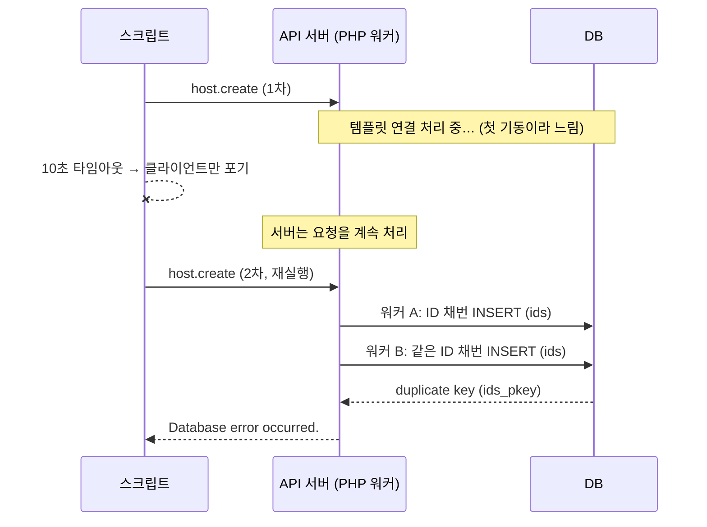

## 증상

모니터링 도구의 JSON-RPC API로 호스트를 등록하는 스크립트를 작성했다. 템플릿을 연결해서 호스트를 생성하는 호출(`host.create`)을 했는데:

1. 첫 실행: HTTP 클라이언트 타임아웃(10초)으로 `TimeoutError`
2. 타임아웃을 늘려서 곧바로 재실행: 약 90초 대기 후 API가 `Database error occurred.` 반환
3. 아무 수정 없이 한 번 더 실행: **정상 동작, 0.5초 만에 완료**

코드는 그대로인데 결과가 세 번 다 달랐다.

## 추적

### 1. DB 로그 확인

```
ERROR:  duplicate key value violates unique constraint "ids_pkey"
STATEMENT:  INSERT INTO ids (table_name,field_name,nextid) VALUES ('hosts','hostid',10683)
```

같은 시각에 **서로 다른 두 DB 세션**(PID 134, 154)이 같은 INSERT를 시도하고 있었다.

### 2. 웹(PHP-FPM) 로그 확인

같은 에러를 **서로 다른 두 PHP 워커**(child 44, child 45)가 동시에 기록했다. 즉 서버 쪽에서 `host.create` 요청 두 개가 동시에 처리되고 있었다.

### 3. 데이터 확인

첫 번째 실행, 그러니까 클라이언트가 타임아웃으로 포기했던 요청의 호스트가 **DB에 생성되어 있었다.**

## 원인



핵심은 두 가지다.

1. **클라이언트 타임아웃은 서버 작업을 취소하지 않는다.** 소켓을 닫아도 서버 프로세스는 요청을 끝까지 처리한다. 1차 요청은 실패한 게 아니라 "결과를 못 받은" 것이었다.
2. 이 애플리케이션은 PK를 DB 시퀀스가 아니라 **별도 채번 테이블(`ids`)에서 직접 관리**한다. 채번 행이 아직 없을 때 두 트랜잭션이 동시에 INSERT하면 한쪽은 unique 제약 위반으로 실패한다. 평소에는 요청이 하나씩 오니까 드러나지 않던 경쟁 조건이다.

세 번째 실행이 0.5초 만에 성공한 이유도 같다. 진행 중인 요청이 없었고, 서비스가 워밍업된 뒤라 템플릿 연결도 빨랐다. 첫 호출이 느렸던 건 컨테이너가 막 뜬 직후의 콜드 스타트였기 때문이다.

## 수정

| 조치 | 이유 |
|---|---|
| API 호출 타임아웃 10초 → 120초 | 무거운 쓰기 작업(템플릿 연결 포함 생성)은 수십 초 걸릴 수 있다. 짧은 타임아웃은 "응답을 못 받은 성공"을 만든다 |
| 생성 전 존재 여부 조회 후 건너뛰기 | 재실행해도 같은 결과가 나오도록 **멱등**하게 만든다. 1차 요청이 이미 만든 호스트는 건너뛴다 |
| 재시도 전에 이전 요청이 끝났는지 확인 | 쓰기 요청을 같은 대상에 겹쳐 보내지 않는다 |

```python
existing = {h["host"] for h in call("host.get", {"filter": {"host": names}})}
for name in names:
    if name in existing:
        continue          # 이전 실행(타임아웃 포함)이 이미 만든 것
    call("host.create", {...})
```

## 정리: 타임아웃과 재시도에서 기억할 것

| 상황 | 실제 서버 상태 | 안전한 대응 |
|---|---|---|
| 응답 성공 | 처리 완료 | — |
| 명시적 에러 응답 | 대부분 롤백됨 | 원인 확인 후 재시도 |
| **클라이언트 타임아웃** | **알 수 없음** (처리 중, 완료, 실패 모두 가능) | 상태 조회 → 없을 때만 재시도 |
| 연결 실패(요청 전송 전) | 처리 안 됨 | 재시도 가능 |

- 타임아웃은 "실패"가 아니라 **"모름"**이다.
- 쓰기 API를 재시도하려면 **멱등성**(존재 확인, 멱등 키, upsert)이 먼저 있어야 한다.
- 처음 호출만 느린 콜드 스타트 구간에서는 짧은 타임아웃이 특히 위험하다.
