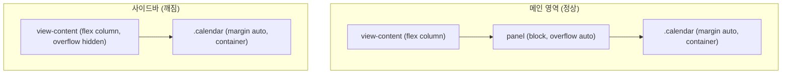

## 증상

달력 컴포넌트를 좁은 폭에서도 보기 좋게 만들려고 CSS container query를 넣었다.

```css
.calendar {
	max-width: 900px;
	margin: 0 auto;
	container-type: inline-size;
}

@container (max-width: 420px) {
	/* 칸 높이 축소, 개수 배지를 점으로 … */
}
```

메인 영역에서는 잘 보였는데, 같은 컴포넌트를 사이드바에 넣자 레이아웃이 완전히 깨졌다.

- 달력 전체가 아주 좁은 세로 띠로 줄어듦
- 요일 이름과 날짜 숫자가 한 칸에 겹쳐 보임
- 아래 task 목록의 한글 문장이 **한 글자씩 세로로** 줄바꿈됨
- 사이드바를 넓혀도 그대로이고, 스크롤도 안 됨

## 추적

두 곳에서 DOM 구조가 달랐다.



메인 영역에는 중간에 블록 요소 래퍼가 하나 끼어 있었고, 사이드바에서는 달력이 flex 컨테이너의 **직속 자식**이었다. container query를 넣기 전에는 사이드바에서도 정상이었으므로 `container-type`과 flex 자식이라는 조건이 겹친 게 원인이라고 좁혔다.

## 원인

두 가지 규칙이 겹쳤다.

1. **세로 flex 컨테이너에서 `margin: auto`인 자식은 늘어나지 않는다**
   - flex column의 자식은 원래 `align-items: stretch`로 가로 폭을 꽉 채운다
   - 그런데 가로 방향 margin이 `auto`이면 stretch가 적용되지 않고, 자식 폭은 **콘텐츠 크기에 맞춘 값(fit-content)** 이 된다
2. **`container-type: inline-size`는 가로 방향 size containment를 건다**
   - container query가 순환 참조(자식이 컨테이너 폭을 바꾸고, 바뀐 폭이 다시 query를 바꾸는)에 빠지지 않도록, 컨테이너의 가로 크기를 계산할 때 **자식 콘텐츠를 무시**한다
   - 즉 이 요소의 콘텐츠 기준 가로 크기는 0으로 취급된다

1번 때문에 폭이 "콘텐츠 크기"로 정해지는데, 2번 때문에 그 콘텐츠 크기가 0이니 결과적으로 폭이 0에 가깝게 접혔다. 폭이 거의 0이니 7열 grid는 겹치고 텍스트는 한 글자마다 줄바꿈됐다.

블록 래퍼 안에서는 `width: auto` 블록 요소가 부모 폭을 채우는 방식(콘텐츠와 무관)으로 폭이 정해져서 문제가 없었다.

여기에 부모의 `overflow: hidden`이 겹쳐, 넘친 내용이 스크롤도 되지 않았다.

## 수정

사이드바에도 메인 영역과 같은 블록 래퍼(스크롤 담당)를 두었다.

```ts
// 사이드바 뷰
const panelEl = contentEl.createDiv({ cls: 'panel' }); // flex: 1; overflow-y: auto;
new CalendarPanel(plugin, panelEl);
```

다른 해결 방법도 있다.

| 방법 | 설명 | 비고 |
|---|---|---|
| 블록 래퍼로 감싸기 | 폭이 부모 기준으로 정해짐 | 채택, 스크롤 문제도 함께 해결 |
| `width: 100%` 지정 | fit-content 대신 명시 폭 | padding이 있으면 `box-sizing: border-box` 필요 |
| `align-self: stretch` + margin 제거 | flex 자식을 다시 늘림 | 가운데 정렬은 내부에서 처리해야 함 |
| 컨테이너를 한 단계 위 요소로 | 폭이 확정된 부모에 `container-type` | 부모가 이미 꽉 찬 폭일 때 가장 깔끔 |

## 정리: size containment가 위험한 위치

`container-type: inline-size`(또는 `size`)를 붙인 요소의 폭이 **콘텐츠에 따라 정해지는 위치**에 놓이면 접힌다.

| 위치 | 폭 결정 방식 | 접힘 여부 |
|---|---|---|
| 일반 블록 (`width: auto`) | 부모 폭을 채움 | 안전 |
| flex column 자식 (stretch) | 부모 폭으로 늘어남 | 안전 |
| flex column 자식 + `margin: auto` | fit-content | **접힘** |
| flex row 자식 (`flex: 0 0 auto`) | 콘텐츠 폭 | **접힘** |
| `display: inline-block`, float, absolute | shrink-to-fit | **접힘** |
| grid 칸 `auto` 트랙 | 콘텐츠 기준 | 접힐 수 있음 |

판단 기준: container query 컨테이너는 **폭이 바깥에서 정해지는 요소**여야 한다. 폭이 안쪽 콘텐츠로 정해지는 요소에 붙이면 containment 때문에 콘텐츠 크기가 0이 되어 무너진다.
