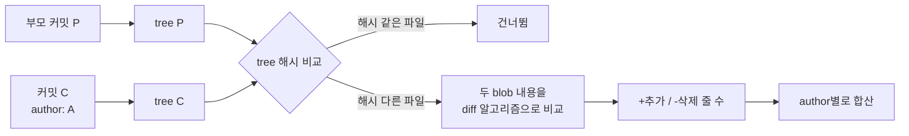

## 의문

Git은 파일이 바뀌면 그 파일을 **통째로** 새로 저장(snapshot)한다고 한다. 그렇다면

1. 100줄짜리 파일의 10번째 줄에 2줄을 추가하면 `git diff`는 100줄이 바뀌었다고 보여주는가?
2. GitHub contributors 화면의 "누가 몇 줄 기여했나"는 어디에 저장돼 있다가 나오는가?

## 답: 저장은 snapshot, diff는 볼 때마다 계산한다

**저장 방식과 표시 방식은 서로 독립**이다. Git은 snapshot만 저장하고, diff나 줄 수 통계는 어디에도 저장하지 않는다. 필요할 때마다 두 snapshot을 비교해서 만들어 낸다.

| 구분 | 동작 |
|---|---|
| 저장 (storage) | 파일이 바뀔 때마다 그 파일 전체를 새 blob 객체로 저장 |
| 표시 (diff) | 두 snapshot을 보는 시점에 비교해 바뀐 부분만 계산 (기본 Myers 알고리즘) |
| 통계 (contributors) | 커밋마다 diff를 계산해 author별로 합산 |

그래서 1번 질문의 답은 **2줄만 보인다**. 내부에는 102줄짜리 blob이 새로 생기지만, `git diff`는 이전 blob과 비교해 `+` 2줄과 주변 context만 출력한다. diff 계산 원리는 [[cs/algorithms/001_myers_diff_algorithm|Myers diff 알고리즘]] 참고.

## 통째로 저장하는데 저장소가 왜 안 커지나

1. **내용 주소 지정(content-addressable) + 중복 제거**: blob의 키는 내용의 SHA-1 해시다. 내용이 같은 파일은 기존 blob을 다시 쓰므로 두 번 저장하지 않는다.
2. **packfile delta 압축**: `git gc`나 push/clone 때 비슷한 blob을 묶어 packfile로 만들면서 증분(delta)으로 압축한다. 디스크상 최종 형태는 사실상 증분에 가깝다.

즉 Git은 **개념상 snapshot이지만, 표시·전송·보관할 때는 diff/delta를 활용**하는 하이브리드 구조다.

## 기여 줄 수는 이렇게 계산된다



1. 커밋마다 **부모 커밋의 tree**와 **자기 tree**를 비교한다.
2. 해시가 같은 디렉터리·파일은 내용이 같으므로 건너뛴다 → 바뀐 파일만 빠르게 골라낸다.
3. 바뀐 파일은 두 blob을 diff로 비교해 **추가 줄 / 삭제 줄**을 센다.
4. 이 숫자를 커밋의 author 기준으로 전부 더한다.

snapshot이라서 통계를 못 내는 게 아니라, snapshot 두 개를 비교하면 diff가 나오므로 통계는 그 **파생값**이다.

```bash
# 특정 author의 추가/삭제 줄 합계
git log --author="이름" --no-merges --numstat --pretty=tformat: \
  | awk '{add+=$1; del+=$2} END {print "+"add, "-"del}'

# 커밋 수 기준 순위
git shortlog -sn --no-merges
```

### GitHub Contributors 그래프의 규칙

| 항목 | 동작 |
|---|---|
| 대상 브랜치 | default 브랜치만 |
| merge 커밋 | **제외**: 부모가 2개라 어느 쪽 기준 diff인지 모호하고 이중 집계됨 |
| 사람 식별 | 커밋 author 이메일 → GitHub 계정에 연결된 이메일만 집계 |
| 계산 시점 | 백그라운드에서 계산 후 캐시 (그래서 처음엔 "계산 중"이 뜸) |

### "수정"이라는 개념은 없다

diff는 **줄 단위**라 한 줄을 고치면 `-1 +1`로 센다. 그래서

- 포매터를 한 번 돌리면 수천 줄의 "기여"가 생긴다.
- 파일 이동, lock 파일, 생성 코드가 숫자를 크게 부풀린다.
- 같은 줄을 여러 번 고치면 매번 다시 센다.

## 관련 개념: 두 가지 "기여 줄 수"

| 지표 | 명령 | 의미 |
|---|---|---|
| **변경량 (churn)** | `git log --numstat` | 지금까지 추가·삭제한 줄의 **누적 합**. GitHub Contributors가 이것 |
| **현재 생존 줄 수** | `git blame` | 지금 코드에서 **각 줄을 마지막으로 바꾼 사람**. 지워진 코드는 안 셈 |

`git blame`도 저장된 값이 아니다. 커밋 이력을 거꾸로 따라가며 "이 줄이 처음 지금 모양이 된 커밋"을 diff로 찾아내는 계산이다.

## 관련 개념: VCS 저장 모델 비교

| 방식 | 대표 | 저장하는 것 | 특정 버전 꺼내기 |
|---|---|---|---|
| delta 기반 | SVN, CVS | 버전 간 차이 | 차이를 차례로 적용 |
| snapshot 기반 | Git | 버전마다 전체 상태 (중복은 해시로 공유) | 해당 커밋의 tree를 바로 읽음 |

## 정리

- Git 저장소에는 **diff도, 줄 수 통계도 저장돼 있지 않다**.
- diff = 두 snapshot을 비교한 계산 결과, contributors = 커밋별 diff의 author별 합.
- 통째로 저장해도 해시 중복 제거와 packfile delta 압축 덕에 저장소가 불지 않는다.
- "누가 많이 바꿨나"(churn)와 "누구 코드가 지금 남아 있나"(blame)는 다른 지표다.
