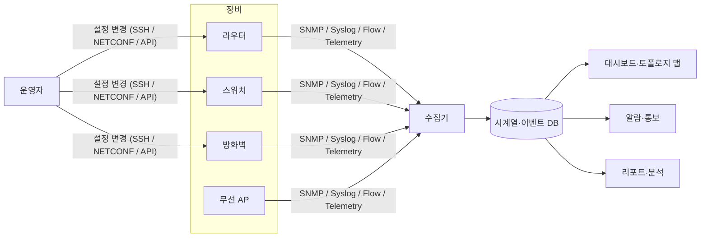

## 질문

NMS(Network Management System)는 정확히 무엇을 하는 시스템이고, 데이터를 어떻게 모으는가?

## NMS란

**NMS** 는 라우터, 스위치, 방화벽, 무선 AP, 서버 같은 네트워크 장비를 한곳에서 **감시·설정·분석**하는 시스템이다. 장애가 나면 알려 주고, 트래픽과 성능을 기록하고, 장비 구성과 자산을 관리한다.

한 줄 요약: "망 전체의 상태를 한 화면에서 보고, 문제를 빨리 알아채고, 원인을 좁히는 도구".

## 관리 영역: FCAPS

ISO/ITU-T가 정의한 네트워크 관리 5대 영역이다. 대부분의 NMS 기능은 이 다섯 칸 중 하나에 들어간다.

| 영역 | 뜻 | NMS의 대표 기능 |
| --- | --- | --- |
| **F**ault | 장애 관리 | 장비 다운·링크 끊김 감지, 알람·이벤트, 장애 이력 |
| **C**onfiguration | 구성 관리 | 장비 설정 백업·배포, 펌웨어 관리, 토폴로지 맵 |
| **A**ccounting | 과금·사용량 관리 | 사용자·부서별 트래픽 사용량 집계 |
| **P**erformance | 성능 관리 | CPU·메모리·대역폭·지연·패킷 손실 추이, 임계치 경보 |
| **S**ecurity | 보안 관리 | 접근 권한, 감사 로그, 비정상 트래픽 탐지 |

**예시 1: 지점 스위치 포트 하나가 끊겼을 때**

- **F**: 스위치가 linkDown Trap을 보냄 → NMS 화면에 빨간 알람, 담당자에게 문자·메신저 통보
- **C**: 토폴로지 맵에서 해당 포트에 어떤 장비가 연결돼 있었는지 확인. 직전에 설정이 바뀌었는지 백업본과 비교
- **P**: 끊기기 전 몇 분 동안 해당 포트의 에러 패킷이 늘고 있었는지 그래프로 확인
- **S**: 누가 언제 그 스위치에 접속해 명령을 넣었는지 감사 로그 확인

**예시 2: 월말 회선 증설 검토**

- **P**: 본사–IDC 구간 회선 사용률이 평일 오후 내내 80%를 넘는다는 리포트
- **A**: 그 트래픽 중 어느 부서·어느 서비스가 많이 쓰는지 집계 → 증설할지, 특정 트래픽을 제한할지 판단

## 데이터를 모으는 방법

| 방식 | 설명 |
| --- | --- |
| ICMP (ping) | 장비가 살아 있는지 확인하는 가장 기본적인 방법. [[cs/network/001_osi_layers\|OSI]] L3 ([[cs/network/002_icmp_snmp_osi_layers\|계층 설명]]) |
| SNMP | 표준 관리 프로토콜. NMS가 주기적으로 값을 묻고(Polling), 장비가 이벤트를 먼저 보내기도 함(Trap). UDP 위의 L7 ([[cs/network/002_icmp_snmp_osi_layers\|계층 설명]]) |
| Syslog | 장비가 남기는 로그 메시지 수집 |
| NetFlow / sFlow / IPFIX | "누가 누구와 얼마나 통신했는지" 같은 흐름(flow) 정보. 트래픽 분석의 핵심 |
| Streaming Telemetry (gNMI 등) | 장비가 데이터를 실시간으로 밀어 보내는 최신 방식. SNMP 폴링보다 촘촘함 |
| CLI / API (SSH, NETCONF, REST) | 설정 조회·변경, 자동화 |



**예시 1: SNMP Polling과 Trap**

NMS가 장비에 "켜진 지 얼마나 됐나(sysUpTime)"를 묻는 요청을 `snmpget`으로 직접 해 보면 이렇다.

```bash
$ snmpget -v2c -c public 192.0.2.1 1.3.6.1.2.1.1.3.0
DISMAN-EVENT-MIB::sysUpTimeInstance = Timeticks: (123456789) 14 days, 6:56:07.89
```

- `1.3.6.1.2.1.1.3.0`은 MIB에 정의된 sysUpTime의 OID(값의 주소)다. 인터페이스 상태는 `ifOperStatus`(1.3.6.1.2.1.2.2.1.8.<포트 번호>), 수신 바이트는 `ifInOctets` 같은 OID로 묻는다.
- NMS는 이런 요청을 보통 1~5분마다 반복해 그래프를 그린다(Polling). 반대로 포트가 내려가면 장비가 `linkDown` Trap을 NMS로 바로 보낸다.

**예시 2: Syslog 메시지**

Cisco 스위치에서 포트가 내려가면 이런 로그가 NMS의 Syslog 수집기로 들어온다.

```text
%LINK-3-UPDOWN: Interface GigabitEthernet0/1, changed state to down
%LINEPROTO-5-UPDOWN: Line protocol on Interface GigabitEthernet0/1, changed state to down
```

`LINK`는 기능, `3`은 심각도(0 긴급 ~ 7 디버그), `UPDOWN`은 이벤트 이름이다. NMS는 심각도와 키워드로 알람 여부를 정한다.

**참고: 장비가 죽으면 Streaming Telemetry도 끊긴다**

텔레메트리는 장비가 밀어 보내는(push) 방식이라, 장비가 다운되거나 관리망이 끊기면 데이터가 오지 않는다. SNMP 폴링도 응답이 없기는 마찬가지지만, 감지 방식이 다르다.

| 방식 | 장비가 죽었을 때 | 감지 방법 |
| --- | --- | --- |
| SNMP 폴링 (pull) | 요청에 응답 없음 | 타임아웃 자체가 증거 |
| Streaming Telemetry (push) | 데이터가 그냥 안 옴 | 침묵을 따로 감지: gRPC 스트림 끊김, gNMI `heartbeat_interval`, 마지막 수신 시각 기준 stale 판정 |

| 장애 유형 | 텔레메트리 | 보완 수단 |
| --- | --- | --- |
| 전원 차단·장비 다운 | ❌ 끊김 | ping·외부 프로브, 이웃 장비의 링크 다운 알람, dying gasp |
| 관리망만 끊김 | ❌ 끊김 | 별도 관리망(OOB), 이웃 장비 데이터로 교차 확인 |
| CPU 과부하 | ⚠️ 지연·일부 누락 | 직전까지의 추세, Syslog |
| 포트·광 모듈 같은 부분 장애, 트래픽 급증 | ✅ 오히려 잘 잡음 | 짧은 주기라 5분 폴링에 안 보이는 변화까지 포착 |

그래서 **장비 내부 상태는 텔레메트리로, 장비 생존 여부는 장비 밖의 수단(ping, 이웃 장비)으로** 함께 판정한다.

## 비슷한 용어 구분

| 용어 | 범위 | 예시 |
| --- | --- | --- |
| EMS (Element Management System) | 특정 제조사 장비만 관리. 보통 장비 회사가 함께 제공 | 통신사가 기지국·전송 장비 제조사의 전용 관리 도구로 그 장비만 관리 |
| **NMS** | 여러 제조사 장비가 섞인 망 전체를 관리 | Cisco 스위치, Juniper 라우터, 다른 회사 방화벽을 Zabbix 같은 도구 한 화면에서 감시 |
| OSS (Operations Support System) | 통신사의 운영 시스템 전체. NMS에 개통·주문·과금 등이 더해짐 | 인터넷 회선 신청 → 장비 포트 할당·설정 → 개통 → 요금 청구까지 이어서 처리 |
| AIOps / 자율 네트워크 | AI로 이상 징후를 예측하고, 원인 분석·조치까지 자동화하는 최근 흐름 | 이상 징후를 찾아 대응 방안을 자동 추천하는 AI 관제 |

NMS와 OSS의 구조와 연결 방식은 [[001_nms_oss_architecture|NMS와 OSS의 차이와 연결]]에서 이어서 다룬다.
