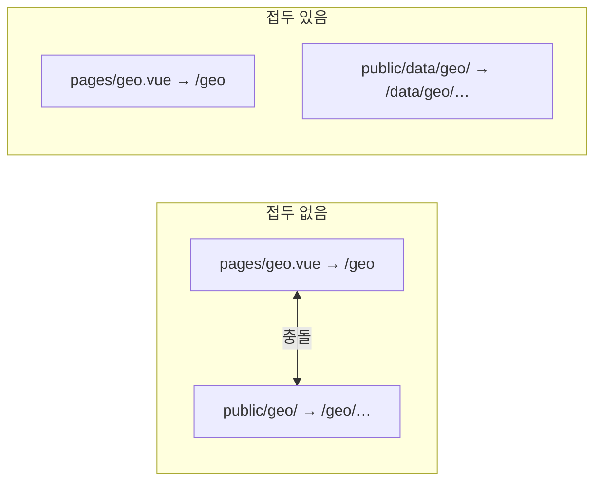

## 의문

Nuxt에서 `pages/geo.vue`(→ `/geo`)와 `public/geo/` 폴더를 함께 두었더니, `/geo`로 들어갈 때 서버가 `/geo/`로 돌려보냈다.
폴더 이름을 바꾸면 이번 문제는 피할 수 있다. 하지만 다음에 같은 이름의 페이지가 생기면 또 겹친다.
**public 경로와 페이지 경로가 겹치지 않게 하려면 보통 어떻게 할까?**

## 답: 정적 파일을 페이지가 절대 쓰지 않을 접두 경로 하나 아래로 모은다

`public/`의 파일은 **사이트 루트(`/`)에 그대로** 올라간다. 그래서 `public/geo/a.json` → `/geo/a.json`이 되고, 페이지 경로와 같은 공간을 나눠 쓴다.
겹치지 않으려면 둘 중 한쪽이 쓰는 공간을 정해 두면 된다. 보통은 정적 파일 쪽에 접두 경로를 붙인다.



## 방법 비교

| 방법 | 예시 | 특징 |
|---|---|---|
| **1. 전용 폴더 하나에 모으기** | `public/data/geoJson/…` → `/data/geoJson/…` | 가장 흔하고 단순하다. `public` 바로 아래에는 이 폴더 하나(와 `favicon.ico` · `robots.txt` 같은 루트 파일)만 두고, 페이지 이름에는 이 단어를 쓰지 않기로 정한다 |
| **2. `_` 접두** | `/_data/…`, `/_geo/…` | 프레임워크가 쓰는 관례다. Nuxt는 빌드 결과물을 `/_nuxt/`에, Next.js는 `/_next/`에 둔다. 페이지 경로에 `_`를 쓸 일은 거의 없어서 겹칠 걱정이 없다 |
| **3. 서버 설정으로 경로 붙이기** | `nitro.publicAssets: [{ dir: 'geo-data', baseURL: '/_geo' }]` | 폴더 위치와 URL을 따로 정할 수 있다. 대신 설정이 하나 늘어난다 |
| **4. 다른 도메인으로 빼기** | `static.example.com/…`, CDN | 경로가 아예 겹칠 수 없다. 운영 규모가 커질 때 쓴다 |

## 고를 때

- **대부분 1번이면 충분하다.** 폴더 하나와 "그 단어는 페이지에 안 쓴다"는 규칙만 있으면 된다.
- 폴더 이름만 바꿔서 피하는 방법(예: `public/geo` → `public/geoJson`)은 당장은 해결된다. 하지만 "이름이 안 겹치게 조심한다"에 기대는 방식이라, `public/img`가 있는데 `/img` 페이지를 만들면 같은 문제가 다시 생긴다.
- 정적 파일 경로를 코드에 직접 쓰지 말고 `runtimeConfig.public`에 두면 좋다. 접두 경로를 바꾸거나 4번처럼 CDN으로 옮길 때 값 하나만 바꾸면 되고, 다시 빌드하지 않고 환경변수(`NUXT_PUBLIC_…`)로 덮어쓸 수도 있다.

```ts
// nuxt.config.ts
runtimeConfig: {
  public: {
    geoJson: { path: '/data/geoJson' } // NUXT_PUBLIC_GEO_JSON_PATH 로 덮어쓰기 가능
  }
}

// 사용하는 곳
const { geoJson } = useRuntimeConfig().public;
await $fetch(`${geoJson.path}/index.json`);
```
