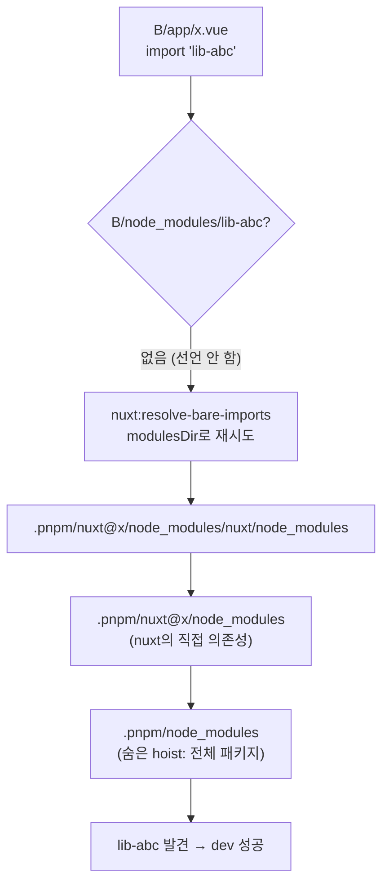

## 의문

Nuxt 앱 두 개가 있다.

- 앱 A: Nuxt layer를 사용한다. layer의 `package.json`에는 `lib-abc`가 있다.
- 앱 B: layer를 쓰지 않는다.

두 앱 모두 자기 `package.json`에는 `lib-abc`가 **없는데** 코드에서 `import ... from 'lib-abc'`를 한다. 패키지 매니저는 pnpm이고 `shamefully-hoist=false`다.

앱 B에서 `pnpm install` → `nuxt dev`는 정상이었는데 `nuxt build`에서 에러가 났다. **선언하지도 않은 패키지를 dev 서버는 왜 찾았을까?**

## 답

두 가지가 겹쳐서 dev에서만 우연히 해석된 것이다.

1. **pnpm의 숨은 hoist**: `shamefully-hoist=false`는 루트 `node_modules`로 꺼내는 *public* hoist만 끈다. 기본값 `hoist=true` 때문에 모든 패키지는 여전히 `node_modules/.pnpm/node_modules`에 링크된다. `lib-abc`가 B의 의존성 트리 어딘가에 전이 의존성으로 있으면 디스크에는 존재한다.
2. **Nuxt의 bare import fallback**: Nuxt의 Vite 플러그인 `nuxt:resolve-bare-imports`(`enforce: 'post'`)는 Vite가 못 찾은 bare import를 `nuxt.options.modulesDir`에서 한 번 더 찾는다. modulesDir에는 **nuxt 패키지 자신의 경로**(`.pnpm/nuxt@x/node_modules/nuxt/node_modules`)가 들어 있고, Node 해석 규칙대로 부모 폴더로 올라가다 보면 `.pnpm/node_modules`, 즉 숨은 hoist 폴더에 닿는다.



build가 실패하는 이유는 이 우회를 거치지 않는 단계가 있기 때문이다.

- dev는 **요청한 모듈만 그때그때 변환**한다(lazy). 서버가 떴다고 모든 import가 해석된 건 아니다.
- build는 **그래프 전체를 한 번에 번들링**하고, 서버 번들(Nitro)·externals 추적처럼 Nuxt의 Vite fallback과 다른 해석기를 쓰는 단계가 있다. 여기서는 소스 파일 기준의 엄격한 해석만 하므로 `lib-abc`를 못 찾는다.

어느 단계에서 깨졌는지는 build 에러 메시지(`Rollup failed to resolve import ...`인지, 서버 번들/trace 단계인지)로 확인한다.

## pnpm hoist 관련 설정 정리

| 설정 | 기본값 | 링크 위치 | 앱 코드에서 보이나 |
|---|---|---|---|
| `hoist` | `true` | `node_modules/.pnpm/node_modules` | ✗ (의존성 패키지 안에서만 보임) |
| `hoist-pattern` | `['*']` | 위와 동일, 대상 패턴 | ✗ |
| `public-hoist-pattern` | `[]` (pnpm 10부터. 9 이하는 eslint·prettier 계열) | 루트 `node_modules` | ✓ (패턴에 맞는 것만) |
| `shamefully-hoist` | `false` | 루트 `node_modules`에 전부 | ✓ (npm처럼 평평하게) |

`shamefully-hoist=false`라도 숨은 hoist는 살아 있다. 그래서 "의존성 패키지의 경로"를 출발점으로 해석하는 도구가 있으면 선언 안 한 패키지가 보인다.

## shamefully-hoist=false인데 왜 유령 의존성이 생겼나

`shamefully-hoist`는 **어디까지 꺼내 보여줄지**를 정하는 설정이지, 유령 의존성을 완전히 막는 설정이 아니다.

- 실제 설치 결과(`node_modules/.modules.yaml`)를 보면 pnpm 10 기본값은 `hoistPattern: ['*']`, `publicHoistPattern: []`다. 한 프로젝트에서 800개가 넘는 패키지가 `private`(숨은 hoist)로 올라가 있었다.
- `private`은 "앱 코드에서는 안 보이지만 `.pnpm` 안의 패키지들끼리는 보인다"는 뜻이다. 의존성을 빠뜨린 채 배포된 패키지가 많아서 pnpm이 일부러 열어 둔 안전망이다.
- 이 안전망은 **어디서부터 찾느냐**로만 막힌다. 앱 소스에서 출발하면 안 보이고, `.pnpm` 안의 패키지 경로에서 출발하면 보인다. Nuxt의 fallback은 nuxt 패키지 경로에서 출발하므로 앱 코드가 이 안전망을 빌려 쓴 셈이다.

| 경우 | `shamefully-hoist=false`로 막히나 | `hoist=false`로 막히나 |
|---|:---:|:---:|
| 앱 코드가 B/node_modules에서 직접 찾기 | ✓ (원래 안 보임) | ✓ |
| 도구가 `.pnpm` 안 패키지 경로에서 찾기 (숨은 hoist 경유) | ✗ | ✓ |
| lib-abc가 nuxt 자신의 직접 의존성 | ✗ | ✗ (`.pnpm/nuxt@x/node_modules` 형제로 존재) |

`hoist=false`로 숨은 hoist까지 끄면 dev에서도 바로 실패해서 문제를 일찍 발견할 수 있다. 다만 의존성 선언이 잘못된 서드파티 패키지가 함께 깨질 수 있으므로, 근본 해결은 여전히 **앱 package.json에 직접 선언**하는 것이다.

## layer를 쓰는 앱 A는 왜 build도 되나

Nuxt는 layer마다 **`<layer 루트>/node_modules`를 `modulesDir`에 추가**한다(앱 루트와, 앱 안의 `layers/` 폴더에서 자동 인식된 layer는 제외). 그리고 이 `modulesDir`은 Vite fallback뿐 아니라 Nitro 서버 빌드에도 `nodeModulesDirs`로 그대로 넘어간다.

| | 앱 A (layer 사용) | 앱 B (layer 없음) |
|---|---|---|
| `modulesDir`에 들어간 경로 | `A/node_modules`, nuxt 패키지 경로, **`layer/node_modules`** | `B/node_modules`, nuxt 패키지 경로 |
| lib-abc가 **그 폴더 바로 안에** 있나 | ✓ `layer/node_modules/lib-abc` (layer가 직접 선언) | ✗ 부모로 한참 올라가야 `.pnpm/node_modules`에 있음 |
| dev (부모로 올라가며 찾는 fallback) | ✓ | ✓ (우연히) |
| build (등록된 폴더 안만 보는 단계) | ✓ | ✗ |

즉 A는 **lib-abc를 직접 선언한 쪽(layer)의 node_modules가 Nuxt에 정식으로 등록돼 있어서** build의 엄격한 단계도 통과한다. B는 숨은 hoist까지 부모로 올라가는 dev fallback에서만 우연히 찾아졌다.

> 빌드 해석기가 `nodeModulesDirs`를 부모로 올라가지 않고 그 폴더 안만 본다는 부분은 동작으로 추정한 것이다. 정확한 실패 단계는 B의 build 에러 메시지로 확인한다.

주의할 점:

- layer를 **로컬 경로나 별도 저장소**로 가져와 그 안에서 `pnpm install`한 경우라야 `layer/node_modules/lib-abc`가 생긴다.
- layer를 **npm 패키지로 설치**하면 pnpm 구조상 lib-abc는 `layer/node_modules`가 아니라 `.pnpm/layer@x/node_modules/lib-abc`(layer의 형제)에 놓인다. 이때는 A도 B처럼 build에서 깨질 수 있다.
- 어느 쪽이든 앱 코드가 직접 import하는 패키지라면 앱 package.json에 선언해 두는 편이 가장 안전하다.

## 폐쇄망 store는 관계없나

pnpm store는 설치 때 복사·링크할 원본일 뿐, 실행 중 모듈 해석에는 쓰이지 않는다. B의 `.pnpm`에 `lib-abc`가 있다는 건 B의 lockfile 그래프에 (전이 의존성으로) 들어 있다는 뜻이다. 반대로 트리 어디에도 없었다면 dev에서도 실패했을 것이다.

## 해결

- **정답**: B의 `package.json`에 `lib-abc`를 직접 추가하고, 폐쇄망 store에도 해당 버전이 들어가게 다시 받아 간다.
- **임시방편**: `public-hoist-pattern[]=lib-abc`로 루트에 꺼내기. 유령 의존성을 숨길 뿐이라 권장하지 않는다.
- layer를 쓰는 앱 A도 앱 코드에서 직접 import한다면 원칙적으로는 같은 문제다. layer의 의존성은 layer의 것이므로, 앱이 직접 쓰는 패키지는 앱에도 선언하는 편이 안전하다.

## 확인 명령

```bash
ls node_modules/lib-abc                    # 없음 → 직접 의존성 아님
ls node_modules/.pnpm/node_modules/lib-abc # 있음 → 숨은 hoist로만 존재
pnpm why lib-abc                           # 누가 끌고 왔는지
```
