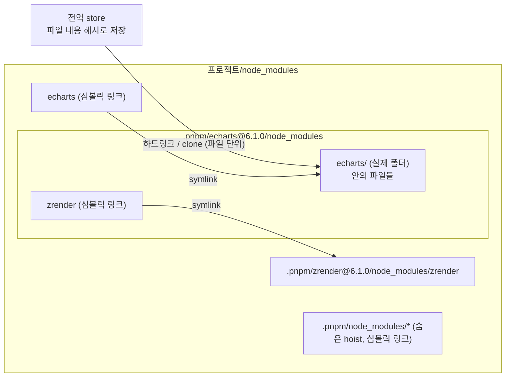

## 의문

pnpm은 "전역 store에 패키지를 한 번만 저장하고 프로젝트에는 링크를 건다"고 한다. 그런데 설명마다 하드링크라고도 하고 심볼릭 링크라고도 한다. 둘 중 무엇을 쓰는 걸까? 왜 두 가지를 섞어 쓰나?

## 답: 파일은 하드링크, 폴더 구조는 심볼릭 링크

**하드링크는 store → `.pnpm` 안의 "파일"**, **심볼릭 링크는 `node_modules` 안의 "폴더 구조"**에 쓴다.



| 링크 | 위치 | 대상 | 이유 |
|---|---|---|---|
| **하드링크** | `.pnpm/<pkg>@<ver>/node_modules/<pkg>/` 안의 **각 파일** | 전역 store의 같은 파일 | 디스크에 한 번만 저장하고 여러 프로젝트가 공유 (용량·설치 속도) |
| **심볼릭 링크** | `node_modules/<pkg>` (직접 의존성) | `.pnpm/<pkg>@<ver>/node_modules/<pkg>` | package.json에 선언한 것만 루트에 노출 (엄격성) |
| **심볼릭 링크** | `.pnpm/<pkg>@<ver>/node_modules/<dep>` | `../../<dep>@<ver>/node_modules/<dep>` | 각 패키지가 자기 의존성만 형제로 보게 함 |
| **심볼릭 링크** | `.pnpm/node_modules/*` (숨은 hoist) | 각 패키지 폴더 | 의존성을 잘못 선언한 패키지를 위한 안전망 |
| **심볼릭 링크** | workspace 패키지 (`workspace:*`) | 로컬 패키지 폴더 | 소스 수정이 바로 반영 |

## 왜 나눠 쓰나

- **하드링크는 폴더에 걸 수 없다.** 그래서 파일은 하드링크로 내용을 공유하고, 폴더 배치(누가 누구를 볼 수 있는지)는 심볼릭 링크로 만든다.
- **하드링크는 같은 파일시스템(볼륨) 안에서만 된다.** store와 프로젝트가 다른 디스크에 있으면 pnpm은 복사로 바꾼다. 그래서 store는 디스크마다 하나씩 생긴다.
- **Node는 심볼릭 링크를 실제 경로(realpath)로 바꿔 해석한다.** echarts 안에서 `import 'zrender'`를 하면 실제 위치 `.pnpm/echarts@6.1.0/node_modules/echarts`에서 위로 올라가 형제 `zrender`를 찾는다. 더 올라가면 `.pnpm/node_modules`(숨은 hoist)에 닿는데, package.json에 없는 패키지가 import되는 "유령 의존성"이 여기서 생긴다 → [[nuxt/002_why_phantom_dependency_works_in_dev_but_fails_in_build|pnpm 유령 의존성이 dev에서만 되는 이유]]

## 관련 개념: 링크 종류 비교

| | 하드링크 | 심볼릭 링크 | clone (copy-on-write) |
|---|---|---|---|
| 가리키는 것 | 같은 inode (같은 데이터) | 경로 문자열 | 같은 디스크 블록 (수정 시 분리) |
| 폴더에 사용 | ✗ | ✓ | 파일 단위 |
| 다른 볼륨 | ✗ | ✓ | ✗ |
| 원본 삭제 시 | 데이터 유지 (링크 수 감소) | 깨진 링크 | 데이터 유지 |
| 한쪽 수정 시 | 양쪽 다 바뀜 | 원본이 바뀜 | 수정한 쪽만 새 블록 |

## macOS에서는 사실 하드링크가 아닐 수 있다

`package-import-method` 기본값 `auto`는 **clone → hardlink → copy** 순서로 시도한다. APFS(macOS)는 clone을 지원해서 하드링크 대신 clone을 쓴다.

```bash
$ stat -f "links=%l" node_modules/.pnpm/echarts@6.1.0/node_modules/echarts/package.json
links=1   # 하드링크였다면 2 이상 → clone으로 들어옴
```

- clone도 수정하기 전까지는 디스크 블록을 공유하므로 용량 절약 효과는 같다.
- Linux ext4처럼 clone이 안 되는 곳에서는 하드링크가 쓰인다 (링크 수 2 이상).
- Windows는 폴더 링크에 심볼릭 링크 대신 **junction**을 쓴다.

## 실무 팁: store를 다른 볼륨에 두지 않는다

store를 USB 같은 다른 볼륨에 둔 채로 설치하면 하드링크/clone이 안 돼서 전부 복사된다. 동작은 정상이지만 느리고 용량을 더 쓴다. 오프라인 환경으로 store를 가져갔다면 프로젝트와 같은 디스크로 옮긴 뒤 `store-dir`을 지정해 설치하는 편이 좋다.
