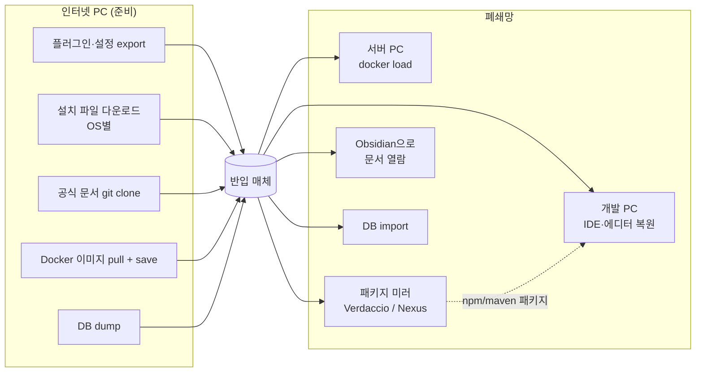

## 왜 이 목록이 필요한가

폐쇄망에 들어가면 "그때 받아올걸" 하는 순간이 반드시 온다. 플러그인 하나, JDBC 드라이버 하나, 명령어 옵션 하나가 없어서 작업이 멈춘다. 인터넷이 안 되니 마켓플레이스·패키지 레지스트리·공식 문서 사이트 모두 쓸 수 없다.

그래서 반입 전에 챙길 것을 네 묶음으로 정리했다.

| 묶음 | 내용 | 핵심 원칙 |
|---|---|---|
| **In** (도구 설정) | 에디터·IDE 플러그인, 설정 파일, 단축키, Docker 기본 이미지·레지스트리 | 설정은 **파일로 export** 해서 가져간다 |
| **Exe** (설치 파일) | IDE, Git, 런타임, Docker Desktop 등 | **대상 PC의 OS·CPU 아키텍처별로** 가져간다 |
| **Docs** (문서) | 공식 문서 clone, 자주 쓰는 명령어 치트시트 | 검색이 안 되니 **로컬에서 열람 가능한 형태로** |
| **DB 덤프** | 스키마·사용자 계정 export/import | 명령어를 **검증된 형태로** 들고 간다 |



---

## 1. In — 도구와 설정

### Obsidian

폐쇄망에서는 커뮤니티 플러그인 스토어에 접속할 수 없다. 인터넷 PC에서 설치를 끝낸 뒤 **vault의 `.obsidian/plugins/` 폴더를 통째로 복사**하는 방식으로 가져간다. `community-plugins.json`(활성화 목록)도 함께 복사해야 플러그인이 켜진 상태로 열린다.

| 플러그인 | 용도 | 비고 |
|---|---|---|
| git | vault 버전 관리 | 폐쇄망 내부 git 서버가 있으면 그대로 사용 |
| excalidraw | 다이어그램 | ⚠️ 자동 정렬 스크립트가 실행되지 않음 (미해결) |
| calendar | 데일리 노트 | |
| terminal | Obsidian 내 터미널 | ⚠️ `error spawning ... python3` 에러 (미해결, 아래 참고) |
| dataview | 노트 쿼리 | |
| excel-to-markdown | 엑셀 표 붙여넣기 변환 | |
| omnisearch | 전문 검색 | 공식 문서 clone과 같이 쓰면 오프라인 검색 엔진 역할 |
| pdf-plus | PDF 주석 | |

**미해결 이슈 메모**

- **excalidraw 자동 정렬 스크립트**: Excalidraw 스크립트는 보통 스크립트 라이브러리에서 내려받아 vault 안의 스크립트 폴더에 `.md` 파일로 저장된다. 플러그인만 복사하고 이 스크립트 파일이 빠졌거나, 플러그인 설정의 스크립트 폴더 경로가 바뀐 경우를 먼저 확인할 것.
- **terminal 플러그인 `error spawning python3`**: 추정 원인은 두 가지다.
  1. macOS·Linux에서 이 플러그인의 내장 터미널은 pty를 다루려고 **Python 3를 보조 프로세스로 띄운다**. 대상 PC에 Python이 없거나, 필요한 Python 패키지(예: `psutil`)가 설치돼 있지 않으면 실행에 실패한다. 폐쇄망이라 `pip install`도 안 되니 wheel을 미리 받아가야 한다.
  2. GUI로 실행한 앱은 **셸의 PATH를 물려받지 않는다**. 터미널에서는 `python3`가 잡혀도 Obsidian에서는 못 찾을 수 있으니, 플러그인 설정에 Python 실행 파일을 절대 경로로 지정해 본다.

### VSCode

| 항목 | 가져가는 방법 |
|---|---|
| sftp / rsync / ssh 확장 | 마켓플레이스에서 `.vsix`를 받아 `code --install-extension xxx.vsix`로 설치 |
| db / docker 확장 | 동일 (`.vsix`) |
| `settings.json` | 사용자 설정 폴더에서 복사 |
| 단축키 | `keybindings.json` 복사 |

확장 중에는 처음 실행할 때 언어 서버 같은 바이너리를 내려받는 것이 있다. 이런 확장은 **인터넷 PC에서 한 번 실행해 본 뒤** 확장 폴더(`~/.vscode/extensions/`)를 통째로 복사하는 편이 확실하다.

### IntelliJ

| 항목 | 메모 |
|---|---|
| 코드 스타일 | Code Style 스킴을 XML로 export → 폐쇄망에서 import |
| `settings.xml` | Maven 미러 설정. 폐쇄망의 Nexus 주소를 바라보게 수정해서 가져간다 |
| 단축키 | Keymap export, 또는 `File > Manage IDE Settings > Export Settings`로 한 번에 |
| SQL 스타일 → MyBatis XML | SQL 코드 스타일을 MyBatis mapper XML 안의 SQL에도 적용되게 설정 (language injection) |
| 플러그인 | 마켓플레이스에서 `.zip`을 받아 `Install Plugin from Disk` |

### Docker

| 항목 | 메모 |
|---|---|
| Docker Desktop | 설치 파일은 Exe 묶음에 포함 |
| 기본 이미지 | node, java(OpenJDK), ubuntu, mariadb |
| 패키지 미러 | **Verdaccio** — 폐쇄망 PC끼리 npm/pnpm 패키지를 공유하는 경량 레지스트리 |
| 범용 저장소 | **Nexus** — Maven·npm·Docker 등 여러 포맷을 한 서버에서 호스팅 |

**Verdaccio vs Nexus**

| | Verdaccio | Nexus Repository |
|---|---|---|
| 지원 포맷 | npm 계열 (npm, pnpm, yarn) | Maven, npm, Docker, PyPI 등 다수 |
| 무게 | 가볍다 (Node 앱 하나) | 무겁다 (JVM, 메모리 넉넉히 필요) |
| 적합한 경우 | 프론트엔드 패키지만 공유 | 백엔드 의존성·이미지까지 한 곳에 |

pnpm은 레지스트리만 바꿔주면 된다.

```bash
pnpm config set registry http://<미러 주소>:4873/
```

**이미지를 구울 때는 Dockerfile도 이미지 안에 넣는다**

폐쇄망으로 이미지 tar만 들고 가면, 몇 달 뒤 "이거 뭘로 만들었더라?"를 알아낼 방법이 거의 없다. `docker history`는 레이어 명령을 일부 보여주지만 `COPY`한 원본 파일이나 빌드 인자는 남지 않는다.

```dockerfile
FROM node:24-slim
# ...
COPY Dockerfile /build-info/Dockerfile
LABEL org.opencontainers.image.version="1.2.0"
```

나중에 꺼내 보기:

```bash
docker run --rm <이미지> cat /build-info/Dockerfile
docker inspect --format '{{json .Config.Labels}}' <이미지>
```

**이미지를 버전별로 저장·복원**

```bash
# 대상 서버의 아키텍처로 명시해서 pull (Apple Silicon에서 받을 때 특히 중요)
docker pull --platform linux/amd64 mariadb:11.4

# 태그를 파일명에 넣어 저장 (압축)
docker save mariadb:11.4 | gzip > mariadb_11.4.tar.gz

# 여러 이미지를 한 파일로
docker save -o base_images.tar node:24-slim eclipse-temurin:21-jre mariadb:11.4

# 폐쇄망에서 복원 (gzip 파일도 그대로 load 가능)
docker load -i mariadb_11.4.tar.gz
```

> `latest` 태그로 저장하면 나중에 어떤 버전이었는지 알 수 없다. **항상 명시적인 버전 태그**로 pull·save 한다.

---

## 2. Exe — 설치 파일

> 운영체제별로 가져가야 한다. 서버 PC와 개발용 PC의 OS·CPU 아키텍처(x64 / arm64)가 다르면 **양쪽 다** 챙긴다.

| 도구 | 메모 |
|---|---|
| Obsidian | |
| IntelliJ IDEA, WebStorm, DataGrip | 플러그인 `.zip` + **DataGrip JDBC 드라이버**도 따로. DataGrip은 처음 연결할 때 드라이버를 내려받으므로, 폐쇄망에서는 드라이버 jar를 직접 지정해야 한다 |
| Git | |
| 7z | 대용량 분할 압축용 |
| Node 24 | LTS 버전으로 |
| pnpm | standalone 바이너리 권장. corepack으로 쓰려면 pnpm을 미리 캐시해 둬야 한다 |
| OpenJDK | 프로젝트가 쓰는 메이저 버전에 맞춰서 |
| Docker Desktop | 서버가 Linux면 Docker Engine 설치 패키지(deb/rpm)를 따로 |
| GitButler | |

---

## 3. Docs — 문서와 명령어 치트시트

### 공식 문서 clone

대부분의 오픈소스 공식 문서는 GitHub 저장소에 **Markdown으로** 관리된다. 용량도 크지 않다. `git clone --depth 1`로 받아 Obsidian vault 안에 두면, omnisearch로 오프라인 검색까지 된다.

### 명령어 치트시트

| 주제 | 꼭 적어갈 것 |
|---|---|
| Regex 검색 | `grep -rnE '패턴' .`, `rg` 사용법 |
| sftp | `put` / `get` / `-r` 재귀 전송 |
| ssh | 키 생성·등록, `~/.ssh/config`, 포트 포워딩 (`-L`) |
| 압축 | `tar -czf`, `tar -xzf`, `split`, 7z 분할 압축 (`-v1g`) |
| bash | 리다이렉트, heredoc, history expansion(`!`) 주의 |
| 환경변수 | `export`, `~/.bashrc` / `~/.zshrc`, Windows `setx` |
| 안 쓰는 파일 찾기 | 아래 참고 |
| MariaDB dump | 아래 4장 |
| git merge 공백 무시 | 아래 참고 |

**안 쓰는 파일 찾기 — 접근 시각(atime)**

```bash
stat <파일명>                        # Access 시각 확인
find . -type f -atime +90           # 90일 넘게 안 읽힌 파일
```

단, atime은 마운트 옵션(`noatime`, `relatime`)에 따라 **갱신되지 않거나 대략적으로만** 갱신된다. "안 쓴다"는 판단의 참고치로만 쓰고, 지우기 전에는 수정 시각(`-mtime`)도 함께 본다.

**git merge 시 들여쓰기·공백 정렬 차이 무시**

내용은 같은데 들여쓰기나 정렬(공백)만 달라서 충돌이 나는 경우:

```bash
git merge -X ignore-space-change <브랜치>   # 공백 개수 차이 무시
git merge -X ignore-all-space <브랜치>      # 공백 유무 자체를 무시
git merge -X renormalize <브랜치>           # 줄바꿈(CRLF/LF) 정규화 후 비교
```

줄의 **순서**가 바뀐 경우(예: import 정렬)를 같은 내용으로 봐주는 옵션은 git에 없다. 이건 포매터를 양쪽에 똑같이 적용한 뒤 머지하는 수밖에 없다.

---

## 4. MariaDB Dump

DB 컨테이너 이름이 `mariadb`라고 가정한다. 비밀번호는 명령어에 직접 쓰면 셸 history에 남으므로, 실제로는 `-p`만 주고 프롬프트로 입력하는 편이 안전하다. (`docker exec -i`로 덤프 파일을 stdin에 흘려보낼 때는 프롬프트를 쓸 수 없으니 환경변수 등으로 대체한다.)

### Export

```bash
# 스키마 (데이터 제외) — 프로시저·트리거·이벤트 포함
docker exec -i mariadb mariadb-dump -uroot -p'<password>' \
  --all-databases --ignore-database=mysql \
  --single-transaction --events --routines --triggers \
  --insert-ignore --no-data > ./db.sql

# 사용자 계정·권한
docker exec -i mariadb mariadb-dump -uroot -p'<password>' \
  --system=users --insert-ignore > ./users.sql
```

| 옵션 | 의미 |
|---|---|
| `--all-databases --ignore-database=mysql` | 전체 DB를 뜨되 시스템 DB(`mysql`)는 제외 |
| `--single-transaction` | InnoDB를 락 없이 일관된 스냅샷으로 덤프 |
| `--events --routines --triggers` | 이벤트·프로시저·함수·트리거까지 포함 (기본값으로 빠지는 것들) |
| `--no-data` | **스키마만**. 데이터까지 가져가려면 이 옵션을 뺀다 |
| `--insert-ignore` | `INSERT` 대신 `INSERT IGNORE` — 중복 키가 있어도 건너뛰고 계속 진행 |
| `--system=users` | 사용자 계정·권한을 `CREATE USER` / `GRANT` 문으로 덤프 (MariaDB 10.11+의 `mariadb-dump`에서 지원) |

> `mysql` DB를 통째로 옮기면 버전 간 시스템 테이블 구조 차이로 깨질 수 있다. 그래서 시스템 DB는 제외하고, 계정은 `--system=users`로 **SQL 문 형태로** 따로 뜨는 것이다.

### Import

```bash
# 1) 사용자 먼저 — 이미 있는 계정이 있어도 계속 진행하도록 -f
docker exec -i mariadb mariadb -uroot -p'<password>' -f < ./users.sql

# 2) 스키마
docker exec -i mariadb mariadb -uroot -p'<password>' < ./db.sql
```

- **순서**: 사용자 → DB. 프로시저·뷰의 `DEFINER`로 지정된 계정이 먼저 있어야 경고나 실행 오류가 줄어든다.
- `-f`(`--force`): 에러가 나도 다음 문장을 계속 실행한다. `root` 같은 기존 계정의 `CREATE USER` 충돌을 넘기기 위해 users 쪽에만 쓴다.
- 파일 리다이렉트(`<`)를 쓰므로 `-it`가 아니라 **`-i`만** 준다. TTY를 붙이면 입력이 깨진다. → [[001_docker_exec_i_vs_it_options|docker exec의 -i와 -it 차이]]
- 원본과 대상의 MariaDB 버전이 다르면 collation 에러가 날 수 있다. → [[006_mariadb_dump_restore_unknown_collation|MariaDB 덤프 Unknown collation]]

---

## 회고

- 폐쇄망 준비의 본질은 **"인터넷이 하던 일을 파일로 대체하는 것"**이다. 플러그인 스토어 → 플러그인 폴더, 패키지 레지스트리 → Verdaccio/Nexus, 공식 문서 사이트 → git clone, 검색 엔진 → omnisearch.
- 가장 자주 빠뜨리는 건 **"처음 실행할 때 뭔가를 내려받는 것"**들이다. DataGrip 드라이버, VSCode 확장의 언어 서버, terminal 플러그인의 Python 의존성. 인터넷 PC에서 **한 번 실행까지 해본 상태**로 가져가는 게 안전하다.
- Docker 이미지는 버전 태그와 Dockerfile을 함께 남겨야 나중에 재현할 수 있다.
- 남은 숙제: excalidraw 자동 정렬 스크립트, terminal 플러그인 python3 spawn 에러 원인 확정.

## 관련 글

- [[003_airgapped_deploy_checklist|폐쇄망 배포 체크리스트]] — 서비스 배포 관점의 체크리스트
- [[004_airgapped_deploy_troubleshooting|폐쇄망 배포 트러블슈팅]] — 서비스 배포 중 겪은 문제들
- [[projects/frontend-offline-deployment/005_docker_image_options|05. Docker 이미지 옵션]]
