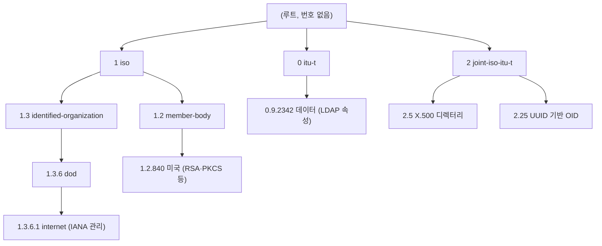

전 세계가 함께 쓰는 **등록 트리(OID 트리)**에서 노드 하나를 가리키는 **경로**. 루트부터 각 단계의 번호(arc)를 점으로 이어 쓴다. SNMP 전용 개념이 아니다. ITU-T · ISO가 정한 범용 식별 체계이고, [[cs/network/nms/collection/snmp|SNMP]]는 MIB 항목의 이름으로 이 트리의 한 가지(`1.3.6.1`)를 빌려 쓴다. 용어는 [[cs/network/nms/glossary#oid|용어]].

## 정의

| 항목 | 뜻 | 출처 |
|---|---|---|
| OID 트리 | 번호를 받은 기관이 자기 아래 가지를 다시 나눠 주는 계층형 등록 트리. 루트에는 번호가 없다 | ITU-T X.660 · ISO/IEC 9834-1 |
| arc | 트리의 한 단계 번호(0 이상의 정수). 이름을 함께 붙이기도 한다(`iso(1)`) | ITU-T X.660 |
| OID | 루트에서 노드까지 arc를 나열한 값. 트리에서 경로는 하나뿐이라 경로 = 노드의 이름 | ITU-T X.660 |
| `OBJECT IDENTIFIER` | OID를 담는 ASN.1 데이터 타입 | ITU-T X.680 |

## 루트 arc

루트 바로 아래 첫 번호는 **0 · 1 · 2 세 개뿐**이다.

| 첫 번호 | 관리 주체 | 예 | 출처 |
|---|---|---|---|
| 0 | ITU-T | `0.9.2342.19200300.100.1.25` = LDAP `dc`(domainComponent) | ITU-T X.660, RFC 4519 |
| 1 | ISO | `1.3.6.1` = 인터넷(SNMP MIB 전부), `1.2.840.113549` = RSA(PKCS) | ITU-T X.660, RFC 1155 |
| 2 | ITU-T · ISO 공동 | `2.5.4.3` = X.509 인증서 CN(commonName), `2.25.{UUID}` | ITU-T X.660, ITU-T X.520, ITU-T X.667 |

- 첫 번호가 0·1이면 둘째 번호는 **0~39**만 쓴다. 2이면 제한이 없다. 이유는 [인코딩](#인코딩).

## 가지 나눠 주기(위임)

OID 가지는 아무나 만들 수 없다. 이미 번호를 받은 기관이 자기 아래 번호를 다른 기관에 넘겨준다.

| 경로 | 받은 곳 | 넘겨준 곳 | 출처 |
|---|---|---|---|
| `1.3` identified-organization | ISO 6523으로 등록된 기관들 | ISO | ITU-T X.660 |
| `1.3.6` dod | 미 국방부 | ISO(`1.3` 아래 6번) | 참고: ISO 6523 |
| `1.3.6.1` internet | 인터넷 커뮤니티(당시 IAB, 지금 IANA) | 국방부 | RFC 1155 |
| `1.3.6.1.4.1.{번호}` | 각 기업(PEN, Private Enterprise Number) | IANA | 참고: IANA PEN 등록부 |

- 인터넷이 국방부 밑에 있는 건 ARPANET이 국방부 프로젝트였고, 1988년 SNMP가 OID 가지를 필요로 할 때 이미 번호를 가진 국방부가 가지를 넘겨줬기 때문이다. 지금 국방부가 관리하지는 않는다.
- 기업 번호(PEN)는 IANA에 신청하면 무료로 받는다(예: Cisco 9, Juniper 2636). 제조사 MIB와 장비 종류(`sysObjectID`)가 이 아래에 있다.

### internet 아래

| 경로 | 이름 | 내용 | 출처 |
|---|---|---|---|
| `1.3.6.1.1` | directory | OSI 디렉터리(거의 안 씀) | RFC 1155 |
| `1.3.6.1.2` | mgmt | 표준 관리 정보. `1.3.6.1.2.1` = mib-2(IF-MIB 등 표준 MIB) | RFC 1155 |
| `1.3.6.1.3` | experimental | 실험용 | RFC 1155 |
| `1.3.6.1.4` | private | `1.3.6.1.4.1` = enterprises(제조사) | RFC 1155 |
| `1.3.6.1.5` | security | 보안 메커니즘 | RFC 2578 |
| `1.3.6.1.6` | snmpV2 | SNMP 자체의 전송·모듈 정의 | RFC 2578 |

## 표기

| 방식 | 예 | 어디서 |
|---|---|---|
| 점 숫자 | `1.3.6.1.2.1.1.5` | 일반적인 표기, 프로토콜 안 |
| 이름 경로 | `iso.org.dod.internet.mgmt.mib-2.system.sysName` | 사람이 읽을 때 |
| ASN.1 | `{ iso(1) org(3) dod(6) internet(1) }` | MIB·표준 문서 정의 |
| 모듈::이름 | `SNMPv2-MIB::sysName` | net-snmp 등 도구(MIB 파일로 숫자 변환) |

## 인코딩

ASN.1 BER / DER로 바이트에 담을 때의 규칙(ITU-T X.690).

| 규칙 | 내용 | 예 |
|---|---|---|
| 첫 두 번호 합치기 | `40 × 첫째 + 둘째`를 한 값으로 쓴다 → 0·1 아래 둘째가 40 이상이면 첫째를 구분할 수 없어서 0~39로 제한 | `1.3` → 43 = `0x2B` |
| 큰 번호 | 7비트씩 나눠 쓰고, 이어지는 바이트는 최상위 비트를 1로 | `840` → `86 48`, `113549` → `86 F7 0D` |
| 결과 | SNMP 패킷의 OID는 거의 항상 `2B 06 01 …`로 시작 | `1.3.6.1` → `2B 06 01` |

## 쓰는 곳

| 분야 | 가지 | 예 | 출처 |
|---|---|---|---|
| SNMP MIB | `1.3.6.1` | `1.3.6.1.2.1.2.2.1.2` = `ifDescr` | RFC 2578 |
| 장비 종류 식별 | `1.3.6.1.4.1.{PEN}…` | `sysObjectID` 값으로 제조사·모델을 가린다 | RFC 3418 |
| X.509 인증서 | `2.5.4`, `1.2.840.113549` | 주체 이름 필드(CN, O), 서명 알고리즘 | RFC 5280 |
| LDAP 스키마 | `0.9.2342`, `2.5.4` | `dc`, `cn` 속성 | RFC 4519 |
| 의료·기타 | 기관별 가지 | DICOM, HL7 식별자 | 참고: 각 표준 |
