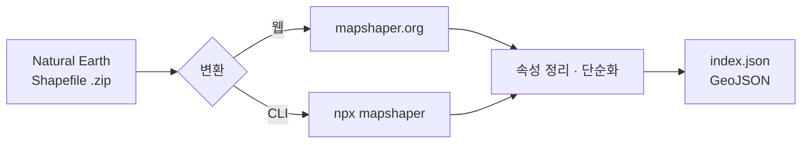

> 세계지도용 국가 경계를 Natural Earth에서 받아 웹 지도(ECharts 등)가 읽는 GeoJSON으로 바꾼다.
> 마우스로 하는 mapshaper 웹과 명령어 한 줄로 하는 CLI, 두 가지 방법을 정리한다.

## 흐름



## 원본 받기

- naturalearthdata.com → Cultural → **Admin 0 – Countries** (퍼블릭 도메인)
- 축척은 세 가지가 있다. 세계 전체를 보는 지도라면 110m면 충분하다.

| 축척 | 용도 |
|---|---|
| 1:110m | 세계 전체 보기 |
| 1:50m | 대륙 · 국가 확대 |
| 1:10m | 상세 지도 |

- zip 안의 파일들은 **한 세트**다. 하나라도 빠지면 도형이나 한글 이름이 깨진다.

| 파일 | 내용 |
|---|---|
| `.shp` | 도형 |
| `.shx` | 도형 위치 인덱스 |
| `.dbf` | 속성 (국가 코드 · 이름 …) |
| `.prj` | 좌표계 |
| `.cpg` | 속성 인코딩 (UTF-8). 빠지면 `NAME_KO`가 깨진다 |

- 참고: GitHub `nvkelso/natural-earth-vector`의 `geojson/` 폴더에는 이미 GeoJSON으로 바꾼 파일이 있다. 그래도 속성을 줄이고 단순화하려면 아래 과정을 거쳐야 한다.

### 쓸 속성

원본에는 속성이 168개 있다. 지도에 필요한 세 개만 골라 다섯 속성으로 만든다. 이름은 원본 값을 그대로 쓴다 (영어 `name`, 한국어 `name_ko`).

| 원본 속성 | 바꾼 이름 | 내용 | 주의 |
|---|---|---|---|
| `ISO_A2_EH` | `segmentId` · `code` · `idPath` | 국가 코드 2자리 (KR, US…). 세계 바로 아래라 경로 조각 · 코드 · 경로가 모두 같다 ([[002_korea_admin_boundary_geojson#지역 경로와 코드|다음 글]]) | `ISO_A2`는 프랑스 · 노르웨이가 `-99`라 쓰지 않는다 |
| `NAME` | `name` | 영어 국가명 | |
| `NAME_KO` | `name_ko` | 한국어 국가명 | |

`ISO_A2_EH`에서도 북키프로스 · 소말릴란드처럼 공식 코드가 없는 지역은 `-99`로 나온다. 코드로 지역을 찾는 화면이라면 이 둘은 클릭 대상에서 빼거나 따로 처리한다.

## 방법 1. mapshaper 웹 (mapshaper.org)

설치 없이 브라우저에서 바로 쓴다. 결과를 눈으로 보면서 조절할 수 있어서 처음 한 번 할 때 좋다.

1. mapshaper.org에 들어가 zip 파일(또는 압축을 푼 파일 전부)을 끌어다 놓고 **Import**
2. (선택) 오른쪽 위 **Simplify** → 슬라이더로 점 개수를 줄인다. 경계 모양을 보면서 정한다.
3. 오른쪽 위 **Console**을 열고 속성을 정리한다
   ```
   -filter 'ISO_A2_EH !== "AQ"'
   -each 'segmentId = ISO_A2_EH, code = ISO_A2_EH, idPath = ISO_A2_EH, name = NAME, name_ko = NAME_KO'
   -filter-fields segmentId,code,idPath,name,name_ko
   ```
   (첫 줄은 남극을 뺀다. 필요 없으면 생략)
4. **Export** → **GeoJSON** 선택 → 내려받기 → 파일 이름을 `index.json`으로 바꾼다 (이름을 이렇게 정한 이유는 [[002_korea_admin_boundary_geojson#파일 이름 정하기|다음 글]]에 있다)

## 방법 2. CLI (npx mapshaper)

웹에서 하던 작업을 명령어 한 줄로 한다. 다시 실행할 수 있으니 **데이터를 주기적으로 바꿔 끼울 때** 좋다.

```bash
npx mapshaper ne_110m_admin_0_countries.shp \
  -filter 'ISO_A2_EH !== "AQ"' \
  -each 'segmentId = ISO_A2_EH, code = ISO_A2_EH, idPath = ISO_A2_EH, name = NAME, name_ko = NAME_KO' \
  -filter-fields segmentId,code,idPath,name,name_ko \
  -simplify 50% \
  -o format=geojson precision=0.0001 index.json
```

| 옵션 | 하는 일 |
|---|---|
| `-filter '식'` | JS 식이 참인 feature만 남긴다 |
| `-each '새 = 옛, …'` | 원본 값으로 새 속성을 만든다. 한 원본 값을 여러 속성에 넣을 수 있다 (`-rename-fields`는 하나에만) |
| `-filter-fields` | 남길 속성만 고른다. 원본 속성 168개는 여기서 빠진다 |
| `-simplify 50%` | 점을 줄여 파일을 가볍게 (퍼센트는 남길 비율) |
| `-o format=geojson precision=0.0001` | GeoJSON으로 쓰고, 좌표 소수점을 4자리(약 10m)로 자른다 |

- 같은 폴더에 `.shx`·`.dbf`·`.prj`·`.cpg`가 있으면 `.shp`만 적어도 같이 읽는다.
- 실행 결과 (110m 기준):
  ```
  [filter] Retained 176 of 177 features
  [simplify] Repaired 2 intersections
  [o] Wrote index.json
  ```
  feature 하나는 `{"segmentId":"KR","code":"KR","idPath":"KR","name":"South Korea","name_ko":"대한민국"}`처럼 다섯 속성만 남는다.

| | 파일 크기 | 속성 수 |
|---|---|---|
| 그대로 변환 | 약 970KB | 168 |
| 위 명령 | 약 130KB | 5 |

- 대안: GDAL의 `ogr2ogr -f GeoJSON -select ISO_A2_EH,NAME,NAME_KO index.json   ne_110m_admin_0_countries.shp`.
  GDAL을 따로 설치해야 하고 단순화 옵션도 약하다. 그래서 Node 프로젝트에서는 mapshaper가 편하다.

## 두 방법 비교

| | mapshaper 웹 | mapshaper CLI |
|---|---|---|
| 설치 | 없음 | Node (npx) |
| 장점 | 결과를 보면서 단순화 정도를 정할 수 있다 | 다시 실행할 수 있고, 스크립트 · package.json에 넣을 수 있다 |
| 단점 | 매번 손으로 해야 한다 | 결과를 보려면 따로 열어 봐야 한다 |
| 추천 | 처음 한 번, 단순화 비율을 정할 때 | 정한 비율로 반복 생성할 때 |

결론: **웹에서 단순화 비율을 정하고, 그 값을 CLI 명령에 옮겨 적어 두면** 다음부터는 한 줄로 다시 만들 수 있다.

다음 글: [[002_korea_admin_boundary_geojson|대한민국 행정구역 GeoJSON 만들기]]
