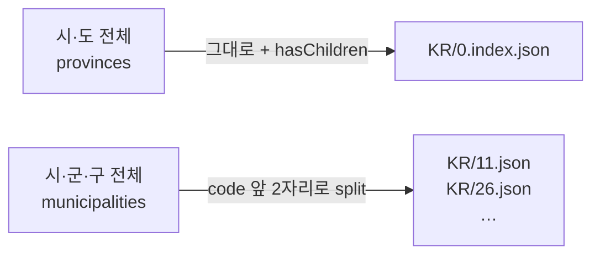

> 세계지도([[001_natural_earth_to_geojson|Natural Earth → GeoJSON]])에서 한국을 누르면 시·도, 시·도를 누르면 시·군·구로 내려가는 지도를 만든다.
> 이 지도에 쓸 경계 파일을 공개 자료에서 받아, **"파일 하나 = 한 지역의 바로 아래 구역들"** 규칙에 맞게 나눠 저장한다.

## 만들 파일 구조

```
geoJson/
├── 0.index.json       세계 → 국가
└── KR/
    ├── 0.index.json   한국 → 시·도 17개
    ├── 11.json        서울 → 구 25개
    ├── 26.json        부산 → 구·군
    └── …              (시·도 코드마다 하나, 17개)
```

- 화면은 처음에 `KR/0.index.json`만 받는다. 사용자가 시·도를 누를 때 그 시·도의 `KR/{code}.json`을 받는다.
- 시·도 코드는 2자리, 시·군·구 코드는 5자리다. 시·군·구 코드의 **앞 2자리가 그 시·도 코드**라서 이 규칙으로 파일을 나눌 수 있다.



## 파일 이름 정하기

처음에는 `countries.json`(세계), `KR.json`(한국), `KR/11.json`(서울)처럼 이름을 붙였다. 개발하면서 지도의 시작점이 되는 파일을 자주 열게 되는데, 이 파일이 폴더 중간에 섞여 있어 찾기가 불편했다. 그래서 두 가지를 정했다.

### 1. 시작점 파일 이름: `_index.json` vs `0.index.json`

"그 지역의 바로 아래 구역들"을 담는 시작점 파일이 **폴더 맨 위**에 오게 하고 싶었다. 후보는 두 개였고, 같은 파일들을 만들어 정렬해 봤다.

| 정렬 방식 | 쓰는 곳 | 결과 |
|---|---|---|
| 사람 기준 정렬 (`Intl.Collator`, 숫자 인식) | VS Code 탐색기, Finder | `_index` → `0.index` → `11` → `39` → `countries` → `KR` |
| 바이트 순 정렬 | 터미널 `ls`, git, GitHub 웹 | `0.index` → `11` → `39` → `KR` → **`_index`** → `countries` |

- `_index.json`은 VS Code에서는 맨 위지만, 바이트 순 정렬에서는 숫자와 대문자 뒤로 밀린다. `_`(0x5F)가 숫자(0x30~)와 대문자(0x41~)보다 코드값이 크기 때문이다.
- `0.index.json`은 두 방식 모두에서 맨 위다. 나중에 `004`처럼 0으로 시작하는 코드가 생겨도 `.`(0x2E)이 숫자보다 앞이라 계속 맨 위에 온다.
- `_index`가 나은 점도 있다. 지역 코드 이름 파일(`11.json`) 사이에서 `0.index`는 "코드 0번 지역"처럼 보일 수 있지만, `_index`는 그런 오해가 없고 Hugo 등에서 익숙한 관례다.

→ "어디서 열어도 맨 위"라는 목적에 맞는 **`0.index.json`**으로 정했다.

### 2. 나라 시작점 위치: `KR.json` vs `KR/0.index.json`

| | `KR.json` (폴더 옆) | `KR/0.index.json` (폴더 안) |
|---|---|---|
| 자료 교체 | 폴더와 파일을 따로 바꿔야 한다. 하나를 빠뜨리면 시·도와 시·군·구 자료의 기준 연도가 어긋날 수 있다 | `KR/` 폴더만 통째로 바꾸면 된다 |
| 나라가 늘면 | `KR.json`, `KR/`, `JP.json`, `JP/` … 나라마다 두 개씩 섞인다 | `0.index.json`과 나라 폴더만 남는다 |
| 규칙 | 최상위와 나라의 규칙이 다르다 | "`0.index.json` = 그 폴더 지역의 바로 아래" 하나로 설명된다 |
| 장점 | 이미 있는 파일을 옮기지 않아도 된다 | |

→ **`KR/0.index.json`**으로 정했다. 폴더는 **나라 단위까지만** 만든다. 시·도 아래(`KR/11.json`)는 `KR/` 안에 평평하게 둔다. 행정코드는 단계가 달라도 겹치지 않으니 더 깊게 나눌 필요가 없다.

## 원본 자료

| 자료 | 단위 | 형식 | 특징 |
|---|---|---|---|
| GitHub `southkorea/southkorea-maps` (`kostat/2013/json`) | 시·도 · 시·군·구 | GeoJSON | 바로 쓸 수 있다. **2013년 기준**이라 그 뒤 행정구역 변경은 빠져 있다 |
| 통계청 SGIS → 자료신청 → 센서스용 행정구역 경계 | 시·도 · 시·군·구 · 읍·면·동 | Shapefile | 해마다 갱신된다. 신청해서 받아야 하고 좌표계 변환이 필요하다 |
| GitHub `vuski/admdongkor` | 행정동 | GeoJSON | 행정동 단위로 자주 갱신된다 |

빨리 만들어 보려면 southkorea-maps가 가장 쉽다. 이 글은 southkorea-maps 기준으로 쓰고, SGIS 자료로 바꿀 때 다른 점은 맨 아래에 정리했다.

southkorea-maps의 파일:

| 파일 | 내용 | 크기 |
|---|---|---|
| `skorea_provinces_geo_simple.json` | 시·도 17개 (단순화본) | 약 145KB |
| `skorea_municipalities_geo_simple.json` | 시·군·구 251개 (단순화본) | 약 370KB |
| `skorea_provinces_geo.json` | 시·도 원본 | 약 28MB |
| `skorea_municipalities_geo.json` | 시·군·구 원본 | 약 55MB |

웹 지도에는 `_simple` 파일로 충분하다. feature 속성은 `{"code":"11250","name":"강동구","name_eng":"Gangdong-gu","base_year":"2013"}` 형태다.

## 1. 시·도 파일 (KR/0.index.json)

```bash
npx mapshaper skorea_provinces_geo_simple.json \
  -each 'hasChildren = true' \
  -o format=geojson KR/0.index.json
```

- `hasChildren`은 "하위 파일(`KR/{code}.json`)이 있다"는 표시다. 브라우저는 서버 폴더의 파일 목록을 읽을 수 없어서, 누를 수 있는 지역인지를 데이터에 직접 적어 둔다.
- 시·도 17개 모두 하위 파일이 있으니 전부 `true`로 둔다. 일부만 있다면 `-each 'if (code === "11") hasChildren = true'`처럼 조건을 건다.

## 2. 시·군·구 파일 나누기 (KR/{code}.json)

```bash
mkdir -p KR
npx mapshaper skorea_municipalities_geo_simple.json \
  -each 'parent = code.slice(0, 2)' \
  -split parent \
  -drop fields=parent target='*' \
  -o format=geojson KR/
```

| 단계 | 하는 일 |
|---|---|
| `-each 'parent = code.slice(0, 2)'` | 시·군·구 코드 앞 2자리(시·도 코드)를 임시 속성 `parent`에 적는다 |
| `-split parent` | `parent` 값이 같은 것끼리 레이어를 나눈다. 레이어 이름이 값(`11`, `26`…)이 된다 |
| `-drop fields=parent target='*'` | 나눈 **모든** 레이어에서 임시 속성을 지운다 (`target='*'`가 없으면 한 레이어에만 적용된다) |
| `-o … KR/` | 폴더를 주면 레이어마다 `레이어이름.json`으로 쓴다 |

실행 결과:

```
[o] Wrote KR/39.json
[o] Wrote KR/38.json
…
```

시·도 코드별로 17개 파일이 생기고, 합쳐서 약 400KB다. 예를 들어 `KR/11.json`에는 서울 구 25개가 들어 있다.

- 세종(`29`)은 아래에 시·군·구가 없어서, `KR/29.json`에는 세종시 하나만 들어 있다.
- 더 내려가는 단계(시·군·구 → 읍·면·동)도 같은 방식이다. 읍·면·동 코드의 앞 5자리로 split하면 `KR/{시·군·구 코드}.json`이 생긴다. 이렇게 하려면 시·군·구 파일 쪽에 `hasChildren`을 적어야 한다.

## SGIS 자료로 바꿀 때 다른 점

SGIS에서 받은 Shapefile은 웹 지도에 바로 쓸 수 없어서, 두 가지를 더 해야 한다.

| 항목 | SGIS 원본 | 웹 지도에 필요한 것 | mapshaper 옵션 |
|---|---|---|---|
| 좌표계 | UTM-K (EPSG:5179, 미터 단위) | WGS84 (경도·위도) | `-proj wgs84` |
| 속성 인코딩 | CP949인 경우가 많다 (`.cpg` 없음) | UTF-8 | `-i 파일.shp encoding=cp949` |
| 속성 이름 | 자료마다 다르다 | `code`, `name` | `-rename-fields code=…,name=…` |

```bash
npx mapshaper -i bnd_sido.shp encoding=cp949 \
  -proj wgs84 \
  -rename-fields code=원본코드필드,name=원본이름필드 \
  -simplify 5% \
  -o format=geojson precision=0.0001 KR/0.index.json
```

- 좌표계를 바꾸지 않으면 좌표가 `953000, 1950000` 같은 미터 값으로 남아서 지도에 아무것도 안 보인다.
- 원본은 수십 MB라 `-simplify`가 꼭 필요하다. 비율은 [[001_natural_earth_to_geojson|mapshaper 웹]]에서 모양을 보며 정한다.
- 코드 체계도 확인해야 한다. 통계청 코드(서울 `11`)와 행정안전부 행정표준코드(서울 `11` + 8자리)는 자릿수가 다르다. 사이트 위치 같은 다른 데이터와 같은 체계를 써야 서로 연결할 수 있다.

## 2013년 자료에서 빠진 변경 (예시)

southkorea-maps를 그대로 쓰면 아래 변경이 반영되어 있지 않다. 운영 화면이라면 최신 SGIS 자료로 바꾸는 시점을 정해 둔다.

| 시기 | 변경 |
|---|---|
| 2014 | 청주시 · 청원군 통합 |
| 2023 | 군위군, 경북 → 대구 편입 |
| 2026 | 인천 중구 · 동구 · 서구 개편 (영종구 · 제물포구 · 검단구) |

경계 파일을 앱에 묶지 않고 public 폴더에서 그때그때 받게 해 두면, 자료를 바꿀 때 파일만 바꿔 끼우면 되고 다시 빌드할 필요가 없다.
