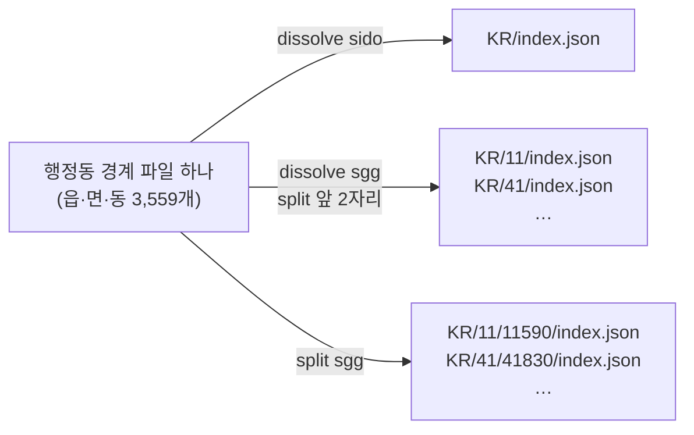

> 세계지도([[001_natural_earth_to_geojson|Natural Earth → GeoJSON]])에서 한국을 누르면 시·도, 시·도를 누르면 시·군·구, 시·군·구를 누르면 읍·면·동으로 내려가는 지도를 만든다.
> 이 지도에 쓸 경계 파일을 공개 자료에서 받아, **"파일 하나 = 한 지역의 바로 아래 구역들"** 규칙에 맞게 나눠 저장한다.
>
> 2026-11-25. 원본 자료를 southkorea-maps(2013, 통계청 코드)에서 **admdongkor(행정동, 행안부 코드)** 로 바꾸고 읍·면·동 단계를 추가했다. 예전 방식과 달라진 점은 [[#2013년 자료(southkorea-maps)와 달라진 점]]에 남겼다.

## 만들 파일 구조

```
geoJson/
├── index.json                   세계 → 국가
└── KR/
    ├── index.json               한국 → 시·도 16개
    ├── 11/
    │   ├── index.json           서울 → 구 25개
    │   └── 11590/
    │       └── index.json       동작구 → 동
    ├── 41/
    │   ├── index.json           경기 → 시·군·구 47개
    │   └── 41830/
    │       └── index.json       양평군 → 읍·면
    └── …                        (시·도 16개, 시·군·구 256개)
```

- **폴더 = 그 지역의 안쪽, `index.json` = 안쪽을 나눈 지도**다. 서울 자신의 모양은 부모의 `KR/index.json`에 있고, `KR/11/index.json`에는 서울의 구들이 있다.
- 화면은 처음에 `KR/index.json`만 받는다. 사용자가 지역을 누를 때 그 지역의 `index.json`을 받는다.
- 시·도 코드는 2자리, 시·군·구는 5자리, 읍·면·동은 10자리다. **앞자리가 항상 상위 지역 코드**라서(`41` → `41830` → `4183025000`) 이 규칙으로 파일을 나눌 수 있다.



## 파일 이름 정하기

처음에는 `countries.json`(세계), `KR.json`(한국), `KR/11.json`(서울)처럼 이름을 붙였다. 개발하면서 지도의 시작점이 되는 파일을 자주 열게 되는데, 이 파일이 폴더 중간에 섞여 있어 찾기가 불편했다. 그래서 세 가지를 정했다.

### 1. 시작점 파일 이름: `0.index.json` vs `index.json`

처음에는 시작점 파일이 **폴더 맨 위**에 오도록 `0.index.json`으로 정했다. `_index.json`도 후보였지만, 터미널 `ls`나 git처럼 바이트 순으로 정렬하는 곳에서는 `_`(0x5F)가 숫자와 대문자보다 뒤라서 맨 위에 오지 않았다. `0.`은 VS Code와 `ls` 양쪽에서 맨 위였다.

그런데 3번까지 정하고 나니 폴더마다 파일은 시작점 하나뿐이고, 나머지는 전부 하위 지역 폴더(`11/`, `41/` …)였다.

- 같은 폴더에 다른 파일이 없으니 시작점을 다른 파일과 헷갈릴 일이 없다.
- VS Code 탐색기는 폴더를 먼저 보여 주므로 `0.`을 붙여도 파일은 폴더들 아래에 온다.
- `0.index`는 지역 코드 폴더 사이에서 "코드 0번 지역"처럼 보일 수도 있다.

→ 정렬용 접두사를 빼고 **`index.json`**으로 바꿨다. 같은 폴더에 파일이 여러 개 생겨 순서가 중요해지면 그때 다시 정한다.

### 2. 나라 시작점 위치: `KR.json` vs `KR/index.json`

| | `KR.json` (폴더 옆) | `KR/index.json` (폴더 안) |
|---|---|---|
| 자료 교체 | 폴더와 파일을 따로 바꿔야 한다. 하나를 빠뜨리면 시·도와 시·군·구 자료의 기준 연도가 어긋날 수 있다 | `KR/` 폴더만 통째로 바꾸면 된다 |
| 나라가 늘면 | `KR.json`, `KR/`, `JP.json`, `JP/` … 나라마다 두 개씩 섞인다 | `index.json`과 나라 폴더만 남는다 |
| 규칙 | 최상위와 나라의 규칙이 다르다 | "`index.json` = 그 폴더 지역의 바로 아래" 하나로 설명된다 |
| 장점 | 이미 있는 파일을 옮기지 않아도 된다 | |

→ **`KR/index.json`**으로 정했다. 실제로 자료를 2013년판에서 최신판으로 바꿀 때 `KR/` 폴더만 지우고 다시 만들었다.

### 3. 나라 아래도 폴더로: `KR/11.json` vs `KR/11/index.json`

처음에는 폴더를 나라 단위까지만 만들고, 시·도 아래는 `KR/11.json`처럼 `KR/` 안에 평평하게 두려 했다. 행정코드는 단계가 달라도 겹치지 않아서(2자리, 5자리, 10자리) 평평해도 파일 이름이 부딪히지 않는다.

그런데 나중에 서울을 더 잘게 나누면 `KR/11.json`이 `KR/11/index.json` + 그 아래 파일로 바뀌어야 한다. 이때 지역마다 형식이 섞이면, 브라우저는 폴더 목록을 읽을 수 없으니 어느 형식인지 알려면 두 번 요청해 보거나 목록 파일을 따로 둬야 한다. 결국 형식을 바꿀 때마다 파일을 전부 옮겨야 한다.

| | 나라까지만 폴더 (`KR/11.json`) | 모든 단계 폴더 (`KR/11/index.json`) |
|---|---|---|
| 규칙 | 나라까지는 `index`, 그 아래는 `{code}.json` | `index` 하나 |
| 단계가 늘면 | 형식이 바뀔 수 있다 | 폴더가 하나 더 생길 뿐이다 |
| code 중복 | 나라 안에서 겹치면 안 된다 | 상관없다 |
| 단점 | | 폴더가 많아진다 |

→ **모든 단계를 폴더로** 정했다. "`index.json` = 그 폴더 지역의 바로 아래" 규칙 하나로 세계부터 읍·면·동까지 설명된다. 읍·면·동을 추가할 때도 시·군·구 폴더 아래에 폴더가 하나씩 더 생겼을 뿐, 화면 코드는 고치지 않았다.

코드도 단순해진다. 지역 경로(`'KR.11'`처럼 code를 `.`으로 이은 것)를 그대로 폴더로 바꾸고 `index`만 붙이면 된다. 세계 지도(최상위, 경로 `''`)도 같은 규칙에 들어가서 분기가 없다.

```ts
const INDEX_FILE = 'index';
const fileOf = (path: string) =>
  [...(path ? path.split('.') : []), INDEX_FILE].join('/') + '.json';

fileOf('');             // 'index.json'              세계 → 국가
fileOf('KR');           // 'KR/index.json'           한국 → 시·도
fileOf('KR.11');        // 'KR/11/index.json'        서울 → 구
fileOf('KR.11.11590');  // 'KR/11/11590/index.json'  동작구 → 동
```

## 원본 자료

| 자료 | 단위 | 형식 | 코드 | 특징 |
|---|---|---|---|---|
| GitHub `southkorea/southkorea-maps` (`kostat/2013/json`) | 시·도 · 시·군·구 | GeoJSON | 통계청 | 바로 쓸 수 있다. **2013년 기준**이라 그 뒤 변경이 빠져 있다 |
| 통계청 SGIS → 자료신청 → 센서스용 행정구역 경계 | 시·도 · 시·군·구 · 읍·면·동 | Shapefile | 통계청 | 신청해서 받아야 하고 좌표계 변환이 필요하다 |
| **GitHub `vuski/admdongkor`** | 행정동 | GeoJSON | **통계청 + 행안부** | 통계청 분기 공지(1.1 · 4.1 · 7.1 · 10.1)에 맞춰 갱신된다 |

**admdongkor**를 골랐다.

- **행안부 코드가 들어 있다.** 주소 검색 API는 보통 행안부 코드를 돌려준다(행정동 코드, 법정동 코드). 나중에 주소로 위치를 정할 때 변환 표 없이 바로 연결된다.
- **읍·면·동 경계 하나로 세 단계를 다 만든다.** 읍·면·동을 합치면(dissolve) 시·군·구, 시·도가 된다. 세 단계가 같은 날짜 자료라 서로 어긋나지 않는다. 저장소도 dissolve할 때 틈이 남지 않게 경계를 맞춰 두었다고 밝힌다.
- 최신이다. 2013년 이후의 시·도 통합, 명칭 변경, 구 신설이 모두 들어 있다.

### 코드 체계: 통계청 vs 행안부

같은 지역이라도 기관마다 코드가 다르다. **둘 다 2자리, 5자리라 겉보기로는 구분이 안 된다**는 게 함정이다.

| | 경기도 | 양평군 | 읍·면·동 |
|---|---|---|---|
| 통계청 행정구역분류 (2013) | `31` | `31380` | 7자리 (지금은 8자리) |
| 행안부 행정동 코드 (행정기관코드) | `41` | `41830` | 10자리 `4183025000` |
| 행안부 법정동 코드 | `41` | `41830` | 10자리 (앞 5자리는 행정동 코드와 같다) |

예를 들어 `31`은 통계청에서는 경기도, 행안부에서는 울산이다. 코드를 바꿀 때는 경계 파일뿐 아니라 **코드를 저장해 둔 다른 데이터도 같이 바꿔야** 한다.

### 받을 파일

`ver{날짜}/HangJeongDong_ver{날짜}.geojson` — 이 글은 `ver20261001` 기준이다. 약 35MB, 읍·면·동 3,559개.

feature 속성:

```json
{
  "adm_nm": "서울특별시 종로구 사직동",
  "adm_cd2": "1111053000",
  "sgg": "11110",
  "sido": "11",
  "sidonm": "서울특별시",
  "sggnm": "종로구",
  "adm_cd": "11010530"
}
```

| 속성 | 뜻 |
|---|---|
| `adm_cd2` | 행안부 10자리 (읍·면·동 `code`로 쓴다) |
| `adm_cd` | 통계청 8자리 |
| `sido` · `sidonm` | 시·도 코드 · 이름 (`adm_cd2` 앞 2자리) |
| `sgg` · `sggnm` | 시·군·구 코드 · 이름 (`adm_cd2` 앞 5자리) |
| `adm_nm` | 전체 이름. 마지막 단어가 읍·면·동 이름 |

영문 이름은 없다. 화면에서 쓰는 속성은 `code`, `name_ko` 두 개로 맞춘다.

**출처 표시가 필수다.** 데이터는 CC BY 4.0이고, 원자료는 통계청 SGIS가 공공누리 제1유형(출처표시)으로 개방한 것이다. 지도 화면 구석에 출처를 적어 둔다.

## 단순화: 단계마다 다르게

원본은 35MB라 줄여야 한다. 처음에는 비율 하나(`-simplify 5%`)로 세 단계를 다 만들려 했는데, 어느 쪽으로 맞춰도 한쪽이 망가졌다.

| 한 가지로 통일 | 결과 |
|---|---|
| 6% | 시·도 파일은 적당하다. 하지만 도시의 동은 원래 점이 20~30개뿐이라 **8개 정도만 남아** 팔각형처럼 된다 |
| 20m 간격 | 동 모양은 좋다. 하지만 전국 시·도 파일이 **1.5MB**가 넘는다 |

비율(`5%`)은 전체 점 중에 몇 %를 남기는지라, 원래 작은 도형부터 깎인다. 그래서 **미터 간격(`interval=`)으로, 단계마다 화면에 보이는 크기에 맞춰** 따로 줄였다.

| 단계 | 간격 | 결과 |
|---|---|---|
| 시·도 | 400m | 155KB (이전 2013 자료 210KB) |
| 시·군·구 | 100m | 시·도별 16개, 중간 77KB (가장 큰 전남광주 293KB) |
| 읍·면·동 | 20m | 시·군·구별 256개, 중간 33KB (최대 137KB) |

대신 **단계끼리 경계가 조금 어긋난다.** 지역을 확대했을 때 주변 지역을 배경으로 같이 그리면, 맞닿는 테두리에서 화면상 1~2px 차이가 날 수 있다. 눈에 띄면 간격을 조정한다.

## 1. 시·도 파일 (KR/index.json)

```bash
SRC=HangJeongDong_ver20261001.geojson
mkdir -p KR

npx mapshaper $SRC \
  -dissolve sido copy-fields=sidonm \
  -simplify interval=400 keep-shapes -clean \
  -rename-fields code=sido,name_ko=sidonm \
  -o KR/index.json format=geojson precision=0.0001
```

| 단계 | 하는 일 |
|---|---|
| `-dissolve sido copy-fields=sidonm` | `sido`가 같은 읍·면·동을 합쳐 시·도 하나로 만든다. 이름(`sidonm`)은 복사해 둔다. 나머지 속성은 빠진다 |
| `-simplify interval=400 keep-shapes` | 400m보다 가까운 점을 줄인다. `keep-shapes`는 작은 섬이 통째로 사라지지 않게 한다 |
| `-clean` | 단순화로 생긴 겹침 · 틈을 고친다 |
| `-rename-fields code=sido,name_ko=sidonm` | 화면에서 쓰는 이름으로 바꾼다 |
| `precision=0.0001` | 좌표를 소수 4자리(약 10m)로 자른다. 파일 크기가 크게 줄어든다 |

- mapshaper는 출력할 때 고리(ring)를 GeoJSON 표준 방향(바깥은 반시계)으로 고쳐 쓴다. 점 순서가 원본과 달라지지만 모양은 같다.
- **하위 파일이 있는지는 데이터에 적지 않는다.** 처음에는 `hasChildren` 속성을 적으려 했지만, 자료를 바꿔 끼울 때마다 같이 맞춰야 한다. 대신 화면에서 하위 파일을 받아 보고, 없으면 그 지역을 기억해 두고 다시 요청하지 않는다.
  - SPA로 배포하면 없는 파일도 404가 아니라 **200 + index.html**로 온다(SPA fallback). 그래서 요청 실패가 아니라 **응답 내용**(`type === 'FeatureCollection'`인지)으로 판단하거나, 경계 폴더만 404를 주도록 서버를 설정한다.

## 2. 시·군·구 파일 나누기 (KR/{시·도}/index.json)

```bash
npx mapshaper $SRC \
  -dissolve sgg copy-fields=sggnm \
  -simplify interval=100 keep-shapes -clean \
  -each 'parent = sgg.slice(0, 2)' \
  -rename-fields code=sgg,name_ko=sggnm \
  -split parent \
  -filter-fields code,name_ko target='*' \
  -o KR/ format=geojson precision=0.0001

# KR/11.json → KR/11/index.json
for f in KR/*.json; do
  c=$(basename "$f" .json)
  [ "$c" = index ] && continue
  mkdir -p "KR/$c" && mv "$f" "KR/$c/index.json"
done
```

| 단계 | 하는 일 |
|---|---|
| `-dissolve sgg copy-fields=sggnm` | 읍·면·동을 시·군·구로 합친다 |
| `-each 'parent = sgg.slice(0, 2)'` | 시·군·구 코드 앞 2자리(시·도 코드)를 임시 속성 `parent`에 적는다 |
| `-split parent` | `parent` 값이 같은 것끼리 레이어를 나눈다. 레이어 이름이 값(`11`, `41`…)이 된다 |
| `-filter-fields … target='*'` | 나눈 **모든** 레이어에서 남길 속성만 남긴다. 임시 속성 `parent`도 여기서 빠진다 |
| `-o KR/ format=geojson` | 폴더를 주면 레이어마다 `레이어이름.json`으로 쓴다. 폴더를 옵션보다 **먼저** 써야 한다 (`-o format=geojson KR/`는 `Unknown output option` 에러) |
| `for` 반복 | mapshaper는 파일 이름만 정할 수 있어서, `KR/11.json`을 `KR/11/index.json`으로 옮긴다 |

시·도별로 16개 파일이 생긴다. 예를 들어 `KR/11/index.json`에는 서울 구 25개가 들어 있다.

- **일반구는 시·군·구 단계에 펼쳐져 있다.** 수원시는 `41111 수원시장안구`, `41113 수원시권선구`처럼 구가 각자 5자리 코드를 가져서, "수원시" 단계 없이 경기도 바로 아래에 구가 온다.
- 세종(`36`)은 시·군·구 `36110 세종시` 하나만 있다. 세종을 누르면 세종시 하나가 보이고, 한 번 더 누르면 읍·면·동이 나온다.

## 3. 읍·면·동 파일 나누기 (KR/{시·도}/{시·군·구}/index.json)

```bash
mkdir -p tmp
npx mapshaper $SRC \
  -simplify interval=20 keep-shapes -clean \
  -each 'code = adm_cd2, name_ko = adm_nm.split(" ").pop()' \
  -split sgg \
  -filter-fields code,name_ko target='*' \
  -o tmp/ format=geojson precision=0.00001

# tmp/41830.json → KR/41/41830/index.json
for f in tmp/*.json; do
  c=$(basename "$f" .json)
  mkdir -p "KR/${c:0:2}/$c" && mv "$f" "KR/${c:0:2}/$c/index.json"
done
```

- 읍·면·동은 합칠 필요가 없으니 `-dissolve` 없이 바로 줄이고 나눈다.
- 이름은 `adm_nm`(`경기도 양평군 양평읍`)의 마지막 단어만 쓴다.
- 동은 작아서 좌표를 소수 5자리(약 1m)까지 남긴다.
- 폴더는 시·군·구 코드 앞 2자리(시·도)로 정한다(`${c:0:2}`).

시·군·구별로 256개 파일이 생긴다. 다 만들고 나서 두 가지를 확인했다.

- 시·군·구 256개마다 읍·면·동 파일이 있는지
- 모든 지역의 code가 부모 code로 시작하는지 (`41` → `41830` → `4183025000`)

## SGIS 자료로 바꿀 때 다른 점

SGIS에서 받은 Shapefile은 웹 지도에 바로 쓸 수 없어서, 두 가지를 더 해야 한다.

| 항목 | SGIS 원본 | 웹 지도에 필요한 것 | mapshaper 옵션 |
|---|---|---|---|
| 좌표계 | UTM-K (EPSG:5179, 미터 단위) | WGS84 (경도·위도) | `-proj wgs84` |
| 속성 인코딩 | CP949인 경우가 많다 (`.cpg` 없음) | UTF-8 | `-i 파일.shp encoding=cp949` |
| 속성 이름 | 자료마다 다르다 | `code`, `name_ko` | `-rename-fields code=…,name_ko=…` |

```bash
npx mapshaper -i bnd_sido.shp encoding=cp949 \
  -proj wgs84 \
  -rename-fields code=원본코드필드,name_ko=원본이름필드 \
  -simplify interval=400 keep-shapes \
  -o format=geojson precision=0.0001 KR/index.json
```

- 좌표계를 바꾸지 않으면 좌표가 `953000, 1950000` 같은 미터 값으로 남아서 지도에 아무것도 안 보인다.
- SGIS 코드는 **통계청 체계**다. 행안부 코드와 섞어 쓰려면 변환 표가 필요하다 ([[#코드 체계: 통계청 vs 행안부]]).

## 2013년 자료(southkorea-maps)와 달라진 점

처음에는 southkorea-maps의 `_simple` 파일(시·도 17개, 시·군·구 251개, 통계청 코드)을 그대로 나눠 썼다. 자료를 바꾸면서 아래가 달라졌다.

| 항목 | 2013 (southkorea-maps) | 지금 (admdongkor `ver20261001`) |
|---|---|---|
| 코드 | 통계청 (경기 `31`, 세종 `29`) | 행안부 (경기 `41`, 세종 `36`) |
| 단계 | 시·도 · 시·군·구 | 시·도 · 시·군·구 · 읍·면·동 |
| 시·도 | 17개 | 16개 (광주 + 전남 통합) |
| 시·군·구 | 251개 | 256개 |
| 영문 이름 | 있음 (`name_eng`) | 없음 |
| 단순화 | 제공된 `_simple` 그대로 | 단계마다 `interval` 로 직접 |

새 자료에 들어 있는 2013년 이후 변경:

| 변경 | 지금 코드 |
|---|---|
| 청주시 · 청원군 통합 (2014) | 청주시 구 4개 `43111` ~ `43114` |
| 군위군, 경북 → 대구 편입 (2023) | `27720` (대구 `27` 아래) |
| 강원도 → 강원특별자치도 (2023) | `51` |
| 전라북도 → 전북특별자치도 (2024) | `52` |
| 인천 중구 · 동구 · 서구 개편 (2026) | 제물포구 `28125` · 영종구 `28155` · 서해구 `28275` · 검단구 `28290` |
| 광주광역시 + 전라남도 → 전남광주통합특별시 | `12` (시·군·구 27개) |

경계 파일을 앱에 묶지 않고 public 폴더에서 그때그때 받게 해 두면, 자료를 바꿀 때 `KR/` 폴더만 바꿔 끼우면 되고 다시 빌드할 필요가 없다. 이번에도 화면 코드는 그대로 두고 폴더만 바꿨다.
