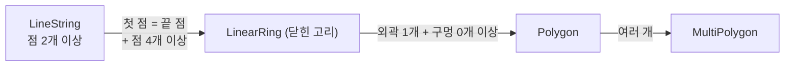

## 의문

GeoJSON 폴리곤 좌표를 보면 첫 좌표와 끝 좌표가 항상 같다. 사각형인데 점이 5개다.

```json
{ "type": "Polygon",
  "coordinates": [[ [0,0], [1,0], [1,1], [0,1], [0,0] ]] }
```

마지막 점에서 첫 점으로 돌아가는 건 당연한데, 왜 굳이 같은 점을 한 번 더 적을까?

## 답: 표준이 "닫힌 선"으로 정의하기 때문

GeoJSON(RFC 7946)은 폴리곤의 고리(linear ring)를 이렇게 정의한다.

> 선형 고리는 **점이 4개 이상인 닫힌 LineString**이다. 첫 점과 끝 점은 같아야 하며(MUST), 같은 값이어야 한다.

즉 고리는 별도 자료형이 아니라 **"끝이 처음으로 돌아오는 LineString"**이다. 닫혀 있다는 사실을 암묵적인 약속에 맡기지 않고 데이터에 직접 적어 둔 것이다. 이 방식은 GeoJSON이 처음 만든 게 아니라 OGC Simple Features(WKT)와 Shapefile에서 이어받은 것이다.

```text
WKT: POLYGON ((0 0, 1 0, 1 1, 0 1, 0 0))
```

"점 4개 이상"이라는 조건도 여기서 나온다. 가장 작은 폴리곤인 삼각형이 꼭짓점 3개에 닫는 점 1개를 더해 4개이기 때문이다.

## 왜 그렇게 정했나

| 이유 | 설명 |
|---|---|
| **LineString과 같은 구조를 재사용** | 고리가 그냥 LineString이라서 길이(둘레)나 변 순회 같은 선 알고리즘을 그대로 쓸 수 있다. 변은 항상 `i → i+1`이고 마지막에 처음으로 되돌아가는 처리가 필요 없다 |
| **닫힘이 데이터만 보고 드러남** | `[0,0] … [0,1]`만 있으면 열린 꺾은선인지 폴리곤 외곽인지 알 수 없다. 첫 점과 끝 점이 같으면 받는 쪽이 따로 추측하지 않아도 된다 |
| **검증 가능** | "첫 점 = 끝 점이 아니면 잘못된 고리"라는 규칙으로 잘리거나 깨진 데이터를 찾아낼 수 있다 |



구멍이 있는 폴리곤에서는 외곽 고리와 구멍 고리 **각각**이 닫혀 있어야 한다.

## 대가와 주의점

- **중복 저장**: 고리마다 점 하나씩 더 들어간다. 대신 표현이 명확해진다.
- **변 순회 시 길이 0인 변**: `% ring.length`로 마지막 점에서 첫 점으로 되돌아가는 코드를 쓰면, 닫힌 고리에서는 끝 점에서 첫 점으로 가는 길이 0인 변이 하나 생긴다. 신발끈 공식처럼 외적을 쓰는 계산에서는 0이 더해질 뿐이라 결과에 영향이 없다 ([[002_why_polygon_centroid_divides_by_6a|다각형 무게중심 공식]] 참고). 반면 꼭짓점 평균처럼 **점 개수를 세는 계산**에서는 첫 점이 두 번 들어가 결과가 틀어진다. 이런 계산에서는 마지막 점을 빼고 써야 한다.
- **라이브러리마다 엄격함이 다름**: Turf의 `polygon()`은 고리가 닫혀 있지 않으면 에러를 낸다. Shapely는 열린 고리를 받아서 알아서 닫는다.

## 관련 개념: 형식마다 닫힘을 표현하는 방법

| 형식 | 닫힘 표현 | 첫 점 반복 |
|---|---|:---:|
| GeoJSON (RFC 7946) | 첫 점 = 끝 점 (필수). 외곽은 반시계, 구멍은 시계 방향 권장 | O |
| WKT / WKB (OGC Simple Features) | 첫 점 = 끝 점 (필수) | O |
| Shapefile | 첫 점 = 끝 점. 방향은 반대로 외곽이 **시계** 방향 | O |
| SVG `<polygon>` | 요소 자체가 자동으로 닫힘 | X |
| SVG `<path>` | `Z` 명령으로 닫음 | X |
| Canvas 2D | `closePath()` 호출 | X |

데이터를 **저장·교환하는 형식**(GeoJSON·WKT·Shapefile)은 닫힘을 데이터에 적어 두고, **그리기 API**(SVG·Canvas)는 명령으로 닫는다. 지도 데이터를 그리기 API로 넘길 때 마지막 점을 그대로 넘겨도 같은 자리에 선을 한 번 더 긋는 것뿐이라 보통은 문제가 없다.
