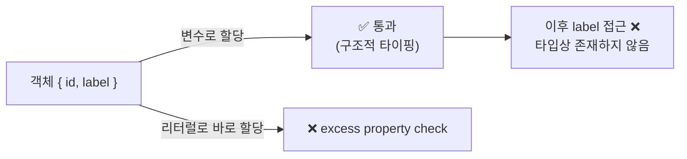

## 의문

그래프 라이브러리의 노드 · 엣지 타입을 interface로 정의하다가, 필드가 더 많은 객체도 타입 검사를 그냥 통과하는 것을 봤다.

```ts
interface INode { id: string }

const raw = { id: 'a', label: 'x', extra: 1 }
const n: INode = raw   // ✅ 통과
```

그렇다면 TypeScript의 interface는 **`Record<string, any>`인데 꼭 있어야 하는 키만 정의해 둔 것**인가?

## 답

아니다. interface는 **"최소한 이런 모양은 갖춰야 한다"는 구조 계약**이다. 정의하지 않은 키는 "있어도 되는 키"가 아니라 **타입 시스템이 모르는 키**로 취급된다.

- 위 코드가 통과한 이유는 **구조적 타이핑** 때문이다. TS는 이름이 아니라 모양으로 타입을 비교하므로, 필요한 `id`만 있으면 키가 더 많아도 할당할 수 있다.
- 하지만 할당된 뒤에는 정의된 키만 존재한다. 추가 키는 **허용되는 게 아니라 무시될 뿐**이다.

## Record<string, any>와 다른 점 세 가지

### 1. 정의하지 않은 키에는 접근할 수 없다

```ts
n.label   // ❌ Property 'label' does not exist on type 'INode'
```

`Record<string, any>`였다면 `n.label`은 `any`로 그냥 통과한다.

### 2. 객체 리터럴을 바로 넣으면 추가 키가 에러가 된다 (excess property check)

```ts
const n: INode = { id: 'a', label: 'x' }   // ❌ 'label'은 INode에 없음
```

같은 객체를 변수에 담았다가 넣으면 통과하지만, 리터럴을 바로 넣으면 막힌다. 오타를 잡으려고 **새로 만든 객체 리터럴에만** 적용하는 검사다.

### 3. 인덱스 시그니처가 암묵적으로 생기지 않는다

```ts
interface IA { id: string }
type TA = { id: string }

const r1: Record<string, unknown> = {} as IA   // ❌ 에러
const r2: Record<string, unknown> = {} as TA   // ✅ OK
```

interface는 **선언 병합**으로 나중에 다른 곳에서 확장될 수 있다. 그래서 TS는 interface에 대해 "모든 키가 string → unknown"이라고 보장하지 않는다. `type` 별칭은 닫혀 있으므로 암묵적 인덱스 시그니처를 인정해 준다.

라이브러리가 `data: Record<string, any>` 같은 제약을 걸어 둔 곳에 interface를 넣으면 에러가 나는 이유가 바로 이것이다.

## 한눈에 비교

| 상황 | `interface I { id: string }` | `type T = { id: string }` | `Record<string, any>` |
|---|---|---|---|
| 키가 더 많은 **변수** 할당 | ✅ | ✅ | ✅ |
| 키가 더 많은 **리터럴** 할당 | ❌ excess check | ❌ excess check | ✅ |
| 정의 안 한 키 접근 (`x.label`) | ❌ | ❌ | ✅ (`any`) |
| `Record<string, unknown>`에 할당 | ❌ | ✅ | ✅ |
| 선언 병합으로 확장 | ✅ | ❌ | ❌ |



## 정말 "필수 키 + 아무 키나 허용"을 원한다면

인덱스 시그니처를 직접 적는다.

```ts
interface INodeData {
  id: string
  [key: string]: unknown   // 그 밖의 키 허용
}
```

또는 `Record<string, unknown>` 제약을 통과해야 하는 경우라면 interface 대신 `type` 별칭으로 정의한다.

## 정리

- interface는 추가 키를 **허용하는 게 아니라 무시**한다.
- 런타임 객체에 키가 더 있는 것은 막지 않지만, 타입 시스템 안에서는 정의된 키만 존재한다.
- `Record<string, ...>` 제약과 엮일 때는 interface와 type 별칭의 차이(암묵적 인덱스 시그니처)를 기억해 두자.
