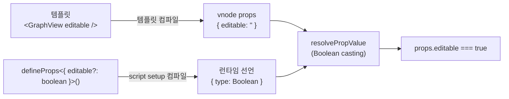

## 의문

컴포넌트에 `editable?: boolean` prop을 선언하고, 부모에서 값 없이 이렇게만 썼다.

```vue
<GraphView editable />
```

`:editable="true"`라고 쓰지 않았는데도 자식에서 `props.editable`은 `true`다.
그리고 속성을 아예 빼면 `undefined`가 아니라 `false`가 들어온다.
**Vue는 값도 안 넘긴 속성을 어떻게 `true`로 판단할까?**

## 답: 런타임의 Boolean casting

세 단계가 이어져서 `true`가 된다.



### 1. 템플릿 컴파일: 값 없는 속성은 빈 문자열이 된다

HTML 규칙과 같다. 값 없이 쓴 속성의 값은 `''`다.

```js
// <GraphView editable /> 를 컴파일한 결과 (개념)
h(GraphView, { editable: '' })
```

이 단계에서는 아직 `true`가 아니다.

### 2. 타입 선언이 런타임 선언으로 바뀐다

TS 타입은 실행 시점에 사라진다. 하지만 `<script setup>` 컴파일러가 `defineProps<{...}>()`의 타입을 읽어 런타임 props 선언을 만들어 준다.

```ts
defineProps<{ editable?: boolean }>()
```

```js
// 컴파일 결과
props: { editable: { type: Boolean, required: false } }
```

그래서 실행 중에도 Vue는 "이 prop은 Boolean 타입"이라는 걸 안다. 타입 기반 선언이 단순한 타입 힌트가 아니라 **동작을 바꾸는** 이유가 이것이다.

### 3. `resolvePropValue`가 값을 변환한다

Vue 코어가 prop 값을 정할 때, 선언된 타입에 `Boolean`이 들어 있으면 다음 규칙을 적용한다.

| 부모가 넘긴 값 | 결과 |
|---|---|
| 속성 생략 (키 없음, `default`도 없음) | `false` (`undefined`가 아님) |
| `''` — `<X editable>` | `true` |
| kebab 이름과 같은 문자열 — `<X editable="editable">` | `true` |
| `:editable="false"` | `false` 그대로 |
| `:editable="true"` | `true` 그대로 |

정리하면 "Boolean prop이 **있다**는 사실 자체가 `true`"라는 HTML 불리언 속성(`disabled`, `checked`)의 관례를 따른 것이다.

## String과 같이 선언하면 순서가 결과를 바꾼다

`''`를 `true`로 바꾸는 규칙에는 조건이 붙는다. 타입에 `String`이 **없거나**, 있어도 **`Boolean`보다 뒤에** 있어야 한다. 빈 문자열은 String으로도 해석할 수 있기 때문이다.

| 선언 | `<X foo>` | `<X foo="foo">` | 생략 |
|---|---|---|---|
| `type: Boolean` | `true` | `true` | `false` |
| `type: [Boolean, String]` | `true` | `true` | `false` |
| `type: [String, Boolean]` | `''` | `'foo'` | `false` |
| `type: String` | `''` | `'foo'` | `undefined` |

TS 유니온도 **쓴 순서 그대로** 배열이 된다. `foo?: boolean | string`은 `[Boolean, String]`, `foo?: string | boolean`은 `[String, Boolean]`이다. 그래서 유니온 순서만 바꿔도 `<X foo>`의 결과가 `true`와 `''` 사이에서 바뀐다. 이런 prop은 값을 명시해서 넘기는 편이 안전하다.

## 실무에서 알아 둘 점

- **`withDefaults`로 `false`를 줄 필요가 없다.** 생략하면 이미 `false`다. `if (!props.editable)` 같은 분기도 `undefined`를 따로 신경 쓸 필요가 없다.
- **기본값을 `true`로 두고 싶다면** `withDefaults(defineProps<{ editable?: boolean }>(), { editable: true })`처럼 명시해야 한다. 이때 끄려면 `:editable="false"`로 넘긴다.
- **이 변환은 런타임 선언이 있을 때만 일어난다.** props로 선언하지 않은 속성은 `attrs`로 빠지고, 그 값은 `''` 그대로다.
- **컴파일러가 `boolean`으로 풀지 못하는 타입이면 Boolean casting이 사라진다.** 이때 런타임 선언은 `type: null`(아무 타입)이 되고, `<X foo>`는 `''`, 생략하면 `undefined`가 들어온다. 아래는 Vue 3.5 `compileScript`와 런타임으로 직접 확인한 결과다.

| `foo`의 타입 | 런타임 `type` | `<X foo>` |
|---|---|---|
| `boolean` | `Boolean` | `true` |
| 제네릭 별칭 `W<boolean>`, 인덱스 접근 `M['a']`, 매핑 타입, `Partial<Pick<…>>` | `Boolean` | `true` |
| 조건부 타입 `T extends string ? boolean : number` | `null` | `''` |
| `typeof x` (`const x = true`) | `null` | `''` |
| `<script setup generic="T extends boolean">`의 `T` | `null` | `''` |
| 찾을 수 없는 모듈에서 import한 타입 | `null` | `''` |

  흔히 쓰는 유틸리티 타입은 잘 풀리지만, 조건부 타입·`typeof`·제네릭 타입 매개변수는 풀지 못한다. Boolean prop은 `foo?: boolean`처럼 직접 쓰는 편이 안전하다.
